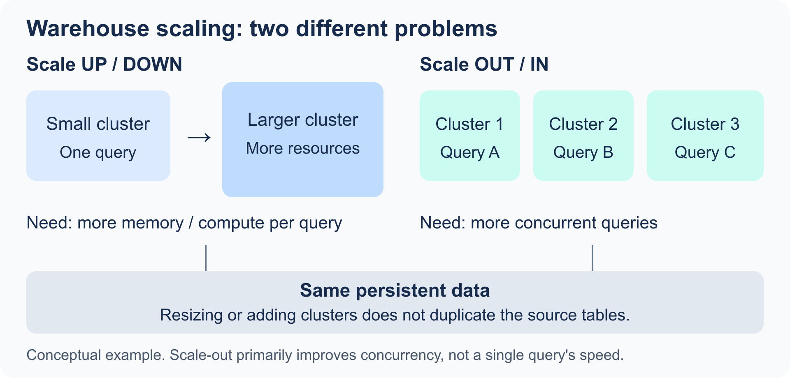

# 1.4 Virtual Warehouses

[Domain 1 index](readme.md)

## Purpose and warehouse types

A virtual warehouse supplies compute, memory, and local storage for warehouse-backed work. Multiple warehouses can access the same persistent tables while maintaining independent compute and data caches.

| Type | Best fit | Remember |
| --- | --- | --- |
| Standard Gen1 | General SQL queries, transformations, and warehouse-backed loading. | Existing standard generation; select size for the workload. |
| Standard Gen2 | General workloads on newer compute hardware/software improvements. | A generation choice, not a different edition or extra cluster. |
| Snowpark-optimized | Memory-intensive Snowpark workloads, including some ML training. | Configurable memory/architecture; ordinary SQL is not guaranteed to benefit. |

Snowpark code can run on a standard warehouse. “Uses Python” alone is not enough reason to select Snowpark-optimized. Generation availability, sizing, credit rates, and QAS defaults should be checked for the account rather than inferred from an old recording.

## Create a small practice warehouse

```sql
-- Requires CREATE WAREHOUSE. Running/resuming compute consumes credits.
CREATE WAREHOUSE study_wh
  WAREHOUSE_TYPE = STANDARD
  WAREHOUSE_SIZE = XSMALL
  AUTO_SUSPEND = 60
  AUTO_RESUME = TRUE
  INITIALLY_SUSPENDED = TRUE;
```

`AUTO_SUSPEND` is in seconds. `AUTO_RESUME` permits work to restart a suspended warehouse; it does not keep it running. `INITIALLY_SUSPENDED` prevents starting compute immediately on creation. Each start has a 60-second billing minimum for standard warehouses; running warehouses use per-second billing afterward.

## Scale up/down versus out/in

<p align="center"></p>

| Change | Changes what? | Choose it when |
| --- | --- | --- |
| Scale up/down | Size/resources of a cluster. | An individual query needs more memory or processing power, or a smaller size meets its target. |
| Scale out/in | Number of running clusters in a multi-cluster warehouse. | Many concurrent queries cause queues, or demand later falls. |

Upsizing does not guarantee a proportional speedup. Extra clusters primarily improve concurrency. For one exploding join or a large remote spill, inspect SQL and Query Profile first; see [Domain 4](../4-Performance-Optimization-Querying-and-Transformation/readme.md).

```sql
ALTER WAREHOUSE study_wh SET WAREHOUSE_SIZE = SMALL;
```

Generation is a separate setting for Standard warehouses; where supported, `GENERATION = '2'` selects Gen2. It is not a setting for Snowpark-optimized warehouses. Use `SHOW WAREHOUSES` to inspect the actual configuration instead of assuming a default generation.

## Multi-cluster settings and scaling policies

Multi-cluster warehouses require Enterprise or higher. `MIN_CLUSTER_COUNT < MAX_CLUSTER_COUNT` enables a range for auto-scaling. Setting both to the same value fixes the number of clusters while the warehouse is running (maximized mode).

| Policy | Main goal | Trade-off |
| --- | --- | --- |
| Standard | Start capacity more readily to reduce queuing. | Better responsiveness can consume more credits. |
| Economy | Favor keeping existing clusters busy before starting more. | Can allow more queuing to save compute. |

```sql
-- Example for a warehouse owner with the appropriate edition.
ALTER WAREHOUSE study_wh SET
  MIN_CLUSTER_COUNT = 1
  MAX_CLUSTER_COUNT = 3
  SCALING_POLICY = 'STANDARD';
```

The scaling policy governs cluster decisions; auto-suspend governs idle warehouse suspension. Increasing the cluster maximum does not mean every query is spread across that many clusters.

## Choose by workload

| Workload | Practical configuration reasoning |
| --- | --- |
| Ad hoc queries | Start modestly, set auto-suspend, inspect slow/expensive patterns. |
| Data loading | Use a dedicated warehouse for bulk `COPY INTO` when isolation helps; usable parallelism also depends on input files. File-based Snowpipe uses serverless compute instead. |
| BI/reporting | Isolate predictable latency needs, consider cache warmth and multi-cluster capacity for concurrent users. |
| Complex transformations | Assess size, spill, scan volume, and joins; scale up when resources are the bottleneck. |
| Different teams | Separate warehouses when scheduling, performance, or cost ownership differs. |

Suspending clears warehouse-local table cache; persistent tables remain. Frequent suspend/resume cycles trade idle savings against startup latency and cache rebuilding. Use [Domain 2](../2-Account-Management-and-Data-Governance/readme.md) for credit calculations and resource monitors.

## What to recall

1. When is Snowpark-optimized preferable to Standard?
2. How do type, generation, size, and cluster count differ?
3. Which setting reduces overload queues: size, cluster count, or either depending on evidence?
4. What differs between Standard and Economy scaling policies?
5. How do auto-suspend, auto-resume, and initially suspended differ?
6. Why might one shared warehouse be unsuitable for BI and heavy ETL?
7. How does suspension affect local cache versus table data?

## Official references

- [Warehouse overview](https://docs.snowflake.com/en/user-guide/warehouses-overview)
- [Warehouse considerations](https://docs.snowflake.com/en/user-guide/warehouses-considerations)
- [Multi-cluster warehouses](https://docs.snowflake.com/en/user-guide/warehouses-multicluster)
- [Gen2 warehouses](https://docs.snowflake.com/en/user-guide/warehouses-gen2)
- [Snowpark-optimized warehouses](https://docs.snowflake.com/en/user-guide/warehouses-snowpark-optimized)
