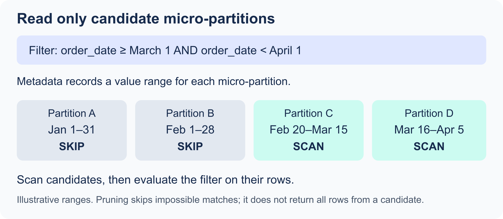

# 1.5 Storage, Table Types, and Views

[Domain 1 index](readme.md)

## Micro-partitions and natural clustering

For standard Snowflake tables, Snowflake automatically organizes rows into immutable, compressed, columnar micro-partitions. You do not define and maintain traditional table partitions yourself. This description does not imply that every specialized table type uses the identical storage mechanism.

- A micro-partition represents approximately 50 MB to 500 MB of uncompressed data; physical storage is compressed.
- Snowflake records metadata such as per-column value ranges and distinct-value information.
- A selective predicate can use metadata to skip partitions that cannot match. This is **micro-partition pruning**.
- Updates/deletes produce new micro-partitions rather than modifying the old ones in place. Historical versions can remain for applicable protection periods.

<p align="center"></p>

The ranges are illustrative: a candidate partition can contain rows outside the filter. Pruning selects what must be scanned; the query still evaluates which rows match.

Data arrives with a natural organization based on load/insert order. If values used by frequent filters are scattered across many overlapping micro-partitions, pruning can become less effective. An optional clustering key guides maintenance of a better organization for a suitable large-table workload. It is not mandatory for every table.

These fundamentals were moved from the storage course chapter. For scan metrics, key choices, maintenance costs, and tuning SQL, use [Domain 4](../4-Performance-Optimization-Querying-and-Transformation/readme.md).

## Table lifetimes and data protection

| Standard table type | Lifetime | Time Travel | Fail-safe | Common use |
| --- | --- | --- | --- | --- |
| Permanent | Until dropped. | Standard: 0 or 1 day; Enterprise or higher: up to 90 days. | Seven days after retained history leaves Time Travel. | Persistent business data requiring recovery protection. |
| Temporary | Current session only, unless dropped sooner. | Up to one day while available; do not rely on recovery after the session ends. | None. | Session-local intermediate work. |
| Transient | Until dropped; survives sessions. | 0 or 1 day. | None. | Rebuildable staging or derived data. |

Temporary tables are session-scoped, not user-scoped across every connection. A temporary table can hide a permanent table of the same name in that session. Transient does not mean “automatically deleted soon.”

```sql
-- Run in an existing writable study schema.
CREATE TABLE study_permanent (id NUMBER, amount NUMBER(12,2));
CREATE TEMPORARY TABLE study_session_work (id NUMBER);
CREATE TRANSIENT TABLE study_rebuildable (id NUMBER)
  DATA_RETENTION_TIME_IN_DAYS = 1;
```

## External, Iceberg, and dynamic tables

These describe data access/format/refresh behavior, rather than a simple lifetime alternative to every row above.

| Table | What it does | Key distinction |
| --- | --- | --- |
| External | Exposes files in external storage as a read-only table abstraction. | Files remain outside managed table storage; metadata refresh tracks file changes. |
| Apache Iceberg | Uses the open Iceberg table format with catalog metadata and data files. | Catalog ownership and storage location affect management and supported operations. |
| Dynamic | Stores the result of a query and refreshes it to pursue a target freshness. | Declare the query and target lag instead of writing every pipeline step manually. |

For Iceberg, distinguish a Snowflake-managed catalog from an external catalog. Current Snowflake supports Snowflake-provided storage as well as external-volume storage in appropriate configurations. An external catalog requires an appropriate external storage configuration. Do not assume that every Iceberg table is read-only, externally stored, or protected by standard-table Fail-safe rules; check the actual catalog/storage setup.

```sql
-- Existing source table and refresh warehouse required.
CREATE DYNAMIC TABLE study_daily_sales
  TARGET_LAG = '10 minutes'
  WAREHOUSE = study_wh
  REFRESH_MODE = AUTO
AS
  SELECT order_date, SUM(amount) AS daily_sales
  FROM analytics.mart.orders
  GROUP BY order_date;
```

Target lag is a freshness target relative to source data, not a fixed refresh interval or guaranteed SLA. Snowflake schedules refresh work to pursue it. Incremental/full refresh support depends on the query and mode; refreshed results consume compute. Direct ordinary DML is not how you maintain dynamic-table results.

## View types

| View | Stores query result? | Purpose and trade-off |
| --- | --- | --- |
| Standard | No. | Reusable SQL abstraction; executes against underlying data. |
| Materialized | Yes, maintained automatically. | Speeds eligible repeated work; adds storage and maintenance cost and has definition restrictions. Requires Enterprise or higher. |
| Secure | Secure behavior can apply to standard or materialized views. | Protects definition/details and restricts optimizations that could expose underlying data; may cost performance. |

```sql
CREATE VIEW study_sales_summary AS
  SELECT order_date, SUM(amount) AS sales
  FROM analytics.mart.orders
  GROUP BY order_date;

CREATE SECURE VIEW study_public_customers AS
  SELECT customer_id, customer_name
  FROM analytics.mart.customer;
```

`SECURE` does not automatically grant access or replace row/masking policies. Materialized views are not the same as dynamic tables: dynamic tables support pipeline definitions with broader transformation patterns, while materialized views focus on eligible query acceleration and can be selected by the optimizer. See [Domain 4](../4-Performance-Optimization-Querying-and-Transformation/readme.md) for materialized-view restrictions and tuning.

## What to recall

1. What makes micro-partitions immutable, and what metadata supports pruning?
2. How does natural clustering differ from an explicitly maintained clustering key?
3. Which table disappears at session end? Which survives but has no Fail-safe?
4. Which permanent-table retention requires Enterprise or higher?
5. How do external tables and Iceberg tables differ?
6. What are the separate Iceberg catalog and storage decisions?
7. Why does a ten-minute target lag not mean a refresh exactly every ten minutes?
8. How do secure, materialized, and standard views differ?

## Official references

- [Micro-partitions and clustering](https://docs.snowflake.com/en/user-guide/tables-clustering-micropartitions)
- [Temporary and transient tables](https://docs.snowflake.com/en/user-guide/tables-temp-transient)
- [External tables](https://docs.snowflake.com/en/user-guide/tables-external-intro)
- [Iceberg storage choices](https://docs.snowflake.com/en/user-guide/tables-iceberg-storage)
- [Dynamic-table target lag](https://docs.snowflake.com/en/user-guide/dynamic-tables/target-lag)
- [Materialized views](https://docs.snowflake.com/en/user-guide/views-materialized)
- [Secure views](https://docs.snowflake.com/en/user-guide/views-secure)
