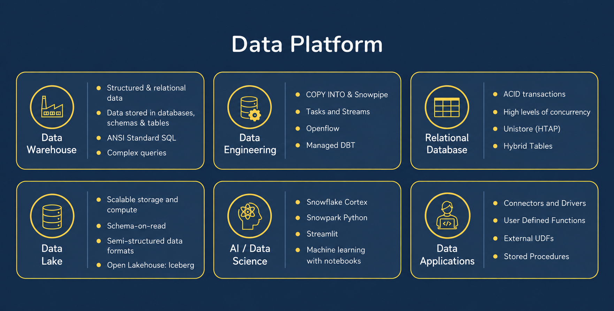
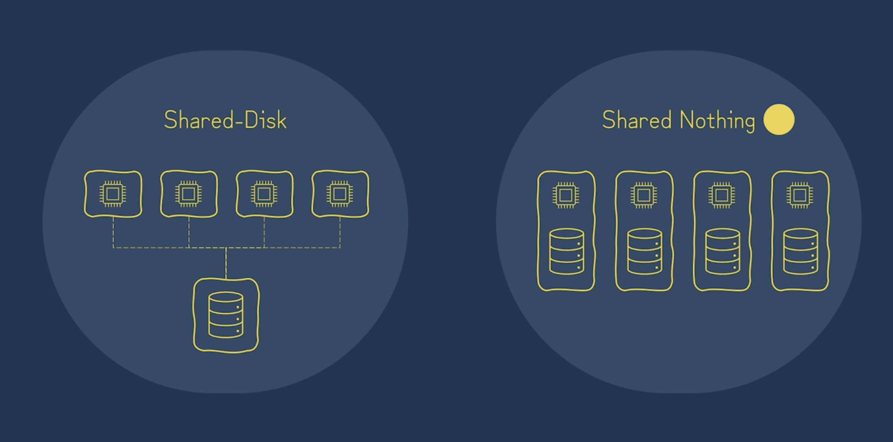
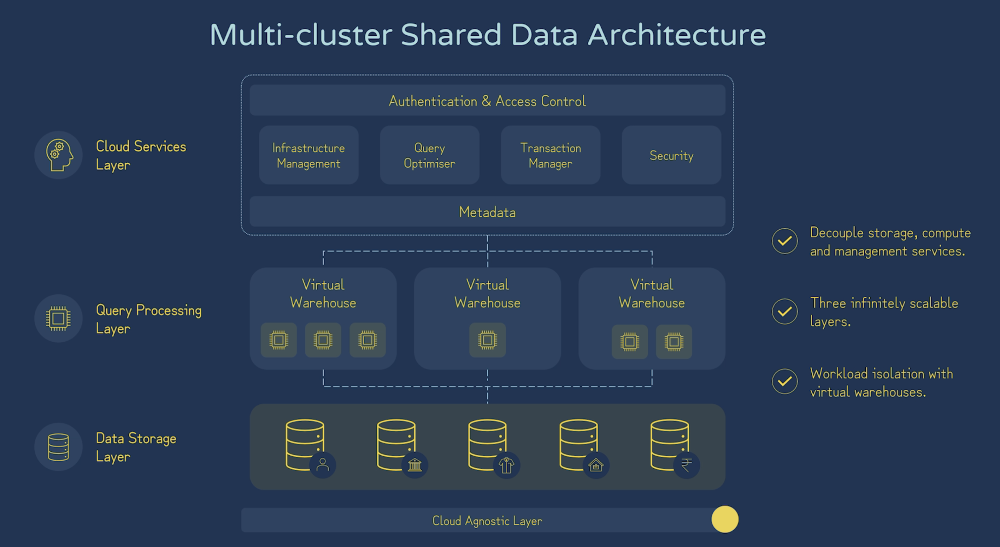
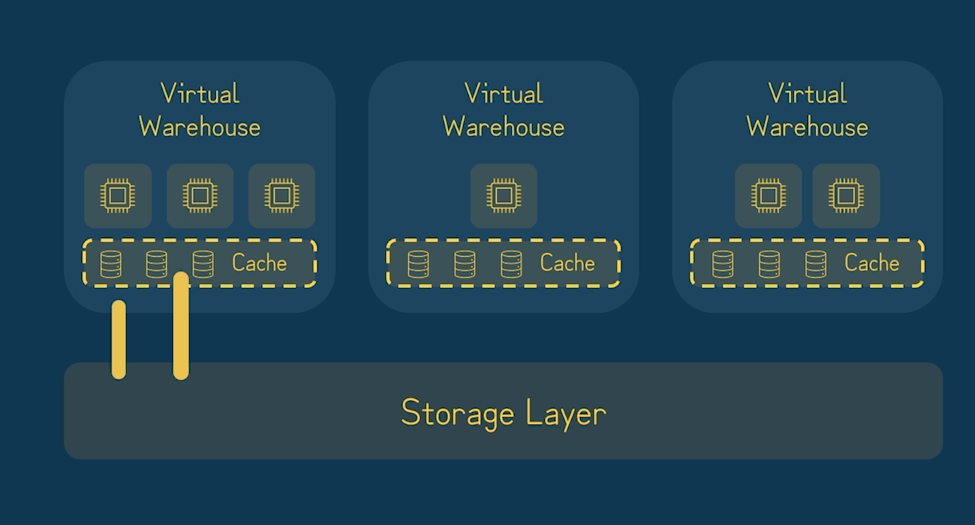
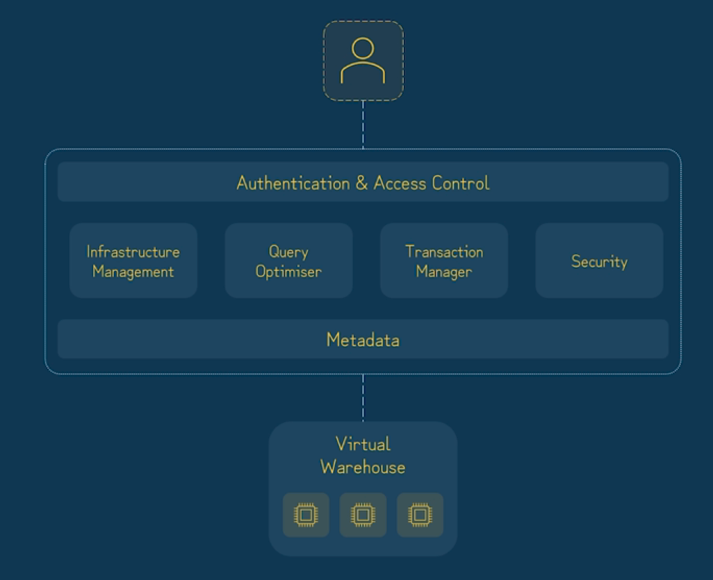

# 1.1 Architecture and Editions

[Domain 1 index](readme.md)

## What is Snowflake?

- **Snowflake** is a cloud data platform for analytics, engineering, applications, collaboration, and AI/ML.
- Snowflake operates the platform on supported public-cloud infrastructure.
- Customers configure:
  - Data.
  - Access.
  - Workloads.
- Snowflake handles the installation and maintenance of the database servers.

<p align="center"></p>

## Shared disk, shared nothing, and Snowflake

| Architecture | Basic idea | Trade-off |
| --- | --- | --- |
| Shared disk | Compute nodes access a shared data repository. | Simpler shared data, but contention can become a concern. |
| Shared nothing | Nodes own their compute and local data. | Parallel work scales, but distributing/rebalancing data is harder. |
| Snowflake multi-cluster shared data | Shared persistent storage with independent compute clusters. | Teams scale compute independently while using the same stored data. |

<p align="center"></p>

- Snowflake combines **centralized persistent data** with **massively parallel compute**.
- Independent warehouses isolate compute workloads.
- Scaling a warehouse does not require duplicating its source tables.
- Scaling is configurable and subject to supported capacity and service limits.
- It is not literally unlimited.

<p align="center"></p>

## The three layers

| Layer | Responsibility | Exam example |
| --- | --- | --- |
| Database storage | Persist managed table data in compressed, columnar form and maintain micro-partition metadata. | Tables remain available when a warehouse suspends. |
| Compute | Execute queries, transformations, and warehouse-backed loads using virtual warehouses. | Increase warehouse size for a memory-heavy aggregation. |
| Cloud services | Coordinate authentication, access control, metadata, parsing, and optimization. | Plan a query and check permissions before execution. |

<p align="center"></p>

<p align="center"></p>

- **Serverless features** use Snowflake-managed compute.
- Not every operation runs on your selected virtual warehouse.
- Storage is charged separately from compute.
- Managed storage billing uses average stored bytes over time.
- A cloud-storage durability percentage is not a Snowflake availability guarantee.

## Editions

- Higher editions include lower-edition capabilities and add features.
- Also consider:
  - Region.
  - Feature availability.
  - Commercial terms.

| Edition | Useful distinctions for C03 |
| --- | --- |
| Standard | Core SQL platform, ordinary virtual warehouses, standard Time Travel for supported tables, and Fail-safe for permanent managed tables. |
| Enterprise | Multi-cluster warehouses, up to 90-day Time Travel for supported permanent objects, masking/row access, materialized views, and other advanced features. |
| Business Critical | Additional protection and continuity capabilities such as Tri-Secret Secure, private-connectivity options, and account failover/failback. |
| Virtual Private Snowflake (VPS) | Dedicated Snowflake environment with additional isolation for demanding security requirements. |

- Keep **edition** separate from:
  - Warehouse size.
  - Warehouse generation.
  - Cloud provider.
  - Region.
- Buying a higher edition does not automatically enable or configure every feature.

## Three distinctions to remember from practice

### 1. MPP within a cluster versus independent warehouses

- **Massively Parallel Processing (MPP)** distributes query work across multiple nodes inside a compute cluster.
- The nodes work in parallel.
- They combine their intermediate results as needed.

- For `SELECT SUM(amount) FROM orders`:
  1. Different nodes process different portions of the data.
  2. Each calculates a partial total.
  3. Those partial totals are combined into the final total.

- **Separate virtual warehouses** provide independent compute resources for different workloads.
- An ETL warehouse and a BI warehouse can access the same persistent tables.
- They do not compete for the same warehouse CPU and memory.
- Each warehouse can use parallel processing internally.

- MPP explains how nodes cooperate within a cluster.
- Independent warehouses explain compute isolation between workloads.
- Adding clusters to a multi-cluster warehouse primarily increases concurrency capacity; it is a different concept from distributing one query across nodes.

- **Reference:** [Snowflake architecture](https://docs.snowflake.com/en/user-guide/intro-key-concepts#snowflake-architecture).

### 2. Extended Time Travel availability versus configured retention

- **Enterprise or higher** allows up to **90 days** of Time Travel for supported permanent tables.
- Upgrading does not automatically set every table to 30 or 90 days.
- The standard default is **1 day**.
- The effective retention depends on:
  - Explicit configuration.
  - Inherited defaults.

- Use an authorized role to configure an existing permanent table for 30 days:

```sql
-- Existing permanent table required; Enterprise Edition or higher.
ALTER TABLE analytics.mart.orders
  SET DATA_RETENTION_TIME_IN_DAYS = 30;
```

- Temporary and transient tables remain limited to **at most one day**, even on higher editions.
- Increasing retention does not recover history that has already been purged.

- **Reference:** [Time Travel retention](https://docs.snowflake.com/en/user-guide/data-time-travel#data-retention-period).

### 3. Business Critical private connectivity versus VPS isolation

- **Business Critical already supports private connectivity** to the Snowflake service, such as AWS PrivateLink.
- A private connection controls the network path to Snowflake.
- It does not by itself create a dedicated Snowflake environment.

- **VPS** includes Business Critical's features.
- It provides a separate Snowflake environment.
- Its hardware resources are not shared with accounts outside that VPS environment.

- Need AWS PrivateLink without a dedicated environment: **Business Critical is the minimum edition**.
- Need the additional environment and hardware isolation described above: **VPS**.

- **References:** [private connectivity](https://docs.snowflake.com/en/user-guide/private-connectivity-inbound) and [VPS](https://docs.snowflake.com/en/user-guide/intro-editions#virtual-private-snowflake-vps).

## What to recall

1. Why does Snowflake combine characteristics of shared disk and shared nothing?
2. Which layer parses SQL? Which executes it? Which retains data after suspension?
3. What is independent compute isolation useful for?
4. Which capabilities suggest Enterprise versus Business Critical?
5. How is VPS different from merely using a private endpoint?
6. How does MPP within a cluster differ from using separate warehouses for ETL and BI?
7. After upgrading to Enterprise, what must you configure to give an existing permanent table 30 days of Time Travel?

## Official references

- [Architecture](https://docs.snowflake.com/en/user-guide/intro-key-concepts)
- [Editions and feature matrix](https://docs.snowflake.com/en/user-guide/intro-editions)
- [Warehouse overview](https://docs.snowflake.com/en/user-guide/warehouses-overview)
