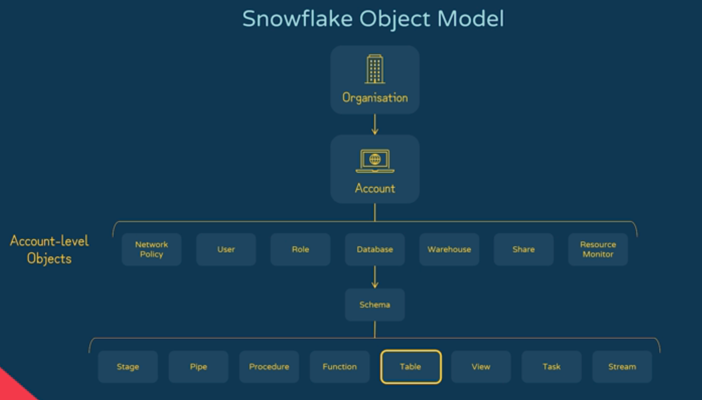

# 1.3 Objects, Sessions, and Parameters

[Domain 1 index](readme.md)

## Object hierarchy

```text
Organization
└── Account
    ├── Account-level objects: warehouses, users, roles, shares, integrations
    └── Database
        └── Schema
            └── Tables, views, named stages, file formats, UDFs,
                stored procedures, pipes, sequences, model objects
```

<p align="center"></p>

- A **container** organizes child objects.
- A **securable object** can have privileges granted on it.
- The C03 list groups many objects together for study.
- A **share is account-level**, not a child of a database schema.
- A Native App **application** is also an account-level installed object with its own contents.

## Object comparison

| Object | What it represents | Important distinction |
| --- | --- | --- |
| Organization | Groups Snowflake accounts. | Organization-level administration differs from account administration. |
| Account | Security/administrative boundary deployed in a cloud region. | Different accounts do not automatically share data or roles. |
| Database | Container for schemas and their objects. | It stores organized data objects; it is not a compute warehouse. |
| Schema | Namespace inside a database. | `database.schema.object` is the normal fully qualified name. |
| Table | Stored rows or a supported table abstraction. | Table types differ in lifetime, storage, and maintenance. |
| View | Query definition over other objects. | A standard view does not store its result. |
| Named stage | Internal file storage or reference to external storage. | It holds/references files, not automatically loaded table rows. |
| File format | Parsing/unloading settings, such as delimiter, JSON, compression, and header behavior. | It contains settings, not the source file itself. |
| UDF | Reusable calculation returning a scalar value or table. | Use it in a query, subject to its supported function form. |
| Stored procedure | Reusable procedural workflow. | Invoke with `CALL`; can perform authorized DDL/DML. |
| Pipe | Stored ingestion definition for Snowpipe. | File-based Snowpipe uses a `COPY INTO` definition and serverless ingestion compute. |
| Share | Grants selected data-object access to consumer accounts. | Ownership stays with the provider; it is not an exported file. |
| Sequence | Generates numeric values for identifiers. | Values can have gaps; do not treat it as a gap-free row counter. |
| ML model | Registered model object with versions and inference methods. | Model artifacts/metadata differ from the training dataset. |
| Application | Installed Snowflake Native App and its packaged logic/data objects. | An application package is the provider's distribution container. |

- **Loading operations:** [loading note](../../study-notes/7-Data-Loading-and-Unloading/readme.md).
- **Shares and app distribution:** [sharing note](../../study-notes/9-Storage-Data-Protection-and-sharing/readme.md).
- **Grants and ownership:** [Domain 2](../2-Account-Management-and-Data-Governance/readme.md).

## Example objects

- Before running these examples:
  1. Select a writable schema using `USE DATABASE` and `USE SCHEMA`.
  2. Use a role with suitable creation privileges.

```sql
CREATE FILE FORMAT study_csv TYPE = CSV SKIP_HEADER = 1;
CREATE STAGE study_stage FILE_FORMAT = (FORMAT_NAME = 'study_csv');
CREATE SEQUENCE study_order_seq START = 1 INCREMENT = 1;

CREATE FUNCTION study_add_tax(amount NUMBER(12,2))
  RETURNS NUMBER(12,2)
  LANGUAGE SQL
  AS $$ amount * 1.07 $$;

SELECT study_add_tax(100), study_order_seq.NEXTVAL;
```

- A **function** applies a reusable calculation inside SQL.
- A **procedure** runs a workflow of statements:
  - It may return a value or table.
  - You do not generally substitute `CALL` into a scalar expression.

## Session context

- Each connection has its own **session state**.
- **Session context** controls:
  - How unqualified object names are resolved.
  - Which compute and role the session uses.

```sql
USE ROLE analyst_role;
USE WAREHOUSE analytics_wh;
USE DATABASE analytics;
USE SCHEMA mart;

SELECT CURRENT_ROLE(), CURRENT_WAREHOUSE(), CURRENT_DATABASE(), CURRENT_SCHEMA();
```

- With this context, `orders` resolves to `analytics.mart.orders`.
- Fully qualified names reduce ambiguity.
- **Quoted identifiers** are case-sensitive.
- **Unquoted identifiers** normally resolve in uppercase.

## Variables versus parameters

| Concept | Example | Meaning |
| --- | --- | --- |
| SQL session variable | `SET region = 'APAC'` | A value referenced later as `$region`. |
| Context function | `CURRENT_ROLE()` | Returns current session/account context. |
| Session parameter | `ALTER SESSION SET TIMEZONE = 'UTC'` | Changes session behavior, not an arbitrary SQL variable. |
| Object parameter | Table retention setting | Changes the supported object's configuration. |

```sql
SET study_region = 'APAC';
SELECT $study_region AS selected_region;
UNSET study_region;

SHOW PARAMETERS LIKE 'TIMEZONE' IN SESSION;
-- If changed during practice, restore your previous setting afterward.
```

## Parameter hierarchy and precedence

- For a **session parameter**, use this order from highest to lowest priority:
  1. Explicit session setting.
  2. User setting.
  3. Account default.
  4. System default, if none of the above is explicitly set.

- For **object parameters**, inheritance depends on the parameter and its supported containers.
- Example: table retention can be set at these levels:
  - Account.
  - Database.
  - Schema.
  - Table.
- A specific table setting takes precedence over a parent default.
- **Account-only parameters** cannot be overridden in a session.
- Do not apply one universal precedence rule to every parameter.

- `SHOW PARAMETERS` displays the value and level.
- `UNSET` removes an explicit override.
- The inherited or default value can then apply.
- `UNSET` does not necessarily set the parameter to zero or false.

## What to recall

1. Where do warehouses, shares, schemas, pipes, and UDFs sit in the hierarchy?
2. How do stage, file format, and pipe differ?
3. When do you choose a UDF versus a stored procedure?
4. Why is a sequence not a reliable row-count or gap-free invoice mechanism?
5. How does a fully qualified name differ from the current database/schema context?
6. How do a session variable and a session parameter differ?
7. Which session-parameter level wins, and what does `UNSET` do?

## Official references

- [Securable objects and hierarchy](https://docs.snowflake.com/en/user-guide/security-access-control-overview)
- [Parameters](https://docs.snowflake.com/en/sql-reference/parameters)
- [SQL variables](https://docs.snowflake.com/en/sql-reference/session-variables)
- [Procedures versus UDFs](https://docs.snowflake.com/en/developer-guide/stored-procedures-vs-udfs)
- [Sequences](https://docs.snowflake.com/en/user-guide/querying-sequences)
