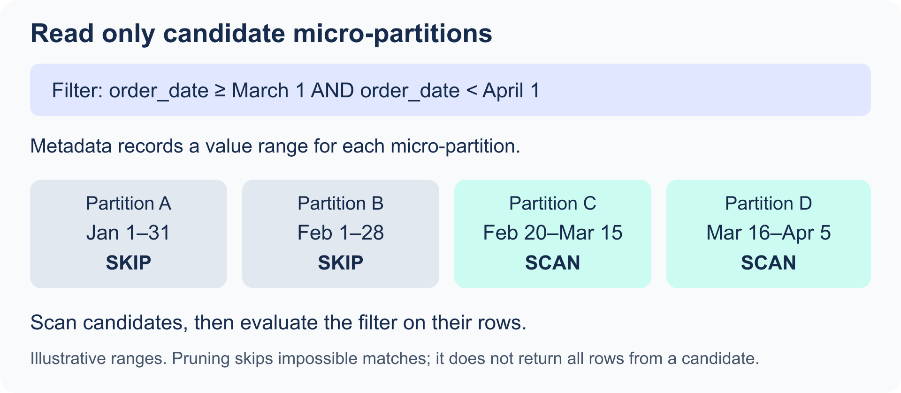

# 1.5 Storage, Table Types, and Views

[Domain 1 index](readme.md)

- **C03 objective:** 1.5. Read the definitions, work through the scenario, then answer recall questions.
- **Practice:** [ordered lab guide](exercises/readme.md); start with its setup.
- **SQL status:** examples reviewed against official documentation; not executed in your account.

<a id="micro-partitions-and-natural-clustering"></a>

## 1.5.1 Micro-partitions and natural clustering

- For standard Snowflake tables, Snowflake automatically organizes rows into **micro-partitions**.
- These are:
  - Immutable.
  - Compressed.
  - Columnar.
- You do not define and maintain traditional table partitions yourself.
- Specialized table types do not necessarily use the same storage mechanism.

- A micro-partition represents approximately 50 MB to 500 MB of uncompressed data; physical storage is compressed.
- Snowflake records metadata such as per-column value ranges and distinct-value information.
- A selective predicate can use metadata to skip partitions that cannot match. This is **micro-partition pruning**.
- Updates/deletes produce new micro-partitions rather than modifying the old ones in place. Historical versions can remain for applicable protection periods.

<p align="center"></p>

- The ranges in the image are illustrative.
- A candidate partition can contain rows outside the filter.
- **Pruning** selects which partitions must be scanned.
- The query still checks which rows match.

- **Natural clustering** comes from the order in which data is loaded or inserted.
- Pruning can become less effective when frequently filtered values are scattered across many overlapping micro-partitions.
- An optional **clustering key** guides maintenance of a better organization for a suitable large-table workload.
- A clustering key is not mandatory for every table.

- These fundamentals were moved from the storage course chapter.
- Use [Domain 4](../4-Performance-Optimization-Querying-and-Transformation/readme.md) for:
  - Scan metrics.
  - Clustering-key choices.
  - Maintenance costs.
  - SQL tuning.

<a id="table-lifetimes-and-data-protection"></a>

## 1.5.2 Table lifetimes and data protection

| Standard table type | Lifetime | Time Travel | Fail-safe | Common use |
| --- | --- | --- | --- | --- |
| Permanent | Until dropped. | Standard: 0 or 1 day; Enterprise or higher: up to 90 days. | Seven days after retained history leaves Time Travel. | Persistent business data requiring recovery protection. |
| Temporary | Current session only, unless dropped sooner. | Up to one day while available; do not rely on recovery after the session ends. | None. | Session-local intermediate work. |
| Transient | Until dropped; survives sessions. | 0 or 1 day. | None. | Rebuildable staging or derived data. |

- **Temporary tables** are scoped to a session.
- They are not shared across every connection owned by the same user.
- A temporary table can hide a permanent table with the same name in that session.
- **Transient** does not mean “automatically deleted soon.”

```sql
-- Run in an existing writable study schema.
CREATE TABLE study_permanent (id NUMBER, amount NUMBER(12,2));
CREATE TEMPORARY TABLE study_session_work (id NUMBER);
CREATE TRANSIENT TABLE study_rebuildable (id NUMBER)
  DATA_RETENTION_TIME_IN_DAYS = 1;
```

<a id="external-iceberg-and-dynamic-tables"></a>

## 1.5.3 External, Iceberg, and dynamic tables

- External, Iceberg, and Dynamic Tables describe:
  - Data access.
  - Data format.
  - Refresh behavior.
- They are not simply alternative lifetimes for every table type listed above.

| Table | What it does | Key distinction |
| --- | --- | --- |
| External | Exposes files in external storage as a read-only table abstraction. | Files remain outside managed table storage; metadata refresh tracks file changes. |
| Apache Iceberg | Uses the open Iceberg table format with catalog metadata and data files. | Catalog ownership and storage location affect management and supported operations. |
| Dynamic | Stores the result of a query and refreshes it to pursue a target freshness. | Declare the query and target lag instead of writing every pipeline step manually. |

- For **Iceberg**, check the catalog and storage choices separately.
- **Catalog:**
  - Snowflake-managed catalog.
  - External catalog.
- **Storage:**
  - Snowflake-provided storage is supported in appropriate configurations.
  - External-volume storage is also supported in appropriate configurations.
  - An external catalog requires an appropriate external storage configuration.
- Do not assume that every Iceberg table:
  - Is read-only.
  - Is externally stored.
  - Follows standard-table Fail-safe rules.
- Check the actual catalog and storage setup.

```sql
-- Existing source table and refresh warehouse required.
CREATE DYNAMIC TABLE study_daily_sales
  TARGET_LAG = '10 minutes'
  WAREHOUSE = study_wh
  REFRESH_MODE = AUTO
AS
  SELECT order_date, SUM(amount) AS daily_sales
  FROM D1_STUDY.LAB.ORDERS
  GROUP BY order_date;
```

- **Target lag** is a freshness target relative to source data.
- It is not a fixed refresh interval or guaranteed SLA.
- Snowflake schedules refresh work to pursue the target.
- Incremental/full refresh support depends on the query and mode.
- Refreshing the stored result consumes compute.
- Ordinary direct DML is not how you maintain Dynamic Table results.

<a id="view-types"></a>

## 1.5.4 View types

| View | Stores query result? | Purpose and trade-off |
| --- | --- | --- |
| Standard | No. | Reusable SQL abstraction; executes against underlying data. |
| Materialized | Yes, maintained automatically. | Speeds eligible repeated work; adds storage and maintenance cost and has definition restrictions. Requires Enterprise or higher. |
| Secure | Secure behavior can apply to standard or materialized views. | Protects definition/details and restricts optimizations that could expose underlying data; may cost performance. |

```sql
CREATE VIEW study_sales_summary AS
  SELECT order_date, SUM(amount) AS sales
  FROM D1_STUDY.LAB.ORDERS
  GROUP BY order_date;

CREATE SECURE VIEW study_public_customers AS
  SELECT customer_id, customer_name
  FROM D1_STUDY.LAB.CUSTOMERS;
```

- `SECURE` does not automatically grant access.
- It does not replace row access or masking policies.
- **Dynamic Tables:**
  - Support pipeline definitions with broader transformation patterns.
- **Materialized views:**
  - Focus on eligible query acceleration.
  - Can be selected by the optimizer.
- Use [Domain 4](../4-Performance-Optimization-Querying-and-Transformation/readme.md) for materialized-view restrictions and tuning.

<a id="iceberg-configuration-pruning-and-exercise-checkpoints"></a>

## 1.5.5 Iceberg configuration, pruning, and exercise checkpoints

### Iceberg: separate the catalog from file storage

1. **Catalog** records the table's schema, snapshots, and file references.
2. **Data files** contain the actual values, usually Parquet for Iceberg.
3. A Snowflake-managed catalog lets Snowflake manage table metadata and supported table operations.
4. An external catalog makes another system responsible for catalog metadata; Snowflake's integration and supported operations depend on that catalog/configuration.
5. An external volume supplies supported storage-location/access configuration for externally stored Iceberg data. It is different from a stage's storage integration.
6. A catalog integration connects supported external catalog/metadata sources. It is different from the external volume that describes storage.

- Snowflake can manage the catalog while the files remain in your cloud storage.
- Supported Snowflake-managed configurations can also use Snowflake-provided storage; do not memorize “all Iceberg files must be in the customer's S3 bucket.”
- Check [catalog options](https://docs.snowflake.com/en/user-guide/tables-iceberg#catalog-options) and [external volumes](https://docs.snowflake.com/en/user-guide/tables-iceberg-configure-external-volume).

### A pruning example without a large warehouse

- Suppose one partition's recorded PRICE range is **10 to 100**.
- `WHERE PRICE = 150` -> this partition cannot match and can be skipped.
- `WHERE PRICE = 50` -> this partition is a candidate; the range does not prove a row with 50 actually exists.
- This is a reasoning example, not a physical partition layout guaranteed by a six-row lab.
- **Practice:** [04-storage-and-views.sql](exercises/04-storage-and-views.sql).
- **Checkpoint:** the temporary `NAME_SHADOW` is selected first; dropping it reveals the permanent table.
- **Checkpoint:** a standard view returns totals **AMER 300 / APAC 175 / EMEA 275** without storing its own result.
- **Remember:** lifetime, file format/catalog ownership, and refresh behavior are different axes of table design.
- **Exam clue:** `SECURE` protects view behavior/definition; it does not decide whether the result is materialized.

<a id="hybrid-tables"></a>

## 1.5.6 Hybrid tables (supplemental table-type depth)

- **Remember:** Use a hybrid table for an application that needs many fast reads and small writes by key, such as looking up and updating one order's status.
- Hybrid tables use a **row store** as primary storage, with indexes and row locking for concurrent transactional work. Snowflake also copies data asynchronously to columnar object storage for larger analytical scans.
- A **primary key is required and enforced**. This differs from standard Snowflake tables, whose primary key declaration is generally informational.
- Unique and foreign key constraints can also be enforced on hybrid tables.
- Queries still use a virtual warehouse; hybrid row storage has its own charge and can cost more than standard table storage.
- Choose a standard table for a typical large analytical scan. A hybrid table is for low-latency point lookups and frequent row-level changes; it is not a faster replacement for every standard table.
- Current limitations include no clustering keys, Snowpipe or Snowpipe Streaming ingestion, data sharing, or Fail-safe for hybrid tables. Check current availability and limits before planning a real deployment.
- **Exam scope:** the supplied C03 guide lists table types but does not name hybrid tables. Learn this feature-selection distinction as supplemental depth.

```sql
-- Optional: run only in an account/region where hybrid tables are available.
-- Trial accounts do not support them. Use a running warehouse and a writable lab schema.
USE WAREHOUSE D1_STUDY_WH;

CREATE HYBRID TABLE D1_STUDY.LAB.HYBRID_ORDER_STATUS (
  ORDER_ID NUMBER PRIMARY KEY,
  STATUS VARCHAR(20) NOT NULL
);

INSERT INTO D1_STUDY.LAB.HYBRID_ORDER_STATUS
  VALUES (101, 'NEW');

UPDATE D1_STUDY.LAB.HYBRID_ORDER_STATUS
  SET STATUS = 'SHIPPED'
  WHERE ORDER_ID = 101;

SELECT * FROM D1_STUDY.LAB.HYBRID_ORDER_STATUS
  WHERE ORDER_ID = 101;
-- Expected: one row, status SHIPPED. A second ORDER_ID = 101 is rejected.

DROP TABLE D1_STUDY.LAB.HYBRID_ORDER_STATUS;
```

- [References: Hybrid tables](https://docs.snowflake.com/en/user-guide/tables-hybrid) · [Create hybrid tables](https://docs.snowflake.com/en/user-guide/tables-hybrid-create) · [Current limitations](https://docs.snowflake.com/en/user-guide/tables-hybrid-limitations)

## What to recall


1. What makes micro-partitions immutable, and what metadata supports pruning?
2. How does natural clustering differ from an explicitly maintained clustering key?
3. Which table disappears at session end? Which survives but has no Fail-safe?
4. Which permanent-table retention requires Enterprise or higher?
5. How do external tables and Iceberg tables differ?
6. What are the separate Iceberg catalog and storage decisions?
7. Why does a ten-minute target lag not mean a refresh exactly every ten minutes?
8. How do secure, materialized, and standard views differ?
9. How do an external volume and a catalog integration have different jobs?
10. When would you choose a hybrid table, and what is special about its primary key?

<details>
<summary>Open the recall answer key</summary>

1. Existing micro-partitions are not edited in place; modifications create replacement storage. Value ranges/distinct metadata support pruning.
2. Natural clustering follows load organization; an explicit key guides paid background maintenance for suitable workloads.
3. Temporary ends with the session; transient persists until dropped and has no Fail-safe.
4. More than one day, up to 90 days for supported permanent objects, needs Enterprise+ and explicit/inherited configuration.
5. An external table exposes external files read-only; Iceberg adds an open table format, snapshots, and catalog-managed metadata with configuration-dependent operations.
6. Choose who manages catalog metadata separately from where data files are stored and how storage access is configured.
7. Target lag guides freshness scheduling and can be exceeded; it is not a fixed ten-minute timer.
8. Standard stores a query; materialized stores maintained results; SECURE protects view behavior/definition and can apply to either.
9. An external volume configures supported external Iceberg storage access; a catalog integration connects supported catalog/metadata sources.
10. Choose it for fast point lookups and frequent small row changes. Its primary key is required and enforced, unlike the generally informational primary key on a standard Snowflake table.

</details>

## Official references

- [Micro-partitions and clustering](https://docs.snowflake.com/en/user-guide/tables-clustering-micropartitions)
- [Temporary and transient tables](https://docs.snowflake.com/en/user-guide/tables-temp-transient)
- [External tables](https://docs.snowflake.com/en/user-guide/tables-external-intro)
- [Iceberg storage choices](https://docs.snowflake.com/en/user-guide/tables-iceberg-storage)
- [Dynamic-table target lag](https://docs.snowflake.com/en/user-guide/dynamic-tables/target-lag)
- [Materialized views](https://docs.snowflake.com/en/user-guide/views-materialized)
- [Secure views](https://docs.snowflake.com/en/user-guide/views-secure)
- [Hybrid tables](https://docs.snowflake.com/en/user-guide/tables-hybrid)
