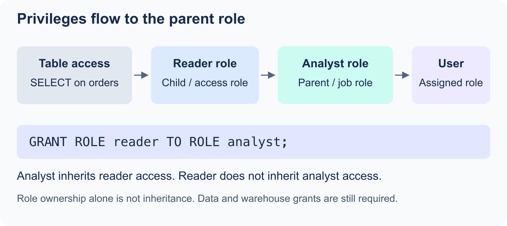
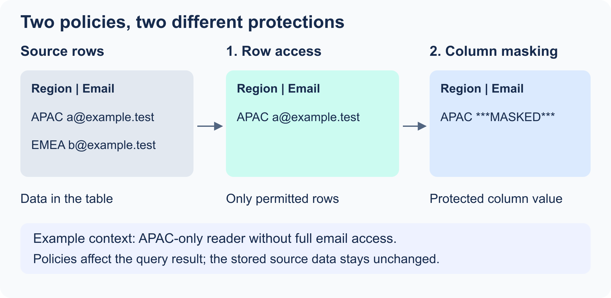

# Domain 2.0: Account Management and Data Governance

This note follows the SnowPro Core Certification Study Guide (C03) objectives:

1. Explain Snowflake's security model and principles.
2. Define data-governance features and how they are used.
3. Explain monitoring and cost management.

Scope: the supplied **C03 guide**, Domain 2, is the exam checklist. Examples below are study patterns checked against documentation, not executed in your Snowflake account. Existing users, databases, schemas, tables, warehouses, and suitable privileges are prerequisites unless the example creates them. Features and editions can change; use the linked official references for account-specific setup.

> **Exam mindset:** start with the business need. Then choose the most specific Snowflake feature that solves it. For example: **hide a column value → masking policy**; **hide whole rows → row access policy**; **stop a warehouse after a credit threshold → resource monitor**.

---

## 2.1 Security Model and Principles

### Core access-control concepts

Snowflake denies access unless an appropriate privilege allows it. Access is controlled through **securable objects**, **privileges**, **roles**, and **users**.

| Term | Meaning | Exam clue |
| --- | --- | --- |
| **Securable object** | An object that can have privileges, such as a warehouse, database, schema, table, view, stage, or integration. | “Who can use/query/manage this object?” |
| **Privilege** | A permitted action on an object, such as `USAGE`, `SELECT`, `CREATE TABLE`, or `OWNERSHIP`. | Privileges are granted, not assumed. |
| **Role** | A collection of privileges. Roles are granted to users or other roles. | Grant privileges to roles, then roles to people. |
| **User** | A human or service identity that signs in to Snowflake. | A user can have more than one role. |
| **OWNERSHIP** | Special privilege that controls an object and can transfer its ownership. | Each object has one owner role. |

### Securable object hierarchy

The normal hierarchy is:

```text
Organization
└── Account
    └── Database
        └── Schema
            └── Object (table, view, stage, function, etc.)
```

To query `analytics.mart.orders`, a role normally needs:

1. `USAGE` on the `analytics` database.
2. `USAGE` on the `analytics.mart` schema.
3. `SELECT` on the `orders` table or view.

A query that executes on a warehouse also needs `USAGE` on that warehouse. Warehouse access and data access are separate grants. Warehouses, users, and roles are account-level objects; they are not children of a schema in the hierarchy above.

**Exam trap:** `SELECT` on a table alone is not enough when the role lacks `USAGE` on its parent database or schema.

### RBAC and DAC

Snowflake combines several access-control models.

| Model | How it works in Snowflake | When to recognize it |
| --- | --- | --- |
| **Role-Based Access Control (RBAC)** | Privileges are granted to roles; roles are granted to users or other roles. | The normal, recommended access-management approach. |
| **Discretionary Access Control (DAC)** | An object's owner can grant access to that object. | A question focuses on the object owner deciding who gets access. |

In a regular schema, the object owner can usually grant access on that object. In a **managed access schema**, grant decisions are centralized: the schema owner or a role with `MANAGE GRANTS` makes grants, not individual object owners.

Snowflake also supports direct privileges on users, but RBAC is the normal design to use and the C03 guide focuses on RBAC and DAC.

### Least privilege and role design

Use **least privilege**: grant only the minimum access needed for a role's job.

A scalable pattern is:

```text
Object privileges → access roles → functional roles → users
```

- **Access role:** describes access to a data area, for example `MART_SALES_READER`.
- **Functional role:** describes a job, for example `FINANCE_ANALYST`.
- Grant access roles to functional roles, then grant functional roles to users.

This separates *what data can be accessed* from *who needs that access*. It also makes auditing and changes easier.

Avoid putting broad business-object privileges directly on system roles such as `SYSADMIN` or `ACCOUNTADMIN`. Keep system administration and day-to-day data access separate.

### System-defined roles

| Role | Main responsibility | Remember |
| --- | --- | --- |
| `GLOBALORGADMIN` | Organization-level administration and usage across accounts. | Exists in the organization account. |
| `ORGADMIN` | Organization-level tasks from a regular account. | Legacy role; Snowflake is moving organization administrators toward `GLOBALORGADMIN`. |
| `ACCOUNTADMIN` | Top-level account administration. | Combines `SYSADMIN` and `SECURITYADMIN`; assign to very few users. |
| `SECURITYADMIN` | Security grants, roles, and users. | Has `MANAGE GRANTS`; inherits `USERADMIN`. |
| `USERADMIN` | Creates and manages users and roles. | User/role administration, not general object management. |
| `SYSADMIN` | Creates and manages warehouses, databases, and other account objects. | Custom object-owner roles are commonly placed under this hierarchy. |
| `PUBLIC` | Automatically available to every user and role. | Never place sensitive access here. |

**Exam trap:** `ACCOUNTADMIN` is not the normal working role. It is powerful and should be controlled carefully.

### Account roles, database roles, and custom roles

| Role type | Scope | Can be activated directly in a session? | Best use |
| --- | --- | --- | --- |
| **Account role** | Across the account. | Yes. | Warehouses, account objects, and user-facing functional roles. |
| **Database role** | One database and objects inside it. | No. Grant it to an account role first. | Portable, database-scoped access; useful for sharing. |
| **Custom role** | A role you create for your organization. | Depends on whether it is an account or database role. | Least-privilege business and access roles. |

Database roles cannot receive privileges on objects in a different database. They are granted to an account role, which is then activated by the user.

### Role inheritance and ownership

<p align="center"></p>

`GRANT ROLE child TO ROLE parent` means the **parent inherits the child's privileges**. The child does not inherit the parent's privileges. Owning a role is different from inheriting it: ownership alone does not give access to everything that role can query.

```sql
USE ROLE USERADMIN;
CREATE ROLE finance_analyst;
-- After mart_sales_reader has been created:
GRANT ROLE mart_sales_reader TO ROLE finance_analyst;
GRANT ROLE finance_analyst TO ROLE SYSADMIN;
```

In this example, `finance_analyst` inherits reader access, and `SYSADMIN` inherits both roles. `MANAGE GRANTS` allows grant administration; it does not automatically supply `SELECT` on every table. Snowflake has no role that bypasses all authorization checks.

A database owner can delegate access inside its database with a database role:

```sql
-- Run with a role that owns analytics or has CREATE DATABASE ROLE there,
-- and can grant the following schema/table privileges.
CREATE DATABASE ROLE analytics.mart_reader;
GRANT USAGE ON SCHEMA analytics.mart
  TO DATABASE ROLE analytics.mart_reader;
GRANT SELECT ON ALL TABLES IN SCHEMA analytics.mart
  TO DATABASE ROLE analytics.mart_reader;
GRANT DATABASE ROLE analytics.mart_reader TO ROLE finance_analyst;
```

Granting a database role to an account role implicitly supplies `USAGE` on the containing database. Schema and object privileges still need to be granted. See [access-control design](https://docs.snowflake.com/en/user-guide/security-access-control-considerations).

### Practical RBAC SQL

The following example grants read access to all current and future tables in one schema. Use names that fit your account.

```sql
-- Create a custom account role and assign it to a user.
USE ROLE USERADMIN;
CREATE ROLE mart_sales_reader;
GRANT ROLE mart_sales_reader TO USER analyst_user;

-- Give the role only the access needed to read the sales mart.
USE ROLE SECURITYADMIN;
GRANT USAGE ON DATABASE analytics TO ROLE mart_sales_reader;
GRANT USAGE ON SCHEMA analytics.mart TO ROLE mart_sales_reader;
GRANT SELECT ON ALL TABLES IN SCHEMA analytics.mart TO ROLE mart_sales_reader;
GRANT SELECT ON FUTURE TABLES IN SCHEMA analytics.mart TO ROLE mart_sales_reader;
GRANT USAGE ON WAREHOUSE analytics_wh TO ROLE mart_sales_reader;
```

`ALL TABLES` covers existing tables. `FUTURE TABLES` covers tables created later. In a production role design, also decide who owns the schema and who is allowed to manage grants.

Views are separate objects: a grant on all tables does not grant `SELECT` on all views. Use `ALL VIEWS` / `FUTURE VIEWS` when required. Future grants are defaults for new objects; they do not backfill existing access.

```sql
SHOW GRANTS TO ROLE mart_sales_reader;
SHOW GRANTS ON TABLE analytics.mart.orders;
-- Remove a specific privilege when it is no longer needed.
REVOKE SELECT ON TABLE analytics.mart.orders FROM ROLE mart_sales_reader;
```

Revoking one grant may leave access available through another active role or role hierarchy. Check the effective access paths, not just one grant.

### Primary and secondary roles

Each session has exactly one **primary role** (also called the current role). A session can also have multiple **secondary roles**.

```sql
-- Change the primary role for this session.
USE ROLE mart_sales_reader;

-- Activate all roles granted to the current user as secondary roles.
USE SECONDARY ROLES ALL;
```

- For most actions, Snowflake can use privileges from the primary role and active secondary roles.
- Authorization to create an object comes from the **primary role**. The new object's ownership is assigned to that primary role.
- Secondary roles are useful when a user must query objects protected by different roles, for example in a cross-database join.

**Exam trap:** a database role cannot be activated directly. Grant it to an account role first.

### Network policies

A **network policy** restricts where connections to Snowflake can originate. It uses allowed and blocked network rules, usually IP addresses or CIDR ranges.

- An account policy is the broad default.
- A user policy overrides an account policy.
- A security-integration policy is the most specific and overrides user and account policies.

Use network policies to allow office/VPN egress addresses and block untrusted sources. Plan carefully: an incorrectly restrictive policy can lock administrators out.

The workflow is **create network rule → include it in a network policy → activate the policy**. A policy that has not been assigned does not restrict traffic. If the same address is allowed and blocked, the block wins. An allow list implicitly excludes other addresses of that identifier type.

```sql
-- Example only: documentation address range, not your actual office network.
CREATE NETWORK RULE governance.policies.office_ingress
  MODE = INGRESS
  TYPE = IPV4
  VALUE_LIST = ('203.0.113.0/24');

CREATE NETWORK POLICY office_access
  ALLOWED_NETWORK_RULE_LIST = ('governance.policies.office_ingress');
-- Activation intentionally shown as a comment: replace the address first.
-- ALTER USER analyst_user SET NETWORK_POLICY = office_access;
```

For Snowflake OAuth token requests, user-level policy handling has integration-specific exceptions; do not assume the general precedence table covers every token flow. See [network policy rules and precedence](https://docs.snowflake.com/en/user-guide/network-policies).

### Authentication methods

Authentication means **proving who is connecting**. The connection might come from a person opening Snowsight or an application running a scheduled job.

Start by separating these three questions:

| Question | Snowflake control | Example |
| --- | --- | --- |
| **Where are you connecting from?** | Network policy | Allow the office IP range. |
| **How will you prove who you are?** | Authentication method and authentication policy | Sign in through company SSO, or use a password with MFA. |
| **What may you do after connecting?** | Authorization: applicable privileges | Read a table only when the session has the required access. |

**Example:** an employee passes company SSO and MFA, but has no applicable `SELECT` grant on `SALES`. They can sign in, but they cannot read that table. Passing authentication does not grant data access.

[References: Authentication overview](https://docs.snowflake.com/en/user-guide/security-authentication-overview) · [Access control](https://docs.snowflake.com/en/user-guide/security-access-control-overview)

#### 1. Password and MFA: your password plus another proof

A password proves **something you know**. MFA means **multi-factor authentication**: adding another kind of proof, such as an authenticator-app code or an approval using a registered device.

A typical human login looks like this:

```text
Open Snowsight
    → Enter your Snowflake username and password
    → Complete the required second-factor check
    → Snowflake verifies the login and opens your session
```

**Enrollment** means registering your second factor, such as setting up an authenticator app. **Using MFA** means completing the check when signing in, subject to the applicable session rules.

Two passwords are still the same kind of proof; MFA uses different factors. It is an extra check in a login path, not a grant of table privileges.

**Remember: password = what you know; MFA = another kind of proof.** Snowflake is enforcing MFA for password sign-ins through a rollout. Do not design unattended jobs around a human password login without MFA; service users need a supported application authentication method.

[Reference: Multi-factor authentication](https://docs.snowflake.com/en/user-guide/security-mfa)

#### 2. Company SSO: your company checks your identity

**SSO** means **single sign-on**: use your company identity across applications. An **identity provider (IdP)**, such as Microsoft Entra ID or Okta, manages that identity. Snowflake is the **service provider (SP)**: the application you want to enter.

**SAML** means **Security Assertion Markup Language**. It is a standard for sending identity proof between systems. A SAML assertion is an XML message exchanged behind the login screens.

For a company using SAML with Entra ID:

1. Open Snowflake and choose the company SSO option.
2. Your browser goes to the company's Entra ID login page.
3. Entra ID verifies your company identity and any required MFA. An existing company session may avoid another password prompt.
4. The browser carries signed identity proof back to Snowflake.
5. Snowflake validates it, maps the identity to a Snowflake user, and opens a session.

The company password stays with the IdP. Administrators first configure a **security integration** so Snowflake knows which provider to trust.

**Remember: Entra ID/Okta = who checks you; SAML = how proof travels; SSO = the login experience.** Federated authentication is the trust arrangement. OIDC is another supported standard for company login.

[Reference: Federated authentication and SSO](https://docs.snowflake.com/en/user-guide/admin-security-fed-auth-overview)

#### 3. OAuth: an application connects using an access token

Imagine a BI application connecting to Snowflake for an analyst. With OAuth, it presents an **access token**, rather than keeping the analyst's Snowflake password.

Think of a token as a temporary access pass with limits. The **authorization server** issues that pass. Snowflake validates it and still applies access checks.

| OAuth option | Who issues the token? | Simple example |
| --- | --- | --- |
| **Snowflake OAuth** | Snowflake | A supported BI client obtains a token through Snowflake's OAuth flow. |
| **External OAuth** | An external authorization server | Entra ID issues the token that a configured BI client presents to Snowflake. |

A simplified interactive flow is:

```text
Open the BI application
    → Complete the configured sign-in/authorization flow
    → The application obtains an access token
    → The application presents it to Snowflake
    → Snowflake validates it and checks the permitted role access
```

SSO and OAuth can work together. For example, a Snowflake OAuth flow can use company SSO to verify the person. The token issuer determines whether it is **Snowflake OAuth** or **External OAuth**; seeing a Microsoft login page alone does not determine that.

**Remember: OAuth = application uses a token; ask who issued it.** The token does not give unrestricted table access.

[References: Snowflake OAuth](https://docs.snowflake.com/en/user-guide/oauth-snowflake-overview) · [External OAuth](https://docs.snowflake.com/en/user-guide/oauth-ext-overview)

#### 4. Key pairs: an application proves it holds a secret key

**Example:** a Python job loads data every night without a person available to approve a login.

A key pair has two matching parts:

| Key | Where it belongs | Job |
| --- | --- | --- |
| **Private key** | Protected by the application, usually through a secret store | Sign authentication proof. Keep it secret. |
| **Public key** | Registered on the Snowflake user | Let Snowflake verify that proof. |

```text
Python job signs authentication proof using its private key
    → The job sends the signed proof to Snowflake
    → Snowflake verifies it using the registered public key
    → Snowflake opens the session if all requirements pass
```

The private key itself is not uploaded to Snowflake. The key pair authenticates the application identity; applicable privileges still control its actions.

For users configured with `RSA_PUBLIC_KEY`, rotation can use both public-key slots: add the new public key in `RSA_PUBLIC_KEY_2`, move and verify all clients using the new private key, then remove the old public key.

**Remember: private signs; public verifies.** Key pairs fit automation; do not confuse them with a person completing MFA.

[Reference: Key-pair authentication and rotation](https://docs.snowflake.com/en/user-guide/key-pair-auth)

#### 5. Authentication policies: set the login rules

An authentication policy controls allowed login methods and MFA requirements. It is a **rule object**, not a new way of proving identity. A **security integration** establishes trust with an IdP; the policy can restrict which configured integrations are allowed.

The settings answer different questions:

| Setting | Meaning | Example |
| --- | --- | --- |
| `AUTHENTICATION_METHODS` | Which login methods may be used? | `('SAML')` allows the configured SAML login path. |
| `MFA_ENROLLMENT` | Who must register a Snowflake MFA factor? | `'REQUIRED_PASSWORD_ONLY'` targets human password users. |
| `MFA_POLICY` | How is Snowflake MFA enforced? | Its properties can also require Snowflake MFA after external SSO. |

For `MFA_ENROLLMENT`:

| Value | Meaning |
| --- | --- |
| `'REQUIRED_PASSWORD_ONLY'` | Human password users must enroll, regardless of client. This setting does not require SSO users to enroll. |
| `'REQUIRED'` | Human password and SSO users must enroll. |
| `'OPTIONAL'` | Legacy compatibility value; it does not bypass Snowflake's enforced MFA requirements. |

**Important distinction:** `REQUIRED_PASSWORD_ONLY` means **require MFA enrollment for password users**. It does not mean **allow only password login**. If `AUTHENTICATION_METHODS` is omitted, its default is `ALL`.

[Reference: Authentication policy parameters](https://docs.snowflake.com/en/sql-reference/sql/create-authentication-policy#optional-parameters)

**Example A: require MFA enrollment for password users.** These examples assume `SECURITY.POLICIES`, `TEST_USER`, and the necessary privileges already exist. Creating a policy requires `CREATE AUTHENTICATION POLICY` on the schema; assigning it requires suitable `APPLY AUTHENTICATION POLICY` authority. SQL here illustrates configuration; it has not been executed in your account.

```sql
CREATE OR REPLACE AUTHENTICATION POLICY SECURITY.POLICIES.MY_MFA_POLICY
  MFA_ENROLLMENT = 'REQUIRED_PASSWORD_ONLY';

-- Apply the rule to a test user.
ALTER USER TEST_USER
  SET AUTHENTICATION POLICY SECURITY.POLICIES.MY_MFA_POLICY;

-- Inspect the policy's settings.
DESCRIBE AUTHENTICATION POLICY SECURITY.POLICIES.MY_MFA_POLICY;
```

**Example B: allow only the configured SAML login path.** This assumes a working SAML security integration. It does not create the Entra ID/Okta connection for you.

```sql
CREATE OR REPLACE AUTHENTICATION POLICY SECURITY.POLICIES.SAML_ONLY_POLICY
  AUTHENTICATION_METHODS = ('SAML');

-- Replace the test user's previous authentication-policy assignment.
ALTER USER TEST_USER
  SET AUTHENTICATION POLICY SECURITY.POLICIES.SAML_ONLY_POLICY;
```

**Create → Assign → Enforce.** Creating the object alone does not enforce it. An account assignment supplies the default; a user-level authentication policy overrides it for that user.

MFA at the company IdP and Snowflake MFA are separate controls. To require Snowflake MFA after external SSO, the policy supports `MFA_POLICY = (ENFORCE_MFA_ON_EXTERNAL_AUTHENTICATION = 'ALL')`. Enrollment and enforcement settings should be considered together.

[Reference: Creating and assigning authentication policies](https://docs.snowflake.com/en/user-guide/authentication-policies)

#### 6. What to remember

| Clue in a question | Think |
| --- | --- |
| Company login page, Entra ID, or Okta | Company SSO / federated authentication; check the configured protocol. |
| SAML | Identity proof sent using the SAML standard. |
| A second proof during a person's login | MFA. |
| An application presents an access token | OAuth; identify the token issuer. |
| A job signs proof with a secret key | Key-pair authentication. |
| Restrict where connections originate | Network policy. |
| Restrict login methods or require MFA enrollment | Authentication policy. |
| Signed in successfully, but cannot query a table | Check authorization: active roles and applicable grants. |

Practice explaining these aloud: **Who verifies a SAML login? Who issues an External OAuth token? Where does the private key stay? What does `REQUIRED_PASSWORD_ONLY` actually require?**

### Account identifiers

For modern URLs and client connections, prefer the organization-account identifier:

```text
my_organization-my_account
```

The legacy account locator can still appear in older connection strings, but the organization-account identifier is the preferred, readable form.

For a normal public endpoint, the hostname is `<organization>-<account>.snowflakecomputing.com`. Client configuration often expects the identifier without the hostname suffix. `CURRENT_ACCOUNT()` returns the locator; `CURRENT_ACCOUNT_NAME()` and `CURRENT_ORGANIZATION_NAME()` return readable names.

### Logging and tracing

Snowflake logging and tracing help diagnose application code and handlers, especially Snowpark procedures and UDFs.

- **Logging** records events and messages.
- **Tracing** records the path of work through an application.
- **Metrics** measure numeric behavior, such as counts or durations.
- Event data is stored in an **event table**. Snowflake provides a default event table, or you can configure your own.

This is application observability. It is different from `ACCOUNT_USAGE`, which is mainly historical account monitoring and audit data.

Configure the collection level (`LOG_LEVEL` / `TRACE_LEVEL`) and an active event table before expecting telemetry. Collecting very verbose events can increase storage and processing cost; avoid writing credentials or sensitive values into logs. Use `LOGIN_HISTORY` for authentication investigation, `QUERY_HISTORY` for SQL activity, and `ACCESS_HISTORY` for data-access auditing. An event table is not a replacement for those audit views.

---

## 2.2 Data Governance Features

The SQL examples are separate study patterns. Use test objects and replace names with your own. For the examples using `analytics.mart.customer`, assume columns `customer_id`, `email`, and `region`; for `analytics.mart.orders`, assume `order_id`, `region`, and `order_date`. The named databases, schemas, warehouses, roles, and users must exist unless the example creates them. Policy creation, attachment, and inspection each require appropriate privileges; being able to query the data is not enough to administer its policies.

### Fast feature selection

| Need | Best feature |
| --- | --- |
| Hide or transform a sensitive **column value** at query time | Masking policy |
| Return only permitted **rows** | Row access policy |
| Label data or objects for classification, cost, or policy automation | Object tag |
| Limit privacy loss from analytical queries | Privacy policy / differential privacy |
| Find security misconfigurations and remediation guidance | Trust Center |
| Add customer control to Snowflake encryption keys | Tri-Secret Secure |
| Perform an action or notification when a condition is met | Alert |
| Send a message to email, webhook, or cloud queue | Notification integration / notification procedure |
| Maintain a disaster-recovery replica in another account or region | Replication and failover groups |
| Understand upstream/downstream data relationships | Data lineage |

### Masking policies: column-level security

<p align="center"></p>

A **masking policy** controls what a user sees in a column at query time. The underlying data stays unchanged; the returned value is masked or transformed for unauthorized users.

Example: show an email address only to the `PII_FULL_ACCESS` role; show a masked value to everyone else.

```sql
CREATE OR REPLACE MASKING POLICY governance.pii.email_mask
  AS (val STRING) RETURNS STRING ->
  CASE
    WHEN IS_ROLE_IN_SESSION('PII_FULL_ACCESS') THEN val
    ELSE '***MASKED***'
  END;

ALTER TABLE analytics.mart.customer
  MODIFY COLUMN email
  SET MASKING POLICY governance.pii.email_mask;
```

Use a masking policy when the user may see the row but should not see the unprotected value in a particular column.

Dynamic masking and row access policies require Enterprise Edition or higher. They supplement object privileges: a policy does not grant permission to query the table. `IS_ROLE_IN_SESSION` considers the active role hierarchy, while `CURRENT_ROLE()` returns only the primary role name. Keep this distinction in mind when secondary roles are enabled.

#### Test the returned values

The test user must have both roles available, and each role needs the usual warehouse, database, schema, and table privileges. For the masked test, `ANALYST` must not inherit `PII_FULL_ACCESS`.

```sql
USE SECONDARY ROLES NONE;

USE ROLE ANALYST;
SELECT customer_id, email
FROM analytics.mart.customer;
-- Expected: email is ***MASKED***.

USE ROLE PII_FULL_ACCESS;
SELECT customer_id, email
FROM analytics.mart.customer;
-- Expected: the original email is returned.
```

Disabling secondary roles makes this comparison easier to understand. It does not remove privileges inherited by the primary role. These statements change only the session's role selection; the policy does not rewrite the stored email.

#### Inspect the policy and its assignments

Run with suitable policy-administration privileges:

```sql
DESCRIBE MASKING POLICY governance.pii.email_mask;

SELECT *
FROM TABLE(analytics.INFORMATION_SCHEMA.POLICY_REFERENCES(
  REF_ENTITY_NAME => 'ANALYTICS.MART.CUSTOMER',
  REF_ENTITY_DOMAIN => 'TABLE'
));
```

`POLICY_REFERENCES` helps answer **which policy is attached to which column?** Visibility depends on policy privileges, so a normal reader may receive an authorization error or see only part of the configuration.

[References: Masking policy SQL](https://docs.snowflake.com/en/sql-reference/sql/create-masking-policy) · [POLICY_REFERENCES](https://docs.snowflake.com/en/sql-reference/functions/policy_references)

### Row access policies: row-level security

A **row access policy** evaluates a Boolean expression to decide which rows a user can see. It is applied to a table or view.

Example: regional analysts can see only rows matching their assigned region.

```sql
CREATE OR REPLACE ROW ACCESS POLICY governance.policies.region_filter
  AS (region STRING) RETURNS BOOLEAN ->
  CASE
    WHEN IS_ROLE_IN_SESSION('SALES_GLOBAL') THEN TRUE
    WHEN IS_ROLE_IN_SESSION('SALES_APAC') AND region = 'APAC' THEN TRUE
    ELSE FALSE
  END;

ALTER TABLE analytics.mart.orders
  ADD ROW ACCESS POLICY governance.policies.region_filter ON (region);
```

Use a row access policy when the user should not receive certain records at all. If a table has both row access and masking policies, Snowflake evaluates row access first.

In larger designs, use a mapping table from role/user to region instead of hard-coding every region into the policy. Snowflake checks policy-referenced objects using the policy owner's privileges; readers do not need direct `SELECT` on the mapping table. Policy administration and data ownership can therefore be separated. See [row access policy behavior](https://docs.snowflake.com/en/user-guide/security-row-intro).

#### Test which rows remain visible

```sql
USE SECONDARY ROLES NONE;

USE ROLE SALES_APAC;
SELECT region, COUNT(*) AS visible_orders
FROM analytics.mart.orders
GROUP BY region;
-- Expected: only APAC, if APAC orders exist.

USE ROLE SALES_GLOBAL;
SELECT region, COUNT(*) AS visible_orders
FROM analytics.mart.orders
GROUP BY region;
-- Expected: every region present in the table.
```

Both roles need the normal query privileges. Do not use a broad parent role for the APAC test if it also inherits `SALES_GLOBAL`.

#### Use a mapping table for more regions

This is an alternative implementation for the same table. Run the setup once as the policy administrator; the new policy's owner must retain `SELECT` on the mapping table.

```sql
CREATE TABLE governance.policies.role_region_map (
  role_name STRING,
  region STRING
);

INSERT INTO governance.policies.role_region_map (role_name, region)
VALUES ('SALES_APAC', 'APAC'), ('SALES_EMEA', 'EMEA');

CREATE ROW ACCESS POLICY governance.policies.region_filter_from_map
  AS (row_region STRING) RETURNS BOOLEAN ->
    IS_ROLE_IN_SESSION('SALES_GLOBAL')
    OR EXISTS (
      SELECT 1
      FROM governance.policies.role_region_map AS m
      WHERE m.region = row_region
        AND IS_ROLE_IN_SESSION(m.role_name)
    );

-- Replace the earlier policy on the test table in one statement.
ALTER TABLE analytics.mart.orders
  DROP ROW ACCESS POLICY governance.policies.region_filter,
  ADD ROW ACCESS POLICY governance.policies.region_filter_from_map ON (region);
```

Adding a new role-to-region mapping can now change access without editing the policy body. A table has one row access policy at a time; the replacement statement assumes the earlier `region_filter` is attached.

[Reference: Using row access policies and mapping tables](https://docs.snowflake.com/en/user-guide/security-row-using)

### Object tagging

A **tag** is metadata you assign to Snowflake objects or columns. Tags do not, by themselves, deny access. They help you classify, find, govern, audit, and sometimes automatically apply tag-based policies.

Common tag examples:

- `DATA_CLASSIFICATION = 'PII'`
- `OWNER_TEAM = 'FINANCE'`
- `COST_CENTER = 'MARKETING'`
- `RETENTION = 'CONFIDENTIAL'`

```sql
CREATE OR REPLACE TAG governance.tags.data_classification;

ALTER TABLE analytics.mart.customer
  SET TAG governance.tags.data_classification = 'PII';
```

**Exam trap:** a tag labels an object; it does not automatically mask a column or filter rows. A tag can be connected to a tag-based policy when centralized, scalable enforcement is needed.

For column-level protection, a policy can be attached to a tag and the tag applied to sensitive columns. The policy's input/output type must match the protected column type.

```sql
CREATE TAG governance.tags.sensitive_email;
ALTER TAG governance.tags.sensitive_email
  SET MASKING POLICY governance.pii.email_mask;
ALTER TABLE analytics.mart.customer
  MODIFY COLUMN email
  SET TAG governance.tags.sensitive_email = 'PII';
```

This uses a separate column-specific tag. Attaching the same masking policy to a table-level classification tag could mask every matching-type descendant column. Use tag inheritance and propagation according to their documented rules, and inspect the resulting assignments and policy references.

#### Limit tag values and inspect assignments

```sql
CREATE TAG governance.tags.cost_center
  ALLOWED_VALUES 'FINANCE', 'MARKETING', 'PLATFORM';

ALTER WAREHOUSE etl_wh
  SET TAG governance.tags.cost_center = 'PLATFORM';

SELECT SYSTEM$GET_TAG(
  'GOVERNANCE.TAGS.COST_CENTER', 'ETL_WH', 'WAREHOUSE'
) AS warehouse_cost_center;

SELECT SYSTEM$GET_TAG(
  'GOVERNANCE.TAGS.SENSITIVE_EMAIL',
  'ANALYTICS.MART.CUSTOMER.EMAIL', 'COLUMN'
) AS email_classification;
```

The first lookup should return `PLATFORM`; the second should return `PII` after the earlier column-tag example. Allowed values help keep labels consistent. Tagging a warehouse does not set a credit limit.

[References: CREATE TAG](https://docs.snowflake.com/en/sql-reference/sql/create-tag) · [SYSTEM$GET_TAG](https://docs.snowflake.com/en/sql-reference/functions/system_get_tag)

### Privacy policies

Snowflake **privacy policies** support differential privacy. A policy associates users with privacy budgets and can be assigned to tables or views.

When an analyst runs a query against privacy-protected data, Snowflake evaluates whether the query would exceed that user's privacy budget. This helps reduce the risk of identifying an individual through repeated analytical queries.

Do not confuse this with:

- **Masking policy:** hides individual column values.
- **Row access policy:** filters visible rows.
- **Privacy policy:** controls privacy loss for aggregate analytical queries through differential privacy.

Differential privacy adds controlled noise to protected analytical results and limits cumulative privacy loss through a budget. This budget measures privacy exposure, not Snowflake credit spend. Related features include aggregation policies (restrict small result groups), projection policies (restrict returning a column), and join policies (control required joins). These are supporting comparisons; the explicit C03 bullet is **privacy policies**.

#### Define and attach a privacy policy

This independent example uses an existing test table `analytics.mart.customer_survey`, where `customer_id` identifies the person being protected. It requires Enterprise Edition or higher and appropriate privacy-policy privileges.

```sql
CREATE PRIVACY POLICY governance.policies.survey_privacy
  AS () RETURNS PRIVACY_BUDGET ->
    PRIVACY_BUDGET(BUDGET_NAME => 'survey_analysts');

ALTER TABLE analytics.mart.customer_survey
  ADD PRIVACY POLICY governance.policies.survey_privacy
  ENTITY KEY (customer_id);
```

This creates a shared named privacy budget using the defaults and attaches the policy. The entity key groups records belonging to the same person. This is the definition/attachment step; analytical queries also need suitable privacy domains for the columns they use. Follow the linked tutorial for that setup. A protected analyst cannot use an ordinary row-level `SELECT *` as though the table were unrestricted.

**Remember:** privacy budget = how much information queries may reveal; cost budget = how many credits you plan to spend.

[References: CREATE PRIVACY POLICY](https://docs.snowflake.com/en/sql-reference/sql/create-privacy-policy) · [Differential privacy tutorial](https://docs.snowflake.com/en/user-guide/tutorials/diff-privacy)

### Trust Center

The **Trust Center** evaluates account configuration using scanners and presents findings and recommendations in Snowsight. It helps teams monitor and reduce security risks, such as insecure configuration or authentication posture.

Think of it as security-posture management—not a substitute for RBAC, network policies, or monitoring. Scanner use can incur serverless compute cost.

Administrators delegate viewing through `SNOWFLAKE.TRUST_CENTER_VIEWER` and management through `SNOWFLAKE.TRUST_CENTER_ADMIN` application roles. Review findings, apply appropriate remediation, and rerun the scanner to verify the issue is resolved. Muting a finding suppresses notifications; it does not fix the configuration. See [Trust Center](https://docs.snowflake.com/en/user-guide/trust-center/overview).

#### Delegate viewing without scanner administration

```sql
USE ROLE ACCOUNTADMIN;

CREATE ROLE IF NOT EXISTS security_reviewer;
GRANT APPLICATION ROLE SNOWFLAKE.TRUST_CENTER_VIEWER
  TO ROLE security_reviewer;

-- Replace REVIEWER_USER with an existing user.
GRANT ROLE security_reviewer TO USER REVIEWER_USER;
```

The user can activate `SECURITY_REVIEWER` to view findings. Use the `TRUST_CENTER_ADMIN` application role only when scanner management is part of the job. The review and remediation workflow is in the Trust Center UI; an application-role grant does not itself run a scanner or fix a finding.

[Reference: Trust Center required roles](https://docs.snowflake.com/en/user-guide/trust-center/overview#required-roles)

### Encryption key management

Snowflake encrypts customer data by default and manages the normal encryption-key hierarchy.

For extra customer control, **Tri-Secret Secure** combines:

1. A Snowflake-maintained key.
2. A customer-managed key in the cloud provider's key-management service.

Together, they form a composite key that protects the account's encryption-key hierarchy. Tri-Secret Secure is a Business Critical feature.

Distinguish **key rotation** from **rekeying**. Rotation replaces active key versions for new encryption; retired versions remain available to decrypt existing data. Optional periodic rekeying re-encrypts older data with new keys. Snowflake rotates its managed keys automatically; periodic rekeying is an Enterprise-or-higher option and may add storage cost. Revoking access to a customer-managed key can make the protected data unavailable. See [key management](https://docs.snowflake.com/en/user-guide/security-encryption-manage).

#### Inspect the periodic-rekeying setting

```sql
SHOW PARAMETERS LIKE 'PERIODIC_DATA_REKEYING' IN ACCOUNT;

-- Account-level configuration example for Enterprise or higher:
-- ALTER ACCOUNT SET PERIODIC_DATA_REKEYING = TRUE;
```

Enabling that parameter changes periodic rekeying; it does not configure Tri-Secret Secure. Tri-Secret Secure additionally requires the supported cloud key-management and Snowflake setup described in the key-management guide.

[Reference: PERIODIC_DATA_REKEYING](https://docs.snowflake.com/en/sql-reference/parameters#periodic-data-rekeying)

### Alerts and notifications

An **alert** is a schema object that evaluates a condition and performs an action when that condition is true. It can run on a schedule or, for an alert on new data, when new rows are available.

Examples:

- Alert when a data-quality query finds invalid records.
- Alert when warehouse credit usage crosses a chosen threshold.
- Alert when application events show failures.

An alert can send a notification, insert an audit record, or call other SQL logic. After creating an alert, remember to resume it.

```sql
-- Setup for the action target; requires the monitoring schema.
CREATE TABLE IF NOT EXISTS analytics.monitoring.alert_log (
  event_time TIMESTAMP_LTZ,
  message STRING
);

CREATE OR REPLACE ALERT analytics.monitoring.no_orders_alert
  WAREHOUSE = monitoring_wh
  SCHEDULE = '30 MINUTE'
  IF (EXISTS (
    SELECT COUNT(*) AS order_count
    FROM analytics.mart.orders
    WHERE order_date = CURRENT_DATE()
    HAVING COUNT(*) = 0
  ))
  THEN
    INSERT INTO analytics.monitoring.alert_log (event_time, message)
      SELECT CURRENT_TIMESTAMP(), 'No orders loaded today';

ALTER ALERT analytics.monitoring.no_orders_alert RESUME;
```

Alerts can use Snowflake-managed serverless compute or a specified virtual warehouse. A notification integration connects Snowflake with supported external destinations, such as email, webhooks, or cloud messaging services.

The setup creates `alert_log` if it is absent; an existing table must have compatible `event_time` and `message` columns. Alert conditions use `IF (EXISTS (...))`: return a row only when the condition is met. The aggregate above returns a row when today's order count is zero. Avoid a bare `COUNT(*)` without `HAVING`, which returns a row even when the count is zero.

The owner needs `CREATE ALERT` on the schema, `EXECUTE ALERT` on the account, and access to referenced data and action targets. A serverless alert additionally requires `EXECUTE MANAGED ALERT`; a warehouse-backed alert requires warehouse `USAGE`. Use `ALERT_HISTORY` to investigate runs.

For an email notification, create an email notification integration, configure eligible recipients, and call `SYSTEM$SEND_EMAIL`. Task/Snowpipe error integrations and general-purpose notification integrations have different supported destinations. Check the integration type instead of assuming every event can go to every destination. See [alert SQL](https://docs.snowflake.com/en/sql-reference/sql/create-alert) and [notifications](https://docs.snowflake.com/en/guides-overview-alerts).

#### Inspect alert runs and stop the test schedule

```sql
SELECT *
FROM TABLE(analytics.INFORMATION_SCHEMA.ALERT_HISTORY(
  SCHEDULED_TIME_RANGE_START => DATEADD('hour', -24, CURRENT_TIMESTAMP()),
  SCHEDULED_TIME_RANGE_END => CURRENT_TIMESTAMP(),
  RESULT_LIMIT => 100,
  ALERT_NAME => 'NO_ORDERS_ALERT'
))
ORDER BY scheduled_time DESC;

SELECT event_time, message
FROM analytics.monitoring.alert_log
ORDER BY event_time DESC;

-- Suspend after the demonstration to stop future scheduled runs.
ALTER ALERT analytics.monitoring.no_orders_alert SUSPEND;
```

History shows whether the condition/action ran successfully; the log table contains rows only when the action inserted them. Run the history function as the alert owner or an authorized administrator. Its alert-name argument uses the unqualified name, and its historical window is at most seven days.

#### Create an email integration and send a test message

Replace `verified_user@example.com` with a verified email belonging to a user in the current account. Creating the integration requires suitable account privileges; sending requires `USAGE` on it. The `CALL` below sends a real email when executed with valid configuration.

```sql
CREATE NOTIFICATION INTEGRATION study_email
  TYPE = EMAIL
  ENABLED = TRUE
  ALLOWED_RECIPIENTS = ('verified_user@example.com');

CALL SYSTEM$SEND_EMAIL(
  'STUDY_EMAIL',
  'verified_user@example.com',
  'Snowflake study alert',
  'The test notification succeeded.'
);
```

The same call can be an alert's action instead of an `INSERT`. For a serverless alert, omit `WAREHOUSE` from its definition and ensure the owner has `EXECUTE MANAGED ALERT` as well as `EXECUTE ALERT` and the required data/action privileges.

[References: ALERT_HISTORY](https://docs.snowflake.com/en/sql-reference/functions/alert_history) · [Email integration](https://docs.snowflake.com/en/sql-reference/sql/create-notification-integration-email) · [SYSTEM$SEND_EMAIL](https://docs.snowflake.com/en/sql-reference/stored-procedures/system_send_email)

### Replication and failover

Replication copies supported Snowflake objects and data from a primary account to a secondary account. **Failover groups** support broader business-continuity and disaster-recovery designs by grouping objects that should fail over together.

- A secondary replica is read-only until promoted.
- Replication supports cross-region and cross-cloud designs within a Snowflake organization.
- Failover and failback require Business Critical Edition or higher.

Replication groups synchronize a chosen set of supported objects; failover groups add promotion to a new primary. Database/share replication is available in all editions; replication of additional account objects and failover/failback require Business Critical or higher. Replicate the required roles and grants as well as the data when planning continuity.

Refreshes are asynchronous. **Recovery point objective (RPO)** is the acceptable amount of lost data; refresh frequency and completed refreshes affect it. **Recovery time objective (RTO)** is the acceptable time to restore service. Test client redirection, permissions, and failback; a replica alone does not prove the application can recover.

#### A failover group across two accounts

This requires two eligible accounts in the same organization, Business Critical or higher, replication enabled where required, and the necessary group/object privileges. Replace `MYORG`, `PRIMARY_ACCOUNT`, and `SECONDARY_ACCOUNT` with actual names. Use an otherwise unreplicated test database for this example.

On the **primary account**, define what may be copied:

```sql
CREATE FAILOVER GROUP analytics_dr
  OBJECT_TYPES = DATABASES
  ALLOWED_DATABASES = analytics
  ALLOWED_ACCOUNTS = MYORG.SECONDARY_ACCOUNT
  REPLICATION_SCHEDULE = '10 MINUTE';
```

On the **secondary account**, create the replica and request a refresh:

```sql
CREATE FAILOVER GROUP analytics_dr
  AS REPLICA OF MYORG.PRIMARY_ACCOUNT.analytics_dr;

ALTER FAILOVER GROUP analytics_dr REFRESH;
SHOW FAILOVER GROUPS;

-- Promotion syntax for a planned failover, after recovery checks:
-- ALTER FAILOVER GROUP analytics_dr PRIMARY;
```

The database-only group above does not include users, roles, or warehouses. Plan those separately. A scheduled refresh is asynchronous; it does not guarantee exactly ten minutes of possible data loss. Promotion changes which copy is writable.

[References: CREATE FAILOVER GROUP](https://docs.snowflake.com/en/sql-reference/sql/create-failover-group) · [Replication setup and refresh](https://docs.snowflake.com/en/user-guide/account-replication-config)

See [replication and failover](https://docs.snowflake.com/en/user-guide/account-replication-intro) and the [storage course note](../../study-notes/9-Storage-Data-Protection-and-sharing/readme.md) for supporting examples. Folder numbers 7/8/9 refer to course chapters, not C03 exam domains.

### Data lineage

**Data lineage** shows how data moves from source to target objects and how objects depend on each other.

It captures two important relationships:

1. **Data movement**, such as `CREATE TABLE AS SELECT`, `INSERT`, or `MERGE`.
2. **Object dependency**, such as a view that references a table without copying its data.

Use lineage for impact analysis: before changing a table, identify which downstream views, tables, and data products may be affected. Data lineage is available in Snowsight and programmatically through `GET_LINEAGE` (Enterprise Edition or higher).

**Upstream** asks where data came from; **downstream** asks what may be affected by a change. Column lineage provides more precise impact analysis than an object-only graph. `ACCESS_HISTORY` supports investigation of data access, while `OBJECT_DEPENDENCIES` records supported dependency relationships. Visibility depends on privileges and supported objects; absence from a lineage graph is not proof that no external application depends on the data.

#### Ask what depends on a table

```sql
SELECT distance, source_object_name, target_object_name
FROM TABLE(SNOWFLAKE.CORE.GET_LINEAGE(
  'ANALYTICS.MART.ORDERS', 'TABLE', 'DOWNSTREAM', 2
));
```

This follows downstream relationships for up to two steps. Change `DOWNSTREAM` to `UPSTREAM` to ask where the table's data came from. The results require appropriate lineage visibility and supported, captured relationships.

For a narrower dependency investigation:

```sql
SELECT referencing_database, referencing_schema,
       referencing_object_name, referencing_object_domain
FROM snowflake.account_usage.object_dependencies
WHERE referenced_database = 'ANALYTICS'
  AND referenced_schema = 'MART'
  AND referenced_object_name = 'ORDERS';
```

This identifies supported objects such as views that reference `ORDERS`; it is not a full replacement for data-movement lineage. Account Usage latency also applies.

[References: GET_LINEAGE](https://docs.snowflake.com/en/sql-reference/functions/get_lineage-snowflake-core) · [OBJECT_DEPENDENCIES](https://docs.snowflake.com/en/sql-reference/account-usage/object_dependencies)

---

## 2.3 Monitoring and Cost Management

### Resource monitors

A **resource monitor** tracks virtual-warehouse credit usage against a credit quota and can take action at configured thresholds.

Possible actions include:

- Notify.
- Suspend assigned warehouses.
- Suspend assigned warehouses immediately.

`SUSPEND` lets running statements finish before suspending; `SUSPEND_IMMEDIATE` cancels running statements. Both can notify. A warehouse can have one warehouse-level monitor and also be covered by the account monitor; whichever applicable suspend threshold is reached can stop it.

```sql
USE ROLE ACCOUNTADMIN;

CREATE OR REPLACE RESOURCE MONITOR monthly_etl_limit
  WITH CREDIT_QUOTA = 1000
  TRIGGERS
    ON 50 PERCENT DO NOTIFY
    ON 80 PERCENT DO NOTIFY
    ON 100 PERCENT DO SUSPEND
    ON 110 PERCENT DO SUSPEND_IMMEDIATE;

ALTER WAREHOUSE etl_wh
  SET RESOURCE_MONITOR = monthly_etl_limit;
```

Important distinctions:

- A monitor can be assigned to a warehouse or to the account.
- An account can have only one account-level resource monitor.
- Resource monitors apply to **virtual warehouses**. They do **not** control serverless-feature or AI-service costs; use the appropriate budgets/cost controls for those services.
- A resource monitor is not a perfectly real-time hard spending cap. Consumption can exceed a threshold before the action is applied.

The example uses the default schedule: immediate start with a reset at the beginning of each calendar month. A custom schedule requires both `FREQUENCY` and `START_TIMESTAMP`. Thresholds are percentages of the quota, not credit amounts. Supporting cloud-services consumption counts toward the quota before the daily billing adjustment, and suspending a warehouse does not stop all cloud-services charges.

Budgets monitor expected monthly spend for supported warehouse and serverless objects and can notify on projected overspend. A budget's spending limit does not itself provide the same warehouse-suspension behavior as a resource monitor.

#### Use an explicit weekly reset

This is a separate monitor example. Creating resource monitors requires `ACCOUNTADMIN`; assignment also requires the appropriate monitor/warehouse authority.

```sql
USE ROLE ACCOUNTADMIN;

CREATE RESOURCE MONITOR weekly_practice_limit
  WITH CREDIT_QUOTA = 20
       FREQUENCY = WEEKLY
       START_TIMESTAMP = IMMEDIATELY
  TRIGGERS
    ON 50 PERCENT DO NOTIFY
    ON 100 PERCENT DO SUSPEND;

ALTER WAREHOUSE etl_wh
  SET RESOURCE_MONITOR = weekly_practice_limit;

SHOW RESOURCE MONITORS;
SHOW WAREHOUSES LIKE 'ETL_WH';
```

The 50% notification threshold represents **10 credits**; 100% represents **20 credits**. Assigning this monitor replaces the warehouse-level assignment from the earlier monthly example. The explicit schedule resets weekly according to its start time, rather than using the default calendar-month reset. Notification delivery also requires configured, eligible notification recipients.

An account assignment uses different SQL:

```sql
-- Account-level assignment example; use an existing suitable monitor.
-- ALTER ACCOUNT SET RESOURCE_MONITOR = account_credit_limit;
```

`SHOW RESOURCE MONITORS` lets you inspect quota, usage, thresholds, and assignment level. A monitor with no account/warehouse assignment is not monitoring warehouse usage.

[References: CREATE RESOURCE MONITOR](https://docs.snowflake.com/en/sql-reference/sql/create-resource-monitor) · [SHOW RESOURCE MONITORS](https://docs.snowflake.com/en/sql-reference/sql/show-resource-monitors)

#### Create a custom cost budget

This example tracks an existing warehouse. It requires an existing `analytics.monitoring` schema, the relevant budget-creation privileges (including `SNOWFLAKE.BUDGET_CREATOR` and `CREATE SNOWFLAKE.CORE.BUDGET` on the schema), and `APPLYBUDGET` on the warehouse. The notification step uses the `STUDY_EMAIL` integration from 2.2 and a verified account user's email; replace the sample address.

```sql
CREATE SNOWFLAKE.CORE.BUDGET analytics.monitoring.etl_budget();

CALL analytics.monitoring.etl_budget!SET_SPENDING_LIMIT(100);

CALL analytics.monitoring.etl_budget!ADD_RESOURCE(
  SYSTEM$REFERENCE('WAREHOUSE', 'ETL_WH', 'SESSION', 'APPLYBUDGET')
);

CALL analytics.monitoring.etl_budget!SET_EMAIL_NOTIFICATIONS(
  'STUDY_EMAIL', 'verified_user@example.com'
);

SELECT SYSTEM$SHOW_BUDGETS_IN_ACCOUNT();
```

The limit is **100 credits per month**, not dollars. The budget can notify on predicted overspend. This configuration does not automatically suspend the warehouse at 100 credits; a resource monitor has separate suspension actions. Budgets can have supported custom actions, but those require additional configuration. Budget monitoring itself can incur serverless cost.

[References: Custom budgets](https://docs.snowflake.com/en/user-guide/budgets/custom-budget) · [Budget setup tutorial](https://docs.snowflake.com/en/user-guide/tutorials/budgets)

### Warehouse monitoring and cost control

Use these controls together:

| Control | Main purpose |
| --- | --- |
| Auto-suspend | Stops an idle warehouse to reduce compute cost. |
| Auto-resume | Starts the warehouse when work arrives. |
| Warehouse size | Controls compute power and credits consumed per running hour. |
| Multi-cluster settings | Adds concurrency capacity; more active clusters can cost more. |
| Resource monitor | Responds to a credit quota threshold. |
| Query history and metering views | Diagnose which workloads and warehouses consume credits. |

Do not choose a warehouse solely because it is small. A smaller warehouse can run much longer. Right-size it based on workload performance and total credits consumed.

#### Create a small warehouse with idle and query limits

Run with `CREATE WAREHOUSE` authority. The warehouse starts suspended; running a query on it later can resume it and consume credits.

```sql
CREATE WAREHOUSE d2_practice_wh
  WAREHOUSE_SIZE = 'XSMALL'
  AUTO_SUSPEND = 60
  AUTO_RESUME = TRUE
  INITIALLY_SUSPENDED = TRUE;

ALTER WAREHOUSE d2_practice_wh SET
  STATEMENT_TIMEOUT_IN_SECONDS = 300
  STATEMENT_QUEUED_TIMEOUT_IN_SECONDS = 60;

SHOW WAREHOUSES LIKE 'D2_PRACTICE_WH';
```

`AUTO_SUSPEND` targets idle time; the two statement timeouts limit statement/queue waiting time. A statement timeout is not a credit quota. Warehouse auto-suspend is checked periodically, so it is not a precise timer. Other applicable session or account timeout settings can also affect statements.

[Reference: Warehouse properties and parameters](https://docs.snowflake.com/en/sql-reference/sql/create-warehouse)

#### Check what compute is on right now

```sql
SHOW WAREHOUSES
->> SELECT "name", "state", "size", "started_clusters",
           "running", "queued", "auto_suspend"
    FROM $1;

SHOW COMPUTE POOLS
->> SELECT "name", "state", "active_nodes", "idle_nodes",
           "num_services", "num_jobs", "auto_suspend_secs"
    FROM $1;

SHOW SERVICES IN ACCOUNT
->> SELECT "database_name", "schema_name", "name",
           "status", "compute_pool", "current_instances"
    FROM $1;
```

`->>` passes a command's result to the following query; `$1` refers to that result. Double quotes are needed for the lowercase column names returned by `SHOW`.

- A warehouse can be `STARTED` with `running = 0`: it is on but executing no SQL statements at that moment.
- A pool in `ACTIVE` has a service running or scheduled. `IDLE` means provisioned machines without scheduled services; `SUSPENDED` means no running machines.
- Inspect service status and its pool to identify notebook/container workloads. A listed pool alone does not establish current billed consumption; use metering history for costs.

Results depend on your privileges. These inventory commands do not require a running warehouse. For notebooks using a compute pool, suspending their query warehouse does not suspend the notebook service. Stop that service through the notebook's service controls when appropriate; other services may share the pool.

[References: SHOW WAREHOUSES](https://docs.snowflake.com/en/sql-reference/sql/show-warehouses) · [SHOW COMPUTE POOLS](https://docs.snowflake.com/en/sql-reference/sql/show-compute-pools) · [SHOW SERVICES](https://docs.snowflake.com/en/sql-reference/sql/show-services) · [Notebook compute setup](https://docs.snowflake.com/en/user-guide/ui-snowsight/notebooks-in-workspaces/notebooks-in-workspaces-compute-setup)

### Virtual warehouse credit usage

For exam reasoning, use this approximation:

```text
Warehouse credits ≈ credit rate for warehouse size
                    × time running
                    × number of active clusters
```

- Larger warehouses consume credits at a higher hourly rate.
- Multi-cluster warehouses consume for each running cluster.
- Warehouses are billed by running time, including work performed after resume. Snowflake bills per second, with a 60-second minimum each time a warehouse starts.
- Cloud-services credits are tracked separately from virtual-warehouse compute credits. Daily cloud-services use up to 10% of daily warehouse usage is not billed; usage above that allowance can be billed.

**Exam trap:** “query ran for 20 seconds” does not always mean “only 20 seconds of warehouse cost.” Consider warehouse start-up, concurrent workload, and idle time before auto-suspend.

#### Credit calculation examples

Use the credit rate supplied in the question or the current warehouse consumption table. For a standard warehouse, calculate each running interval and each cluster separately when they differ.

| Given | Calculation | Compute credits |
| --- | --- | --- |
| Rate 4 credits/hour, one cluster, 30 minutes | `4 × 30 / 60` | `2` |
| Rate 4 credits/hour per cluster, two clusters for 15 minutes | `4 × 2 × 15 / 60` | `2` |
| Rate 4 credits/hour, four separate 20-second runs, each followed by suspension | `4 × 4 × 60 / 3600` | Approximately `0.2667` because each start has a 60-second minimum. |

If compute usage is 100 credits in a UTC billing day and cloud-services usage is 15, the 10-credit cloud-services allowance leaves 5 billable cloud-services credits. Dollar cost then depends on the applicable price per credit; storage and data transfer are separate cost categories. Savings are not guaranteed to scale linearly with warehouse size.

#### Reproduce the arithmetic in SQL

The rate of 4 below is supplied for the exercise; it is not a universal rate for every warehouse type or generation. Each row assumes identical running intervals for its starts and clusters.

```sql
WITH runs (scenario, hourly_rate, seconds_per_start, clusters, starts) AS (
  SELECT * FROM VALUES
    ('One cluster for 30 minutes', 4, 1800, 1, 1),
    ('Two clusters for 15 minutes', 4, 900, 2, 1),
    ('Four separate 20-second starts', 4, 20, 1, 4)
)
SELECT scenario,
       ROUND(hourly_rate * GREATEST(seconds_per_start, 60)
             * clusters * starts / 3600.0, 4) AS estimated_compute_credits
FROM runs;
```

Expected results are **2**, **2**, and approximately **0.2667** credits. Use the full running interval, including idle time, rather than just a query's execution time. Calculate intervals separately when cluster counts or rates change. For real usage, use metering records instead of this simplified exercise.

[Reference: Understanding compute cost](https://docs.snowflake.com/en/user-guide/cost-understanding-compute)

### `ACCOUNT_USAGE` schema

The shared `SNOWFLAKE` database contains `ACCOUNT_USAGE`, which provides historical account-monitoring and audit views. It is useful for trend analysis, chargeback/showback, and investigating account activity.

Common views include:

| View | Use it for |
| --- | --- |
| `WAREHOUSE_METERING_HISTORY` | Hourly warehouse credit usage. |
| `METERING_DAILY_HISTORY` | Daily billed usage and adjustments. |
| `QUERY_HISTORY` | Query investigation and workload analysis. |
| `LOGIN_HISTORY` | Sign-in auditing and troubleshooting. |
| `ACCESS_HISTORY` | Auditing data/object access where available. |
| `SNOWPARK_CONTAINER_SERVICES_HISTORY` | Hourly compute-pool credits, separate from warehouse metering. |

`ACCOUNT_USAGE` is historical, not real-time. Views have latency, so do not use it as the only control for an immediate incident response.

```sql
-- Find the virtual warehouses with the highest compute-credit use in the last 30 days.
SELECT
  warehouse_name,
  SUM(credits_used_compute) AS compute_credits
FROM snowflake.account_usage.warehouse_metering_history
WHERE start_time >= DATEADD(day, -30, CURRENT_TIMESTAMP())
GROUP BY warehouse_name
ORDER BY compute_credits DESC;
```

`CREDITS_USED` in `WAREHOUSE_METERING_HISTORY` includes compute and cloud-services usage. For the actual billed cloud-services adjustment, use the daily metering views rather than assuming hourly consumption equals the invoice.

Access can be delegated through relevant `SNOWFLAKE` database roles such as `USAGE_VIEWER`, rather than using `ACCOUNTADMIN` for every report. `ACCOUNT_USAGE` historical views commonly retain a year of records, but latency and retention are view-specific. Information Schema functions often provide fresher, shorter-range results. `ACCESS_HISTORY` requires Enterprise or higher. Match the view to the question: login failure, query runtime, warehouse credits, and data access are different investigations.

#### Daily billed credits by service type

```sql
-- Use UTC dates when comparing billing days.
ALTER SESSION SET TIMEZONE = 'UTC';

SELECT usage_date, service_type,
       SUM(credits_used_compute) AS compute_credits,
       SUM(credits_used_cloud_services) AS cloud_services_before_adjustment,
       SUM(credits_adjustment_cloud_services) AS cloud_services_adjustment,
       SUM(credits_billed) AS billed_credits
FROM snowflake.account_usage.metering_daily_history
WHERE usage_date >= DATEADD('day', -30, CURRENT_DATE())
  AND usage_date < CURRENT_DATE()
GROUP BY usage_date, service_type
ORDER BY usage_date DESC, billed_credits DESC;
```

The adjustment is typically negative. `CREDITS_BILLED` accounts for the adjustment, while consumed credits alone do not. Grouping by service type also exposes categories beyond warehouse compute. This is a credits report, not a complete dollar invoice including storage and transfer. The view can lag by up to three hours.

[Reference: METERING_DAILY_HISTORY](https://docs.snowflake.com/en/sql-reference/account-usage/metering_daily_history)

#### Investigate slow queries and warehouse queuing

```sql
SELECT query_id, user_name, warehouse_name,
       ROUND(total_elapsed_time / 1000.0, 2) AS elapsed_seconds,
       ROUND(execution_time / 1000.0, 2) AS execution_seconds,
       ROUND(queued_overload_time / 1000.0, 2) AS overload_queue_seconds,
       bytes_scanned, query_text
FROM snowflake.account_usage.query_history
WHERE start_time >= DATEADD('day', -7, CURRENT_TIMESTAMP())
  AND warehouse_name IS NOT NULL
ORDER BY total_elapsed_time DESC
LIMIT 20;
```

The source timing columns use milliseconds. High overload queue time suggests concurrency pressure; long execution time calls for query/profile investigation. Neither number alone proves that resizing is the right fix. Do not treat query elapsed time as its exact share of warehouse credits: concurrent queries and idle time complicate attribution.

[Reference: QUERY_HISTORY columns](https://docs.snowflake.com/en/sql-reference/account-usage/query_history)

#### Find recent failed SQL statements

For a fresher, shorter-range investigation, use an Information Schema function. This example needs access to the `analytics` database and visibility of the relevant queries:

```sql
SELECT query_id, user_name, start_time,
       execution_status, error_code, error_message
FROM TABLE(analytics.INFORMATION_SCHEMA.QUERY_HISTORY(
  END_TIME_RANGE_START => DATEADD('hour', -1, CURRENT_TIMESTAMP()),
  END_TIME_RANGE_END => CURRENT_TIMESTAMP(),
  RESULT_LIMIT => 10000
))
WHERE error_code IS NOT NULL
ORDER BY start_time DESC;
```

The function supports a seven-day window. The result limit is applied before the outer filter, so even `10000` can omit older matches in a busy account. Missing results can also reflect insufficient privileges. For authentication failures before a SQL session exists, use `LOGIN_HISTORY` instead.

[Reference: QUERY_HISTORY table functions](https://docs.snowflake.com/en/sql-reference/functions/query_history)

#### Measure compute-pool credits separately

```sql
SELECT compute_pool_name,
       SUM(credits_used) AS compute_pool_credits
FROM snowflake.account_usage.snowpark_container_services_history
WHERE start_time >= DATEADD('day', -7, CURRENT_TIMESTAMP())
GROUP BY compute_pool_name
ORDER BY compute_pool_credits DESC;
```

Use this for pool-level consumption, including pools hosting notebook services. It does not separate every individual notebook's cost within a shared pool. The view can lag by up to three hours; use `SHOW COMPUTE POOLS` and `SHOW SERVICES` for current state. Warehouse and pool reports also do not cover every other serverless feature's cost.

[Reference: SNOWPARK_CONTAINER_SERVICES_HISTORY](https://docs.snowflake.com/en/sql-reference/account-usage/snowpark_container_services_history)

#### Delegate access to usage reports

```sql
USE ROLE ACCOUNTADMIN;

CREATE ROLE IF NOT EXISTS cost_reviewer;
GRANT DATABASE ROLE SNOWFLAKE.USAGE_VIEWER TO ROLE cost_reviewer;

-- Replace REVIEWER_USER with an existing user.
GRANT ROLE cost_reviewer TO USER REVIEWER_USER;
```

Use `COST_REVIEWER` for the metering views exposed through `USAGE_VIEWER`. Other query/audit views may require different `SNOWFLAKE` database roles. Running report queries also requires warehouse `USAGE`. Access to all Snowsight cost-management screens can require additional application-role grants; the SQL grant above is for the database-role usage reports.

[Reference: SNOWFLAKE database roles](https://docs.snowflake.com/en/sql-reference/snowflake-db-roles)

---

## Scenario Decision Guide

| Scenario | Best answer | Why the close alternatives are wrong |
| --- | --- | --- |
| An analyst can see the customer row but must not see the email address. | Masking policy. | Row access would hide the whole row; a tag alone only labels it. |
| APAC users must see only APAC sales records. | Row access policy. | Masking hides column values, not rows. |
| The security team wants a consistent `PII` label across databases and columns. | Object tag. | A tag classifies; pair it with policies if enforcement is required. |
| A service account must authenticate without a stored password. | Key-pair authentication. | MFA is for an additional human sign-in factor; SSO is identity-provider login. |
| One user needs access to two independent role sets for a cross-database query. | Activate appropriate secondary roles. | Do not make every role a broad parent role just for one query. |
| Stop an ETL warehouse after its monthly credit quota is reached. | Resource monitor. | It manages virtual-warehouse credit thresholds, not serverless costs. |
| Investigate which warehouse used the most compute credits last month. | `ACCOUNT_USAGE.WAREHOUSE_METERING_HISTORY`. | Query History is useful for query detail, but not the primary hourly warehouse-metering summary. |
| Identify downstream objects before changing a source table. | Data lineage. | Tags describe metadata; lineage shows movement and dependency relationships. |

---

## What to Recall

Try these closed-book before rereading the answers.

1. What are the three privileges needed to select from `database.schema.table`?
2. How do RBAC and DAC differ in Snowflake?
3. Why is `ACCOUNTADMIN` not a normal day-to-day working role?
4. What is the scope difference between an account role and a database role?
5. Can a database role be activated directly in a session?
6. What is the difference between the primary role and secondary roles?
7. Which role determines ownership when a user creates a new object?
8. What does a managed access schema centralize?
9. What network-policy level has the highest precedence: account, user, or security integration?
10. Which authentication method is a strong fit for an automated service account?
11. What is the difference between a masking policy and a row access policy?
12. What can a tag do by itself, and what can it not do by itself?
13. What problem do privacy policies solve?
14. What does the Trust Center help you find?
15. What extra control does Tri-Secret Secure add to normal Snowflake encryption?
16. What must you do after creating an alert before it can run?
17. What is the difference between an alert and a notification integration?
18. Which costs can a resource monitor control, and which can it not control?
19. How do warehouse size, running time, and active clusters affect credit use?
20. Why should `ACCOUNT_USAGE` not be treated as real-time monitoring data?
21. Which direction does privilege inheritance flow in `GRANT ROLE child TO ROLE parent`?
22. Why does owning a role differ from inheriting that role?
23. Which separate warehouse privilege is needed to execute a table query?
24. How do SSO, MFA, OAuth, and key pairs differ, and where must a private key be stored?
25. What is the preferred account identifier, and how does it differ from an account locator?
26. Which telemetry settings and storage destination are needed for logging and tracing?
27. What is the difference between key rotation and periodic rekeying?
28. How do replication groups and failover groups differ? What do RPO and RTO measure?
29. How does lineage help with upstream tracing and downstream impact analysis?
30. Calculate credits for two clusters running 45 minutes at 8 credits/hour each. What happens if their run times differ?
31. Which statement cancels active queries: `SUSPEND` or `SUSPEND_IMMEDIATE`?
32. How do a resource-monitor quota, a cost budget, and a differential-privacy budget differ?

---

## Official References

- [Snowflake access control overview](https://docs.snowflake.com/en/user-guide/security-access-control-overview)
- [Authentication overview](https://docs.snowflake.com/en/user-guide/security-authentication-overview)
- [Network policies](https://docs.snowflake.com/en/user-guide/network-policies)
- [Data governance overview](https://docs.snowflake.com/en/guides-overview-govern)
- [Trust Center](https://docs.snowflake.com/en/user-guide/trust-center/overview)
- [Encryption key management](https://docs.snowflake.com/en/user-guide/security-encryption-manage)
- [Alerts](https://docs.snowflake.com/en/user-guide/alerts)
- [Data lineage](https://docs.snowflake.com/en/user-guide/ui-snowsight-lineage)
- [Resource monitors](https://docs.snowflake.com/en/user-guide/resource-monitors)
- [Exploring compute cost](https://docs.snowflake.com/en/user-guide/cost-exploring-compute)
- [`WAREHOUSE_METERING_HISTORY`](https://docs.snowflake.com/en/sql-reference/account-usage/warehouse_metering_history)
- [Database roles and access-control design](https://docs.snowflake.com/en/user-guide/security-access-control-considerations)
- [Authentication policies](https://docs.snowflake.com/en/user-guide/authentication-policies)
- [Logging and tracing levels](https://docs.snowflake.com/en/developer-guide/logging-tracing/telemetry-levels)
- [Row access policies](https://docs.snowflake.com/en/user-guide/security-row-intro)
- [Privacy policy SQL](https://docs.snowflake.com/en/sql-reference/sql/create-privacy-policy)
- [Differential privacy tutorial](https://docs.snowflake.com/en/user-guide/tutorials/diff-privacy)
- [Account replication and failover](https://docs.snowflake.com/en/user-guide/account-replication-intro)
- [Compute credit billing](https://docs.snowflake.com/en/user-guide/cost-understanding-compute)
- [Budgets and resource monitors](https://docs.snowflake.com/en/user-guide/cost-controlling)
