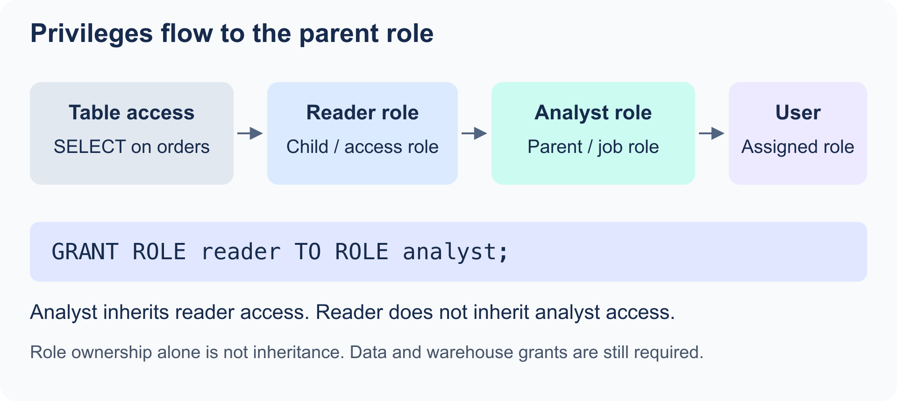
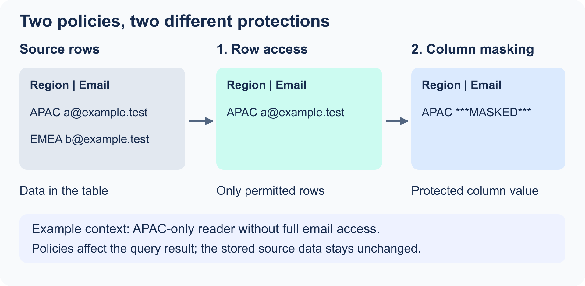

# Domain 2.0: Account Management and Data Governance

- **Exam outline:** supplied [SnowPro Core C03 guide](../../SnowProCoreStudyGuideC03.pdf), pages 5 and 8.
- **Domain weighting in that guide:** **20%**.
- **Format and exercise update:** November 5, 2026.
- **Purpose:** understand the feature, recognize a scenario, and practice with SQL.
- Technical terms stay unchanged; explanations use short bullets and numbered steps.
- SQL examples are reviewed against official documentation, **not executed in your Snowflake account**.

## How to use this note

1. Read one numbered subsection.
2. Learn its **Remember** line and scenario distinctions.
3. Run the related exercise and compare the expected result.
4. Answer **What to Recall** without looking, then open its answer key.
5. Check the official reference when a feature or prerequisite needs more detail.

### Practice Q&A

- [2.1 Security Model and Principles](practice/01-security-model-and-principles-qa.md)
- [2.2 Data Governance Features](practice/02-data-governance-features-qa.md)
- [2.3 Monitoring and Cost Management](practice/03-monitoring-and-cost-management-qa.md)
- [DMF hands-on test](../additional-exercises/04-dmf-data-quality/readme.md)

### The C03 coverage checklist

| C03 objective | Coverage | Start |
| --- | --- | --- |
| **2.1** | RBAC/DAC; hierarchy; network/authentication; roles; identifiers; logging/tracing. | [2.1](#21-security-model-and-principles) |
| **2.2** | Masking/row access; tagging; privacy; Trust Center; encryption; alerts/notifications; DR; lineage. | [2.2](#22-data-governance-features) |
| **2.3** | Resource monitors; warehouse cost arithmetic; account-usage investigation. | [2.3](#23-monitoring-and-cost-management) |

### Core study versus optional depth

- Start with the named guide objectives and feature-selection distinctions.
- Add the runnable lab to connect the definition to an observed result.
- Reference snippets outside the exercise folder are separate patterns with stated prerequisites; do not run the entire README as one SQL script.
- Account-wide security changes, real email, multi-account DR, paid AI, and paid background optimization require their own setup.
- New product features do not automatically become new exam objectives. The guide also says its list is not exhaustive.
- Keep the existing images, practice Q&A, and course references as supporting material.

## Practice setup and exercise files

- Follow the [ordered lab guide and checkpoints](exercises/readme.md).
- Run [00-setup.sql](exercises/00-setup.sql) first in a fresh lab session.
- Finish with [99-stop-lab.sql](exercises/99-stop-lab.sql).
- Each script uses only its named study objects and synthetic data.
- Basic queries can resume the small warehouse and consume credits.
- Optional blocks are clearly marked; their permissions/editions and cleanup are in the lab guide.

## 2.1 Security Model and Principles

<a id="core-access-control-concepts"></a>

### 2.1.1 Core access-control concepts

- **Remember:** A successful sign-in proves identity; privileges still authorize each action.

- Snowflake denies access unless an appropriate privilege allows it.
- Access is controlled through **securable objects**, **privileges**, **roles**, and **users**.

| Term | Meaning | Exam clue |
| --- | --- | --- |
| **Securable object** | An object that can have privileges, such as a warehouse, database, schema, table, view, stage, or integration. | “Who can use/query/manage this object?” |
| **Privilege** | A permitted action on an object, such as `USAGE`, `SELECT`, `CREATE TABLE`, or `OWNERSHIP`. | Privileges are granted, not assumed. |
| **Role** | A collection of privileges. Roles are granted to users or other roles. | Grant privileges to roles, then roles to people. |
| **User** | A human or service identity that signs in to Snowflake. | A user can have more than one role. |
| **OWNERSHIP** | Special privilege that controls an object and can transfer its ownership. | Each object has one owner role. |

<a id="securable-object-hierarchy"></a>

### 2.1.2 Securable object hierarchy

- **Remember:** Reading a table normally needs database/schema USAGE and table SELECT; warehouse access is separate.

- The normal hierarchy is:

```text
Organization
└── Account
    └── Database
        └── Schema
            └── Object (table, view, stage, function, etc.)
```

- To query `analytics.mart.orders`, a role normally needs:

1. `USAGE` on the `analytics` database.
2. `USAGE` on the `analytics.mart` schema.
3. `SELECT` on the `orders` table or view.

- A query that executes on a warehouse also needs `USAGE` on that warehouse.
- Warehouse access and data access are separate grants.
- Warehouses, users, and roles are account-level objects; they are not children of a schema in the hierarchy above.

- **Exam trap:** `SELECT` on a table alone is not enough when the role lacks `USAGE` on its parent database or schema.

<a id="rbac-and-dac"></a>

### 2.1.3 RBAC and DAC

- **Remember:** RBAC grants through roles; DAC centers on object ownership. Managed access centralizes grant decisions.

- Snowflake combines several access-control models.

| Model | How it works in Snowflake | When to recognize it |
| --- | --- | --- |
| **Role-Based Access Control (RBAC)** | Privileges are granted to roles; roles are granted to users or other roles. | The normal, recommended access-management approach. |
| **Discretionary Access Control (DAC)** | An object's owner can grant access to that object. | A question focuses on the object owner deciding who gets access. |

- In a regular schema, the object owner can usually grant access on that object.
- In a **managed access schema**, grant decisions are centralized: the schema owner or a role with `MANAGE GRANTS` makes grants, not individual object owners.

- Snowflake also supports direct privileges on users, but RBAC is the normal design to use and the C03 guide focuses on RBAC and DAC.

<a id="least-privilege-and-role-design"></a>

### 2.1.4 Least privilege and role design

- **Remember:** Give a role only the access needed for its job, then build an understandable inheritance hierarchy.

- Use **least privilege**: grant only the minimum access needed for a role's job.

- A scalable pattern is:

```text
Object privileges → access roles → functional roles → users
```

- An **access role** describes access to a data area, such as `MART_SALES_READER`. A **functional role** describes a job, such as `FINANCE_ANALYST`. Grant access roles to functional roles, then functional roles to users.
- This pattern separates *what data can be accessed* from *who needs that access*, making audits and changes easier. Keep day-to-day business access separate from broad system roles such as `SYSADMIN` and `ACCOUNTADMIN`.

<a id="system-defined-roles"></a>

### 2.1.5 System-defined roles

- **Remember:** USERADMIN manages users/roles; SECURITYADMIN manages grants; SYSADMIN manages data/compute; ACCOUNTADMIN combines broad administration.

| Role | Main responsibility | Remember |
| --- | --- | --- |
| `GLOBALORGADMIN` | Organization-level administration and usage across accounts. | Exists in the organization account. |
| `ORGADMIN` | Organization-level tasks from a regular account. | Legacy role; Snowflake is moving organization administrators toward `GLOBALORGADMIN`. |
| `ACCOUNTADMIN` | Top-level account administration. | Combines `SYSADMIN` and `SECURITYADMIN`; assign to very few users. |
| `SECURITYADMIN` | Security grants, roles, and users. | Has `MANAGE GRANTS`; inherits `USERADMIN`. |
| `USERADMIN` | Creates and manages users and roles. | User/role administration, not general object management. |
| `SYSADMIN` | Creates and manages warehouses, databases, and other account objects. | Custom object-owner roles are commonly placed under this hierarchy. |
| `PUBLIC` | Automatically available to every user and role. | Never place sensitive access here. |

- **Exam trap:** `ACCOUNTADMIN` is not the normal working role.
- It is powerful and should be controlled carefully.

<a id="account-roles-database-roles-and-custom-roles"></a>

### 2.1.6 Account roles, database roles, and custom roles

- **Remember:** Database roles have one-database scope and cannot be activated directly with USE ROLE.

| Role type | Scope | Can be activated directly in a session? | Best use |
| --- | --- | --- | --- |
| **Account role** | Across the account. | Yes. | Warehouses, account objects, and user-facing functional roles. |
| **Database role** | One database and objects inside it. | No. The lab uses the account-role grant path. | Portable, database-scoped access; useful for sharing. |
| **Custom role** | A role you create for your organization. | Depends on whether it is an account or database role. | Least-privilege business and access roles. |

- Database roles cannot receive privileges on objects in a different database.
- The common activation path used here grants the database role to an account role, which the user activates.
- A database role cannot itself be selected by USE ROLE.
- **Granting is different from activation:** the current `GRANT DATABASE ROLE` command reference allows `GRANT DATABASE ROLE analytics.mart_reader TO USER analyst_user`. The database role still cannot be selected with `USE ROLE` or `USE SECONDARY ROLES`. The account-role path below makes the session's authorization path explicit and is the recommended pattern for these labs. Some Snowflake guides still describe only that account-role path; the command reference is the source for current grant syntax. Test direct-user-grant behavior in your account before relying on it for access. [Grant syntax](https://docs.snowflake.com/en/sql-reference/sql/grant-database-role) · [Session role rules](https://docs.snowflake.com/en/user-guide/security-access-control-overview#authorization-through-primary-role-and-secondary-roles)

<a id="role-inheritance-and-ownership"></a>

### 2.1.7 Role inheritance and ownership

- **Remember:** GRANT ROLE child TO ROLE parent gives the parent the child privileges; ownership of a role is different.

<p align="center"></p>

- `GRANT ROLE child TO ROLE parent` means the **parent inherits the child's privileges**.
- The child does not inherit the parent's privileges.
- Owning a role is different from inheriting it: ownership alone does not give access to everything that role can query.

```sql
USE ROLE USERADMIN;
CREATE ROLE finance_analyst;
-- After mart_sales_reader has been created:
GRANT ROLE mart_sales_reader TO ROLE finance_analyst;
GRANT ROLE finance_analyst TO ROLE SYSADMIN;
```

- In this example, `finance_analyst` inherits reader access, and `SYSADMIN` inherits both roles.
- `MANAGE GRANTS` allows grant administration; it does not automatically supply `SELECT` on every table.
- Snowflake has no role that bypasses all authorization checks.

- A database owner can delegate access inside its database with a database role:

```sql
-- Run with a role that owns analytics or has CREATE DATABASE ROLE there,
-- and can grant the following schema/table privileges.
CREATE DATABASE ROLE analytics.mart_reader;
GRANT USAGE ON SCHEMA analytics.mart
  TO DATABASE ROLE analytics.mart_reader;
GRANT SELECT ON ALL TABLES IN SCHEMA analytics.mart
  TO DATABASE ROLE analytics.mart_reader;
GRANT DATABASE ROLE analytics.mart_reader TO ROLE finance_analyst;
```

- Granting a database role to an account role implicitly supplies `USAGE` on the containing database.
- Schema and object privileges still need to be granted.
- See [access-control design](https://docs.snowflake.com/en/user-guide/security-access-control-considerations).

<a id="practical-rbac-sql"></a>

### 2.1.8 Practical RBAC SQL

- **Remember:** ALL covers existing objects; FUTURE covers objects created later; tables and views need separate grants.

- The following example grants read access to all current and future tables in one schema.
- Use names that fit your account.

```sql
-- Create a custom account role and assign it to a user.
USE ROLE USERADMIN;
CREATE ROLE mart_sales_reader;
GRANT ROLE mart_sales_reader TO USER analyst_user;

-- Give the role only the access needed to read the sales mart.
USE ROLE SECURITYADMIN;
GRANT USAGE ON DATABASE analytics TO ROLE mart_sales_reader;
GRANT USAGE ON SCHEMA analytics.mart TO ROLE mart_sales_reader;
GRANT SELECT ON ALL TABLES IN SCHEMA analytics.mart TO ROLE mart_sales_reader;
GRANT SELECT ON FUTURE TABLES IN SCHEMA analytics.mart TO ROLE mart_sales_reader;
GRANT USAGE ON WAREHOUSE analytics_wh TO ROLE mart_sales_reader;
```

- `ALL TABLES` covers existing tables; `FUTURE TABLES` covers tables created later. Future grants do not backfill access to existing objects. In production, also decide who owns the schema and who can manage grants.
- Views need separate grants: use `ALL VIEWS` and `FUTURE VIEWS` when readers need access to existing and future views.

```sql
SHOW GRANTS TO ROLE mart_sales_reader;
SHOW GRANTS ON TABLE analytics.mart.orders;
-- Remove a specific privilege when it is no longer needed.
REVOKE SELECT ON TABLE analytics.mart.orders FROM ROLE mart_sales_reader;
```

- Revoking one grant may leave access available through another active role or role hierarchy.
- Check the effective access paths, not just one grant.

<a id="primary-and-secondary-roles"></a>

### 2.1.9 Primary and secondary roles

- **Remember:** Most query authorization can combine active roles; object creation is authorized through the primary role and its inheritance.

- Each session has exactly one **primary role** (also called the current role).
- A session can also have multiple **secondary roles**.

```sql
-- Change the primary role for this session.
USE ROLE mart_sales_reader;

-- Activate all roles granted to the current user as secondary roles.
USE SECONDARY ROLES ALL;
```

- For most actions, Snowflake can use privileges from the primary role and active secondary roles.
- Authorization to create an object comes from the **primary role**. The new object's ownership is assigned to that primary role.
- Secondary roles are useful when a user must query objects protected by different roles, for example in a cross-database join.

- **Exam trap:** a database role cannot be activated directly.
- Grant it to an account role first.

<a id="network-policies"></a>

### 2.1.10 Network policies

- **Remember:** Create the policy, then assign it. An unassigned policy does not restrict a connection.

- A **network policy** restricts where connections to Snowflake can originate, using allowed and blocked rules such as IP addresses or CIDR ranges.

- An account-level policy is the broad default. A user-level policy overrides it, and a security-integration policy is more specific than either one for applicable connections.

- Use network policies to allow office/VPN egress addresses and block untrusted sources.
- Plan carefully: an incorrectly restrictive policy can lock administrators out.

- The workflow is **create network rule → include it in a network policy → activate the policy**. An unassigned policy does not restrict traffic.
- If an address is both allowed and blocked, the block wins. An allow list implicitly excludes other addresses of the same identifier type.

```sql
-- Example only: documentation address range, not your actual office network.
CREATE NETWORK RULE governance.policies.office_ingress
  MODE = INGRESS
  TYPE = IPV4
  VALUE_LIST = ('203.0.113.0/24');

CREATE NETWORK POLICY office_access
  ALLOWED_NETWORK_RULE_LIST = ('governance.policies.office_ingress');
-- Activation intentionally shown as a comment: replace the address first.
-- ALTER USER analyst_user SET NETWORK_POLICY = office_access;
```

- For Snowflake OAuth token requests, user-level policy handling has integration-specific exceptions; do not assume the general precedence table covers every token flow.
- See [network policy rules and precedence](https://docs.snowflake.com/en/user-guide/network-policies).

<a id="authentication-methods"></a>

### 2.1.11 Authentication methods

- **Remember:** Network origin, identity proof, and data authorization answer different questions.

- Authentication means **proving who is connecting**.
- The connection might come from a person opening Snowsight or an application running a scheduled job.

- Start by separating these three questions:

| Question | Snowflake control | Example |
| --- | --- | --- |
| **Where are you connecting from?** | Network policy | Allow the office IP range. |
| **How will you prove who you are?** | Authentication method and authentication policy | Sign in through company SSO, or use a password with MFA. |
| **What may you do after connecting?** | Authorization: applicable privileges | Read a table only when the session has the required access. |

- **Example:** an employee passes company SSO and MFA, but has no applicable `SELECT` grant on `SALES`.
- They can sign in, but they cannot read that table.
- Passing authentication does not grant data access.

- [References: Authentication overview](https://docs.snowflake.com/en/user-guide/security-authentication-overview) · [Access control](https://docs.snowflake.com/en/user-guide/security-access-control-overview)

#### 1. Password and MFA: your password plus another proof

- A password proves **something you know**.
- MFA means **multi-factor authentication**: adding another kind of proof, such as an authenticator-app code or an approval using a registered device.

- A typical human login looks like this:

```text
Open Snowsight
    → Enter your Snowflake username and password
    → Complete the required second-factor check
    → Snowflake verifies the login and opens your session
```

- **Enrollment** means registering a second factor, such as an authenticator app. **Using MFA** means completing that check during sign-in, subject to the session rules. Two passwords are still the same kind of proof; MFA uses different factors and does not grant table privileges.

- **Remember: password = what you know; MFA = another kind of proof.** Snowflake is enforcing MFA for password sign-ins through a rollout.
- Do not design unattended jobs around a human password login without MFA; service users need a supported application authentication method.

- [Reference: Multi-factor authentication](https://docs.snowflake.com/en/user-guide/security-mfa)

#### 2. Company SSO: your company checks your identity

- **SSO** means **single sign-on**: you use your company identity across applications. An **identity provider (IdP)**, such as Microsoft Entra ID or Okta, checks that identity; Snowflake is the **service provider (SP)** you want to enter.
- **SAML** means **Security Assertion Markup Language**. It is a standard for sending identity proof between systems; a SAML assertion is the XML message exchanged behind the login screens.

- For a company using SAML with Entra ID:

1. Open Snowflake and choose the company SSO option.
2. Your browser goes to the company's Entra ID login page.
3. Entra ID verifies your company identity and any required MFA. An existing company session may avoid another password prompt.
4. The browser carries signed identity proof back to Snowflake.
5. Snowflake validates it, maps the identity to a Snowflake user, and opens a session.

- The company password stays with the IdP. Administrators configure a **security integration** so Snowflake knows which provider to trust.

- **Remember: Entra ID/Okta = who checks you; SAML = how proof travels; SSO = the login experience.** Federated authentication is the trust arrangement.
- OIDC is another supported standard for company login.

- [Reference: Federated authentication and SSO](https://docs.snowflake.com/en/user-guide/admin-security-fed-auth-overview)

#### 3. OAuth: an application connects using an access token

- Imagine a BI application connecting to Snowflake for an analyst.
- With OAuth, it presents an **access token**, rather than keeping the analyst's Snowflake password.

- Think of a token as a temporary access pass with limits.
- The **authorization server** issues that pass.
- Snowflake validates it and still applies access checks.

| OAuth option | Who issues the token? | Simple example |
| --- | --- | --- |
| **Snowflake OAuth** | Snowflake | A supported BI client obtains a token through Snowflake's OAuth flow. |
| **External OAuth** | An external authorization server | Entra ID issues the token that a configured BI client presents to Snowflake. |

- A simplified interactive flow is:

```text
Open the BI application
    → Complete the configured sign-in/authorization flow
    → The application obtains an access token
    → The application presents it to Snowflake
    → Snowflake validates it and checks the permitted role access
```

- SSO and OAuth can work together.
- For example, a Snowflake OAuth flow can use company SSO to verify the person.
- The token issuer determines whether it is **Snowflake OAuth** or **External OAuth**; seeing a Microsoft login page alone does not determine that.

- **Remember: OAuth = application uses a token; ask who issued it.** The token does not give unrestricted table access.

- [References: Snowflake OAuth](https://docs.snowflake.com/en/user-guide/oauth-snowflake-overview) · [External OAuth](https://docs.snowflake.com/en/user-guide/oauth-ext-overview)

#### 4. Key pairs: an application proves it holds a secret key

- **Example:** a Python job loads data every night without a person available to approve a login.

- A key pair has two matching parts:

| Key | Where it belongs | Job |
| --- | --- | --- |
| **Private key** | Protected by the application, usually through a secret store | Sign authentication proof. Keep it secret. |
| **Public key** | Registered on the Snowflake user | Let Snowflake verify that proof. |

```text
Python job signs authentication proof using its private key
    → The job sends the signed proof to Snowflake
    → Snowflake verifies it using the registered public key
    → Snowflake opens the session if all requirements pass
```

- The private key itself is not uploaded to Snowflake.
- The key pair authenticates the application identity; applicable privileges still control its actions.

- For users configured with `RSA_PUBLIC_KEY`, rotation can use both public-key slots: add the new public key in `RSA_PUBLIC_KEY_2`, move and verify all clients using the new private key, then remove the old public key.

- Current key-pair management also supports **named key pairs** with expiration and role restrictions.
- `ALTER USER ... ADD KEY PAIR` registers a public key; the application retains the private key.
- The two legacy `RSA_PUBLIC_KEY` slots remain a rotation pattern; they are not a universal limit on all current named key-pair configurations.
- Use the current [key-pair reference](https://docs.snowflake.com/en/user-guide/key-pair-auth) when implementing rotation.

- **Remember: private signs; public verifies.** Key pairs fit automation; do not confuse them with a person completing MFA.

- [Reference: Key-pair authentication and rotation](https://docs.snowflake.com/en/user-guide/key-pair-auth)

#### 5. Authentication policies: set the login rules

- An authentication policy controls allowed login methods and MFA requirements.
- It is a **rule object**, not a new way of proving identity.
- A **security integration** establishes trust with an IdP; the policy can restrict which configured integrations are allowed.

- The settings answer different questions:

| Setting | Meaning | Example |
| --- | --- | --- |
| `AUTHENTICATION_METHODS` | Which login methods may be used? | `('SAML')` allows the configured SAML login path. |
| `MFA_ENROLLMENT` | Who must register a Snowflake MFA factor? | `'REQUIRED_PASSWORD_ONLY'` targets human password users. |
| `MFA_POLICY` | How is Snowflake MFA enforced? | Its properties can also require Snowflake MFA after external SSO. |

- For `MFA_ENROLLMENT`:

| Value | Meaning |
| --- | --- |
| `'REQUIRED_PASSWORD_ONLY'` | Human password users must enroll, regardless of client. This setting does not require SSO users to enroll. |
| `'REQUIRED'` | Human password and SSO users must enroll. |
| `'OPTIONAL'` | Legacy compatibility value; it does not bypass Snowflake's enforced MFA requirements. |

- **Important distinction:** `REQUIRED_PASSWORD_ONLY` means **require MFA enrollment for password users**.
- It does not mean **allow only password login**.
- If `AUTHENTICATION_METHODS` is omitted, its default is `ALL`.

- [Reference: Authentication policy parameters](https://docs.snowflake.com/en/sql-reference/sql/create-authentication-policy#optional-parameters)

- **Example A: require MFA enrollment for password users.** These examples assume `SECURITY.POLICIES`, `TEST_USER`, and the necessary privileges already exist.
- Creating a policy requires `CREATE AUTHENTICATION POLICY` on the schema; assigning it requires suitable `APPLY AUTHENTICATION POLICY` authority.
- SQL here illustrates configuration; it has not been executed in your account.

```sql
CREATE OR REPLACE AUTHENTICATION POLICY SECURITY.POLICIES.MY_MFA_POLICY
  MFA_ENROLLMENT = 'REQUIRED_PASSWORD_ONLY';

-- Apply the rule to a test user.
ALTER USER TEST_USER
  SET AUTHENTICATION POLICY SECURITY.POLICIES.MY_MFA_POLICY;

-- Inspect the policy's settings.
DESCRIBE AUTHENTICATION POLICY SECURITY.POLICIES.MY_MFA_POLICY;
```

- **Example B: allow only the configured SAML login path.** This assumes a working SAML security integration.
- It does not create the Entra ID/Okta connection for you.

```sql
CREATE OR REPLACE AUTHENTICATION POLICY SECURITY.POLICIES.SAML_ONLY_POLICY
  AUTHENTICATION_METHODS = ('SAML');

-- Replace the test user's previous authentication-policy assignment.
ALTER USER TEST_USER
  SET AUTHENTICATION POLICY SECURITY.POLICIES.SAML_ONLY_POLICY;
```

- **Create → Assign → Enforce.** Creating the object alone does not enforce it.
- An account assignment supplies the default; a user-level authentication policy overrides it for that user.

- MFA at the company IdP and Snowflake MFA are separate controls.
- To require Snowflake MFA after external SSO, the policy supports `MFA_POLICY = (ENFORCE_MFA_ON_EXTERNAL_AUTHENTICATION = 'ALL')`.
- Enrollment and enforcement settings should be considered together.

- [Reference: Creating and assigning authentication policies](https://docs.snowflake.com/en/user-guide/authentication-policies)

#### 6. What to remember

| Clue in a question | Think |
| --- | --- |
| Company login page, Entra ID, or Okta | Company SSO / federated authentication; check the configured protocol. |
| SAML | Identity proof sent using the SAML standard. |
| A second proof during a person's login | MFA. |
| An application presents an access token | OAuth; identify the token issuer. |
| A job signs proof with a secret key | Key-pair authentication. |
| Restrict where connections originate | Network policy. |
| Restrict login methods or require MFA enrollment | Authentication policy. |
| Signed in successfully, but cannot query a table | Check authorization: active roles and applicable grants. |

- Practice explaining these aloud: **Who verifies a SAML login?
- Who issues an External OAuth token?
- Where does the private key stay?
- What does `REQUIRED_PASSWORD_ONLY` actually require?**

<a id="account-identifiers"></a>

### 2.1.12 Account identifiers

- **Remember:** CURRENT_ACCOUNT returns the locator; organization/account names form the readable connection identifier.

- For modern URLs and client connections, prefer the organization-account identifier:

```text
my_organization-my_account
```

- The legacy account locator can still appear in older connection strings, but the organization-account identifier is the preferred, readable form.

- For a normal public endpoint, the hostname is `<organization>-<account>.snowflakecomputing.com`.
- Client configuration often expects the identifier without the hostname suffix.
- `CURRENT_ACCOUNT()` returns the locator; `CURRENT_ACCOUNT_NAME()` and `CURRENT_ORGANIZATION_NAME()` return readable names.

<a id="logging-and-tracing"></a>

### 2.1.13 Telemetry: logs, traces, metrics, and event tables

- **Remember:** Telemetry tells you what happened *inside* a Snowflake workload. An event table stores it; the relevant telemetry level controls what Snowflake collects.
- Use it to troubleshoot supported code and services, such as procedures, UDFs, tasks, and Snowpark Container Services.

| Type | Simple meaning | Example question |
| --- | --- | --- |
| **Log message** | A written message about an event or error. | What warning did my procedure emit? |
| **Trace** | A record of the steps and timing during execution. | Where did this operation spend time? |
| **Metric** | A numeric measurement. | How much CPU or memory was used? |

- Snowflake provides `SNOWFLAKE.TELEMETRY.EVENTS` as the default event table and `SNOWFLAKE.TELEMETRY.EVENTS_VIEW` as a view for reading it. You can configure a custom event table when needed.
- To collect a type of telemetry, the account needs an active event table and a level that permits that type. Supported workloads may emit some data automatically; custom messages or traces can require code instrumentation.
- `LOG_LEVEL` controls messages from logging APIs, `TRACE_LEVEL` controls traces, and `METRIC_LEVEL` controls metrics. `LOG_EVENT_LEVEL` separately controls supported Snowflake-generated events, such as task run events. `LOG_LEVEL` does not replace `LOG_EVENT_LEVEL`.
- Levels can be set at an appropriate scope, such as the account or a supported object. Check the effective setting before assuming data will appear.

```sql
-- Read-only checks: these do not turn collection on.
SHOW PARAMETERS LIKE 'LOG_LEVEL' IN ACCOUNT;
SHOW PARAMETERS LIKE 'TRACE_LEVEL' IN ACCOUNT;
SHOW PARAMETERS LIKE 'METRIC_LEVEL' IN ACCOUNT;
SHOW PARAMETERS LIKE 'LOG_EVENT_LEVEL' IN ACCOUNT;

-- Requires access to the default telemetry view and a running warehouse.
SELECT TIMESTAMP, RECORD_TYPE, VALUE
FROM SNOWFLAKE.TELEMETRY.EVENTS_VIEW
ORDER BY TIMESTAMP DESC
LIMIT 20;
```

- If the view query is denied, an administrator can grant the `SNOWFLAKE.EVENTS_VIEWER` application role to an account role used for viewing telemetry. Do not use `ACCOUNTADMIN` for routine inspection.
- Telemetry ingestion can incur serverless credits and event-table storage. More verbose collection can increase cost; keep levels scoped and avoid logging secrets.
- For a login attempt, use `LOGIN_HISTORY`; for SQL execution, use `QUERY_HISTORY`; for data-access auditing, use `ACCESS_HISTORY`. These historical audit views answer different questions from an event table.

- [Reference: Enable telemetry collection](https://docs.snowflake.com/en/developer-guide/logging-tracing/logging-tracing-enabling) · [Reference: Event table and access roles](https://docs.snowflake.com/en/developer-guide/logging-tracing/event-table-setting-up) · [Reference: Telemetry levels](https://docs.snowflake.com/en/developer-guide/logging-tracing/telemetry-levels)

---

## 2.2 Data Governance Features

- The SQL examples are separate study patterns.
- Use test objects and replace names with your own.
- For the examples using `analytics.mart.customer`, assume columns `customer_id`, `email`, and `region`; for `analytics.mart.orders`, assume `order_id`, `region`, and `order_date`.
- The named databases, schemas, warehouses, roles, and users must exist unless the example creates them.
- Policy creation, attachment, and inspection each require appropriate privileges; being able to query the data is not enough to administer its policies.

<a id="fast-feature-selection"></a>

### 2.2.1 Fast feature selection

- **Remember:** Mask values, filter rows, label metadata, limit privacy loss, inspect risk, or control spend: choose by the actual need.

| Need | Best feature |
| --- | --- |
| Hide or transform a sensitive **column value** at query time | Masking policy |
| Return only permitted **rows** | Row access policy |
| Label data or objects for classification, cost, or policy automation | Object tag |
| Limit privacy loss from analytical queries | Privacy policy / differential privacy |
| Find security misconfigurations and remediation guidance | Trust Center |
| Add customer control to Snowflake encryption keys | Tri-Secret Secure |
| Perform an action or notification when a condition is met | Alert |
| Send a message to email, webhook, or cloud queue | Notification integration / notification procedure |
| Maintain a disaster-recovery replica in another account or region | Replication and failover groups |
| Understand upstream/downstream data relationships | Data lineage |

<a id="masking-policies-column-level-security"></a>

### 2.2.2 Masking policies: column-level security

- **Remember:** Masking changes returned values at query time; it does not grant SELECT or rewrite source data.

<p align="center"></p>

- A **masking policy** controls what a user sees in a column at query time.
- The underlying data stays unchanged; the returned value is masked or transformed for unauthorized users.

- Example: show an email address only to the `PII_FULL_ACCESS` role; show a masked value to everyone else.

```sql
CREATE OR REPLACE MASKING POLICY governance.pii.email_mask
  AS (val STRING) RETURNS STRING ->
  CASE
    WHEN IS_ROLE_IN_SESSION('PII_FULL_ACCESS') THEN val
    ELSE '***MASKED***'
  END;

ALTER TABLE analytics.mart.customer
  MODIFY COLUMN email
  SET MASKING POLICY governance.pii.email_mask;
```

- Use a masking policy when the user may see the row but should not see the unprotected value in a particular column.

- Dynamic masking and row access policies require Enterprise Edition or higher.
- They supplement object privileges: a policy does not grant permission to query the table.
- `IS_ROLE_IN_SESSION` considers the active role hierarchy, while `CURRENT_ROLE()` returns only the primary role name.
- Keep this distinction in mind when secondary roles are enabled.

#### Test the returned values

- The test user must have both roles available, and each role needs the usual warehouse, database, schema, and table privileges.
- For the masked test, `ANALYST` must not inherit `PII_FULL_ACCESS`.

```sql
USE SECONDARY ROLES NONE;

USE ROLE ANALYST;
SELECT customer_id, email
FROM analytics.mart.customer;
-- Expected: email is ***MASKED***.

USE ROLE PII_FULL_ACCESS;
SELECT customer_id, email
FROM analytics.mart.customer;
-- Expected: the original email is returned.
```

- Disabling secondary roles makes this comparison easier to understand.
- It does not remove privileges inherited by the primary role.
- These statements change only the session's role selection; the policy does not rewrite the stored email.

#### Inspect the policy and its assignments

- Run with suitable policy-administration privileges:

```sql
DESCRIBE MASKING POLICY governance.pii.email_mask;

SELECT *
FROM TABLE(analytics.INFORMATION_SCHEMA.POLICY_REFERENCES(
  REF_ENTITY_NAME => 'ANALYTICS.MART.CUSTOMER',
  REF_ENTITY_DOMAIN => 'TABLE'
));
```

- `POLICY_REFERENCES` helps answer **which policy is attached to which column?** Visibility depends on policy privileges, so a normal reader may receive an authorization error or see only part of the configuration.

- [References: Masking policy SQL](https://docs.snowflake.com/en/sql-reference/sql/create-masking-policy) · [POLICY_REFERENCES](https://docs.snowflake.com/en/sql-reference/functions/policy_references)

<a id="row-access-policies-row-level-security"></a>

### 2.2.3 Row access policies: row-level security

- **Remember:** A Boolean row policy filters visible rows. A table has one row policy at a time; it can combine many conditions.

- A **row access policy** evaluates a Boolean expression to decide which rows a user can see.
- It is applied to a table or view.

- Example: regional analysts can see only rows matching their assigned region.

```sql
CREATE OR REPLACE ROW ACCESS POLICY governance.policies.region_filter
  AS (region STRING) RETURNS BOOLEAN ->
  CASE
    WHEN IS_ROLE_IN_SESSION('SALES_GLOBAL') THEN TRUE
    WHEN IS_ROLE_IN_SESSION('SALES_APAC') AND region = 'APAC' THEN TRUE
    ELSE FALSE
  END;

ALTER TABLE analytics.mart.orders
  ADD ROW ACCESS POLICY governance.policies.region_filter ON (region);
```

- Use a row access policy when the user should not receive certain records at all.
- If a table has both row access and masking policies, Snowflake evaluates row access first.

- In larger designs, use a mapping table from role/user to region instead of hard-coding every region into the policy.
- Snowflake checks policy-referenced objects using the policy owner's privileges; readers do not need direct `SELECT` on the mapping table.
- Policy administration and data ownership can therefore be separated.
- See [row access policy behavior](https://docs.snowflake.com/en/user-guide/security-row-intro).

#### Test which rows remain visible

```sql
USE SECONDARY ROLES NONE;

USE ROLE SALES_APAC;
SELECT region, COUNT(*) AS visible_orders
FROM analytics.mart.orders
GROUP BY region;
-- Expected: only APAC, if APAC orders exist.

USE ROLE SALES_GLOBAL;
SELECT region, COUNT(*) AS visible_orders
FROM analytics.mart.orders
GROUP BY region;
-- Expected: every region present in the table.
```

- Both roles need the normal query privileges.
- Do not use a broad parent role for the APAC test if it also inherits `SALES_GLOBAL`.

#### Use a mapping table for more regions

- This is an alternative implementation for the same table.
- Run the setup once as the policy administrator; the new policy's owner must retain `SELECT` on the mapping table.

```sql
CREATE TABLE governance.policies.role_region_map (
  role_name STRING,
  region STRING
);

INSERT INTO governance.policies.role_region_map (role_name, region)
VALUES ('SALES_APAC', 'APAC'), ('SALES_EMEA', 'EMEA');

CREATE ROW ACCESS POLICY governance.policies.region_filter_from_map
  AS (row_region STRING) RETURNS BOOLEAN ->
    IS_ROLE_IN_SESSION('SALES_GLOBAL')
    OR EXISTS (
      SELECT 1
      FROM governance.policies.role_region_map AS m
      WHERE m.region = row_region
        AND IS_ROLE_IN_SESSION(m.role_name)
    );

-- Replace the earlier policy on the test table in one statement.
ALTER TABLE analytics.mart.orders
  DROP ROW ACCESS POLICY governance.policies.region_filter,
  ADD ROW ACCESS POLICY governance.policies.region_filter_from_map ON (region);
```

- Adding a new role-to-region mapping can now change access without editing the policy body.
- A table has one row access policy at a time; the replacement statement assumes the earlier `region_filter` is attached.

- [Reference: Using row access policies and mapping tables](https://docs.snowflake.com/en/user-guide/security-row-using)

<a id="object-tagging"></a>

### 2.2.4 Object tagging

- **Remember:** A tag alone labels an object; associated policies supply enforcement.

- A **tag** is metadata on an object or column. It helps classify, find, govern, and audit data, but it does not deny access by itself; an associated tag-based policy can add enforcement.

- Common tag examples:

- `DATA_CLASSIFICATION = 'PII'`
- `OWNER_TEAM = 'FINANCE'`
- `COST_CENTER = 'MARKETING'`
- `RETENTION = 'CONFIDENTIAL'`

```sql
CREATE OR REPLACE TAG governance.tags.data_classification;

ALTER TABLE analytics.mart.customer
  SET TAG governance.tags.data_classification = 'PII';
```

- **Exam trap:** a tag alone does not mask a column or filter rows. For centralized column protection, attach a compatible masking policy to the tag and apply that tag to sensitive columns; the policy's input and output type must match the column type.

```sql
CREATE TAG governance.tags.sensitive_email;
ALTER TAG governance.tags.sensitive_email
  SET MASKING POLICY governance.pii.email_mask;
ALTER TABLE analytics.mart.customer
  MODIFY COLUMN email
  SET TAG governance.tags.sensitive_email = 'PII';
```

- This uses a separate column-specific tag.
- Attaching the same masking policy to a table-level classification tag could mask every matching-type descendant column.
- Use tag inheritance and propagation according to their documented rules, and inspect the resulting assignments and policy references.
- **Materialized-view limit:** If a base table is protected by a tag-based masking policy, Snowflake does not allow creating a materialized view on that table, even when the protection comes from a tag inherited from the database. If the materialized view already exists and the tag-based policy is added later, the view becomes invalid for queries. Check the effective policy on the base table, not only tags attached directly to its columns.
- [Reference: Tag-based masking and materialized views](https://docs.snowflake.com/en/user-guide/tag-based-masking-policies#considerations)

#### Limit tag values and inspect assignments

```sql
CREATE TAG governance.tags.cost_center
  ALLOWED_VALUES 'FINANCE', 'MARKETING', 'PLATFORM';

ALTER WAREHOUSE etl_wh
  SET TAG governance.tags.cost_center = 'PLATFORM';

SELECT SYSTEM$GET_TAG(
  'GOVERNANCE.TAGS.COST_CENTER', 'ETL_WH', 'WAREHOUSE'
) AS warehouse_cost_center;

SELECT SYSTEM$GET_TAG(
  'GOVERNANCE.TAGS.SENSITIVE_EMAIL',
  'ANALYTICS.MART.CUSTOMER.EMAIL', 'COLUMN'
) AS email_classification;
```

- The first lookup should return `PLATFORM`; the second should return `PII` after the earlier column-tag example.
- Allowed values help keep labels consistent.
- Tagging a warehouse does not set a credit limit.

- [References: CREATE TAG](https://docs.snowflake.com/en/sql-reference/sql/create-tag) · [SYSTEM$GET_TAG](https://docs.snowflake.com/en/sql-reference/functions/system_get_tag)

<a id="privacy-policies"></a>

### 2.2.5 Privacy policies

- **Remember:** Differential-privacy budget measures cumulative privacy loss, not warehouse credits.

- Snowflake **privacy policies** support differential privacy.
- A policy associates users with privacy budgets and can be assigned to tables or views.

- When an analyst runs a query against privacy-protected data, Snowflake evaluates whether the query would exceed that user's privacy budget.
- This helps reduce the risk of identifying an individual through repeated analytical queries.

- Do not confuse this with:

- **Masking policy:** hides individual column values.
- **Row access policy:** filters visible rows.
- **Privacy policy:** controls privacy loss for aggregate analytical queries through differential privacy.

- Differential privacy adds controlled noise to protected analytical results and limits cumulative privacy loss through a budget.
- This budget measures privacy exposure, not Snowflake credit spend.
- Related features include aggregation policies (restrict small result groups), projection policies (restrict returning a column), and join policies (control required joins).
- These are supporting comparisons; the explicit C03 bullet is **privacy policies**.

#### Define and attach a privacy policy

- This independent example uses an existing test table `analytics.mart.customer_survey`, where `customer_id` identifies the person being protected.
- It requires Enterprise Edition or higher and appropriate privacy-policy privileges.

```sql
CREATE PRIVACY POLICY governance.policies.survey_privacy
  AS () RETURNS PRIVACY_BUDGET ->
    PRIVACY_BUDGET(BUDGET_NAME => 'survey_analysts');

ALTER TABLE analytics.mart.customer_survey
  ADD PRIVACY POLICY governance.policies.survey_privacy
  ENTITY KEY (customer_id);
```

- This creates a shared named privacy budget using the defaults and attaches the policy.
- The entity key groups records belonging to the same person.
- This is the definition/attachment step; analytical queries also need suitable privacy domains for the columns they use.
- Follow the linked tutorial for that setup.
- A protected analyst cannot use an ordinary row-level `SELECT *` as though the table were unrestricted.

- **Remember:** privacy budget = how much information queries may reveal; cost budget = how many credits you plan to spend.

- [References: CREATE PRIVACY POLICY](https://docs.snowflake.com/en/sql-reference/sql/create-privacy-policy) · [Differential privacy tutorial](https://docs.snowflake.com/en/user-guide/tutorials/diff-privacy)

#### Aggregation policies (supplemental depth)

- **Aggregation policy:** Limits a table or view to queries that aggregate records into groups meeting a minimum size. Think **"show a safe group, not an individual row."**
- **Without an entity key,** `MIN_GROUP_SIZE` counts rows in each group.
- **With an entity key,** it counts distinct entities identified by that key in each group. For `ENTITY KEY (customer_id)` and `MIN_GROUP_SIZE => 10`, each `GROUP BY region` result needs at least **10 different customers in that region**. Twenty rows from eight customers do not qualify as a separate region result.
- The entity key does not have to appear in the consumer's `SELECT` or `GROUP BY`; Snowflake still checks it. Groups below the threshold can be combined into a remainder group with a `NULL` region instead of being shown separately.

#### Projection policies (supplemental depth)

- **Projection policy:** Controls whether a particular column can appear in the final query output. Think **"you may use this column in a filter or join, but cannot show its value."** The policy can reject projection or return `NULL`, depending on its definition.

#### How these policies work together

- These can be attached to the same table. A query must satisfy **both** policies. A projection-constrained column cannot be used as an argument to `COUNT` on an aggregation-constrained table; `COUNT(*)` is a different expression.
- **Enforcement order to recall:** masking is applied before aggregation, and projection is enforced after aggregation. Aggregation therefore works on masked values where a masked column is involved.
- A **privacy policy** is a separate differential-privacy feature with a privacy budget. Do not treat it as another name for an aggregation policy.
- **Exam scope:** the supplied C03 guide names privacy policies, not aggregation or projection policies. This comparison helps answer related scenarios without treating them as equally weighted objectives.

#### Practice SQL: aggregation and projection together

```sql
-- Optional Enterprise+ pattern. Run once in a separate writable lab with
-- the privileges needed to create and attach policies.
CREATE TABLE D2_STUDY.LAB.POLICY_DEMO (
  ID NUMBER,
  REGION STRING,
  SECRET STRING
);

INSERT INTO D2_STUDY.LAB.POLICY_DEMO VALUES
  (1, 'APAC', 'A'), (2, 'APAC', 'B'),
  (3, 'EMEA', 'C'), (4, 'EMEA', 'D');

CREATE AGGREGATION POLICY D2_STUDY.LAB.MIN_TWO_ROWS
  AS () RETURNS AGGREGATION_CONSTRAINT ->
    AGGREGATION_CONSTRAINT(MIN_GROUP_SIZE => 2);

ALTER TABLE D2_STUDY.LAB.POLICY_DEMO
  SET AGGREGATION POLICY D2_STUDY.LAB.MIN_TWO_ROWS;

CREATE PROJECTION POLICY D2_STUDY.LAB.HIDE_SECRET
  AS () RETURNS PROJECTION_CONSTRAINT ->
    PROJECTION_CONSTRAINT(ALLOW => FALSE);

ALTER TABLE D2_STUDY.LAB.POLICY_DEMO
  MODIFY COLUMN SECRET
  SET PROJECTION POLICY D2_STUDY.LAB.HIDE_SECRET;

-- A suitable grouped query can return results without projecting SECRET:
SELECT REGION, COUNT(*)
FROM D2_STUDY.LAB.POLICY_DEMO
GROUP BY REGION;
-- Expected: APAC = 2 and EMEA = 2; SECRET is not shown.

-- Cleanup after the exercise:
ALTER TABLE D2_STUDY.LAB.POLICY_DEMO
  MODIFY COLUMN SECRET UNSET PROJECTION POLICY;
ALTER TABLE D2_STUDY.LAB.POLICY_DEMO UNSET AGGREGATION POLICY;
DROP TABLE D2_STUDY.LAB.POLICY_DEMO;
DROP PROJECTION POLICY D2_STUDY.LAB.HIDE_SECRET;
DROP AGGREGATION POLICY D2_STUDY.LAB.MIN_TWO_ROWS;
```

- Each returned group must meet the minimum of two rows. This uses a separate table from the privacy-protected `CUSTOMER_SURVEY` example above.
- [References: Aggregation policies](https://docs.snowflake.com/en/user-guide/aggregation-policies) · [Projection policies](https://docs.snowflake.com/en/user-guide/projection-policies) · [Enforcement order](https://docs.snowflake.com/en/user-guide/aggregation-policies-entity-privacy#about-minimum-group-sizes)
- [Entity-level minimum-group rules](https://docs.snowflake.com/en/user-guide/aggregation-policies-entity-privacy#about-minimum-group-sizes)

<a id="trust-center"></a>

### 2.2.6 Trust Center

- **Remember:** A **violation** is an ongoing condition; a **detection** is a specific event. Muting a violation does not remediate it.

- The **Trust Center** evaluates account configuration using scanners and presents findings and recommendations in Snowsight.
- It helps teams monitor and reduce security risks, such as insecure configuration or authentication posture.

| Finding | What it means | Example |
| --- | --- | --- |
| **Violation** | A condition that remains until the underlying configuration is fixed. | A user has no MFA configured. |
| **Detection** | A distinct event that happened at a particular time. | A login attempt came from an unusual IP address last night. |

**Exam scenario:** A user has gone without MFA for months, while one login attempt came from an unusual IP last night. The missing MFA is a **violation**; the unusual login is a **detection**. Both can come from the Threat Intelligence scanner package. A violation is checked again until remediated; investigate a detection and take action to prevent similar events.

- Finding type and scanner timing are separate ideas: a scheduled scanner can report a violation, while an event-driven scanner can report a detection. Do not use the scanner package name alone to decide the finding type.

- Think of it as security-posture management—not a substitute for RBAC, network policies, or monitoring.
- Scanner use can incur serverless compute cost.

- **Trust Center role map:**

| Job | Application role to grant to the team's account role |
| --- | --- |
| View findings from enabled scanner packages | `SNOWFLAKE.TRUST_CENTER_VIEWER` |
| Enable/disable scanners, change supported schedules, and manage findings | `SNOWFLAKE.TRUST_CENTER_ADMIN` |

- These are **application roles**, not the `SNOWFLAKE.SECURITY_VIEWER` database role used for some `ACCOUNT_USAGE` views. `TRUST_CENTER_ADMIN` can also view findings. Event-driven scanners and the Security Essentials package do not have adjustable schedules.
- Review findings, apply appropriate remediation, and rerun the scanner to verify the issue is resolved.
- Muting a finding suppresses notifications; it does not fix the configuration.
- See [Trust Center](https://docs.snowflake.com/en/user-guide/trust-center/overview).

#### Delegate viewing without scanner administration

```sql
USE ROLE ACCOUNTADMIN;

CREATE ROLE IF NOT EXISTS security_reviewer;
GRANT APPLICATION ROLE SNOWFLAKE.TRUST_CENTER_VIEWER
  TO ROLE security_reviewer;

CREATE ROLE IF NOT EXISTS security_scanner_admin;
GRANT APPLICATION ROLE SNOWFLAKE.TRUST_CENTER_ADMIN
  TO ROLE security_scanner_admin;

-- Replace REVIEWER_USER with an existing user.
GRANT ROLE security_reviewer TO USER REVIEWER_USER;
```

- The user can activate `SECURITY_REVIEWER` to view findings. Assign `SECURITY_SCANNER_ADMIN` separately to the people who manage scanners.
- The review and remediation workflow is in the Trust Center UI; an application-role grant does not itself run a scanner or fix a finding.

- [Reference: Trust Center required roles](https://docs.snowflake.com/en/user-guide/trust-center/overview#required-roles)

<a id="encryption-key-management"></a>

### 2.2.7 Encryption key management

- **Remember:** Rotation, rekeying, and customer-managed key control are different mechanisms.

- Snowflake encrypts customer data by default and manages the normal encryption-key hierarchy.

- For extra customer control, **Tri-Secret Secure** combines:

1. A Snowflake-maintained key.
2. A customer-managed key in the cloud provider's key-management service.

- The Snowflake-maintained key and customer-managed key form a composite key that protects the account's encryption-key hierarchy. **Tri-Secret Secure** is a Business Critical feature; revoking access to the customer-managed key can make protected data unavailable.
- **Rotation** replaces active key versions for new encryption while retaining older versions for decryption. Optional **periodic rekeying** re-encrypts older data with new keys; Snowflake rotates its managed keys automatically, while periodic rekeying is an Enterprise-or-higher option that may add storage cost.
- See [key management](https://docs.snowflake.com/en/user-guide/security-encryption-manage).

#### Inspect the periodic-rekeying setting

```sql
SHOW PARAMETERS LIKE 'PERIODIC_DATA_REKEYING' IN ACCOUNT;

-- Account-level configuration example for Enterprise or higher:
-- ALTER ACCOUNT SET PERIODIC_DATA_REKEYING = TRUE;
```

- Enabling that parameter changes periodic rekeying; it does not configure Tri-Secret Secure.
- Tri-Secret Secure additionally requires the supported cloud key-management and Snowflake setup described in the key-management guide.

- [Reference: PERIODIC_DATA_REKEYING](https://docs.snowflake.com/en/sql-reference/parameters#periodic-data-rekeying)

<a id="alerts-and-notifications"></a>

### 2.2.8 Alerts and notifications

- **Remember:** An alert evaluates a condition and acts; a notification integration configures supported message delivery.

#### Alerts: condition and action

- An **alert** is a schema object that evaluates a condition and performs an action when that condition is true.
- It can run on a schedule or, for an alert on new data, when new rows are available.

- Examples include:
  - A data-quality query finds invalid records.
  - Warehouse credit usage crosses a chosen threshold.
  - Application events show failures.

- An alert can send a notification, insert an audit record, or call other SQL logic.
- After creating an alert, remember to resume it.

#### Example: log when no orders arrive

```sql
-- Setup for the action target; requires the monitoring schema.
CREATE TABLE IF NOT EXISTS analytics.monitoring.alert_log (
  event_time TIMESTAMP_LTZ,
  message STRING
);

CREATE OR REPLACE ALERT analytics.monitoring.no_orders_alert
  WAREHOUSE = monitoring_wh
  SCHEDULE = '30 MINUTE'
  IF (EXISTS (
    SELECT COUNT(*) AS order_count
    FROM analytics.mart.orders
    WHERE order_date = CURRENT_DATE()
    HAVING COUNT(*) = 0
  ))
  THEN
    INSERT INTO analytics.monitoring.alert_log (event_time, message)
      SELECT CURRENT_TIMESTAMP(), 'No orders loaded today';

ALTER ALERT analytics.monitoring.no_orders_alert RESUME;
```

#### Compute, permissions, and notifications

- Alerts can use Snowflake-managed serverless compute or a specified virtual warehouse.
- A notification integration connects Snowflake with supported external destinations, such as email, webhooks, or cloud messaging services.

- The setup creates `alert_log` if it is absent; an existing table must have compatible `event_time` and `message` columns.
- Alert conditions use `IF (EXISTS (...))`: return a row only when the condition is met.
- The aggregate above returns a row when today's order count is zero.
- Avoid a bare `COUNT(*)` without `HAVING`, which returns a row even when the count is zero.

- The owner needs `CREATE ALERT` on the schema, `EXECUTE ALERT` on the account, and access to referenced data and action targets.
- A serverless alert additionally requires `EXECUTE MANAGED ALERT`; a warehouse-backed alert requires warehouse `USAGE`.
- Use `ALERT_HISTORY` to investigate runs.

- For an email notification, create an email notification integration, configure eligible recipients, and call `SYSTEM$SEND_EMAIL`.
- Task/Snowpipe error integrations and general-purpose notification integrations have different supported destinations.
- Check the integration type instead of assuming every event can go to every destination.
- See [alert SQL](https://docs.snowflake.com/en/sql-reference/sql/create-alert) and [notifications](https://docs.snowflake.com/en/guides-overview-alerts).

#### Inspect alert runs and stop the test schedule

```sql
SELECT *
FROM TABLE(analytics.INFORMATION_SCHEMA.ALERT_HISTORY(
  SCHEDULED_TIME_RANGE_START => DATEADD('hour', -24, CURRENT_TIMESTAMP()),
  SCHEDULED_TIME_RANGE_END => CURRENT_TIMESTAMP(),
  RESULT_LIMIT => 100,
  ALERT_NAME => 'NO_ORDERS_ALERT'
))
ORDER BY scheduled_time DESC;

SELECT event_time, message
FROM analytics.monitoring.alert_log
ORDER BY event_time DESC;

-- Suspend after the demonstration to stop future scheduled runs.
ALTER ALERT analytics.monitoring.no_orders_alert SUSPEND;
```

- History shows whether the condition/action ran successfully; the log table contains rows only when the action inserted them.
- Run the history function as the alert owner or an authorized administrator.
- Its alert-name argument uses the unqualified name, and its historical window is at most seven days.

#### Create an email integration and send a test message

- Replace `verified_user@example.com` with a verified email belonging to a user in the current account.
- Creating the integration requires suitable account privileges; sending requires `USAGE` on it.
- The `CALL` below sends a real email when executed with valid configuration.

```sql
CREATE NOTIFICATION INTEGRATION study_email
  TYPE = EMAIL
  ENABLED = TRUE
  ALLOWED_RECIPIENTS = ('verified_user@example.com');

CALL SYSTEM$SEND_EMAIL(
  'STUDY_EMAIL',
  'verified_user@example.com',
  'Snowflake study alert',
  'The test notification succeeded.'
);
```

- The same call can be an alert's action instead of an `INSERT`.
- For a serverless alert, omit `WAREHOUSE` from its definition and ensure the owner has `EXECUTE MANAGED ALERT` as well as `EXECUTE ALERT` and the required data/action privileges.

- [References: ALERT_HISTORY](https://docs.snowflake.com/en/sql-reference/functions/alert_history) · [Email integration](https://docs.snowflake.com/en/sql-reference/sql/create-notification-integration-email) · [SYSTEM$SEND_EMAIL](https://docs.snowflake.com/en/sql-reference/stored-procedures/system_send_email)

<a id="replication-and-failover"></a>

### 2.2.9 Replication and failover

- **Remember:** Replication copies state; failover promotes a secondary to primary. Completed refreshes determine what data is available.

- Replication copies supported Snowflake objects and data from a primary account to a secondary account.
- **Failover groups** support broader business-continuity and disaster-recovery designs by grouping objects that should fail over together.

- A secondary replica is read-only until promoted.
- Replication supports cross-region and cross-cloud designs within a Snowflake organization.
- Failover and failback require Business Critical Edition or higher.

- Replication groups synchronize a chosen set of supported objects; failover groups add promotion to a new primary.
- Database/share replication is available in all editions; replication of additional account objects and failover/failback require Business Critical or higher.
- Replicate the required roles and grants as well as the data when planning continuity.

- Refreshes are asynchronous.
- **Recovery point objective (RPO)** is the acceptable amount of lost data; refresh frequency and completed refreshes affect it.
- **Recovery time objective (RTO)** is the acceptable time to restore service.
- Test client redirection, permissions, and failback; a replica alone does not prove the application can recover.

#### A failover group across two accounts

- This requires two eligible accounts in the same organization, Business Critical or higher, replication enabled where required, and the necessary group/object privileges.
- Replace `MYORG`, `PRIMARY_ACCOUNT`, and `SECONDARY_ACCOUNT` with actual names.
- Use an otherwise unreplicated test database for this example.

- On the **primary account**, define what may be copied:

```sql
CREATE FAILOVER GROUP analytics_dr
  OBJECT_TYPES = DATABASES
  ALLOWED_DATABASES = analytics
  ALLOWED_ACCOUNTS = MYORG.SECONDARY_ACCOUNT
  REPLICATION_SCHEDULE = '10 MINUTE';
```

- On the **secondary account**, create the replica and request a refresh:

```sql
CREATE FAILOVER GROUP analytics_dr
  AS REPLICA OF MYORG.PRIMARY_ACCOUNT.analytics_dr;

ALTER FAILOVER GROUP analytics_dr REFRESH;
SHOW FAILOVER GROUPS;

-- Promotion syntax for a planned failover, after recovery checks:
-- ALTER FAILOVER GROUP analytics_dr PRIMARY;
```

- The database-only group above does not include users, roles, or warehouses.
- Plan those separately.
- A scheduled refresh is asynchronous; it does not guarantee exactly ten minutes of possible data loss.
- Promotion changes which copy is writable.

- [References: CREATE FAILOVER GROUP](https://docs.snowflake.com/en/sql-reference/sql/create-failover-group) · [Replication setup and refresh](https://docs.snowflake.com/en/user-guide/account-replication-config)

- See [replication and failover](https://docs.snowflake.com/en/user-guide/account-replication-intro) and the [storage course note](../../study-notes/9-Storage-Data-Protection-and-sharing/readme.md) for supporting examples.
- Folder numbers 7/8/9 refer to course chapters, not C03 exam domains.

<a id="data-lineage"></a>

### 2.2.10 Data lineage

- **Remember:** Trace upstream sources and downstream impact; data movement and object dependency are distinct relationships.

- **Data lineage** shows how data moves from source to target objects and how objects depend on each other.

- It captures two important relationships:

1. **Data movement**, such as `CREATE TABLE AS SELECT`, `INSERT`, or `MERGE`.
2. **Object dependency**, such as a view that references a table without copying its data.

- Use lineage for impact analysis: before changing a table, identify which downstream views, tables, and data products may be affected.
- Data lineage is available in Snowsight and programmatically through `GET_LINEAGE` (Enterprise Edition or higher).

- **Upstream** asks where data came from; **downstream** asks what may be affected by a change.
- Column lineage provides more precise impact analysis than an object-only graph.
- `ACCESS_HISTORY` supports investigation of data access, while `OBJECT_DEPENDENCIES` records supported dependency relationships.
- Visibility depends on privileges and supported objects; absence from a lineage graph is not proof that no external application depends on the data.

#### Ask what depends on a table

```sql
SELECT distance, source_object_name, target_object_name
FROM TABLE(SNOWFLAKE.CORE.GET_LINEAGE(
  'ANALYTICS.MART.ORDERS', 'TABLE', 'DOWNSTREAM', 2
));
```

- This follows downstream relationships for up to two steps.
- Change `DOWNSTREAM` to `UPSTREAM` to ask where the table's data came from.
- The results require appropriate lineage visibility and supported, captured relationships.

- For a narrower dependency investigation:

```sql
SELECT referencing_database, referencing_schema,
       referencing_object_name, referencing_object_domain
FROM snowflake.account_usage.object_dependencies
WHERE referenced_database = 'ANALYTICS'
  AND referenced_schema = 'MART'
  AND referenced_object_name = 'ORDERS';
```

- This identifies supported objects such as views that reference `ORDERS`; it is not a full replacement for data-movement lineage.
- Account Usage latency also applies.

- [References: GET_LINEAGE](https://docs.snowflake.com/en/sql-reference/functions/get_lineage-snowflake-core) · [OBJECT_DEPENDENCIES](https://docs.snowflake.com/en/sql-reference/account-usage/object_dependencies)

---

## 2.3 Monitoring and Cost Management

<a id="resource-monitors"></a>

### 2.3.1 Resource monitors

- **Remember:** Assign the monitor; suspension actions control warehouses, not every serverless service.

- A **resource monitor** tracks virtual-warehouse credit usage against a credit quota and can take action at configured thresholds.

- A monitor can notify you, suspend assigned warehouses after running statements finish, or suspend them immediately and cancel running statements. The last two actions are `SUSPEND` and `SUSPEND_IMMEDIATE`, and both can notify.
- A warehouse can have one warehouse-level monitor and also be covered by the account monitor; whichever applicable suspend threshold is reached can stop it.

```sql
USE ROLE ACCOUNTADMIN;

CREATE OR REPLACE RESOURCE MONITOR monthly_etl_limit
  WITH CREDIT_QUOTA = 1000
  TRIGGERS
    ON 50 PERCENT DO NOTIFY
    ON 80 PERCENT DO NOTIFY
    ON 100 PERCENT DO SUSPEND
    ON 110 PERCENT DO SUSPEND_IMMEDIATE;

ALTER WAREHOUSE etl_wh
  SET RESOURCE_MONITOR = monthly_etl_limit;
```

- A monitor can be assigned to a warehouse or to the account; an account can have only one account-level monitor. Resource monitors cover **virtual warehouses**, not serverless features or AI services, which need other cost controls.
- A resource monitor is not a perfectly real-time hard spending cap. Consumption can exceed a threshold before the action is applied.

- The example uses the default schedule: immediate start with a reset at the beginning of each calendar month.
- A custom schedule requires both `FREQUENCY` and `START_TIMESTAMP`.
- Thresholds are percentages of the quota, not credit amounts.
- Supporting cloud-services consumption counts toward the quota before the daily billing adjustment, and suspending a warehouse does not stop all cloud-services charges.

- Budgets monitor expected monthly spend for supported warehouse and serverless objects and can notify on projected overspend.
- A budget's spending limit does not itself provide the same warehouse-suspension behavior as a resource monitor.

#### Use an explicit weekly reset

- This is a separate monitor example.
- Creating resource monitors requires `ACCOUNTADMIN`; assignment also requires the appropriate monitor/warehouse authority.

```sql
USE ROLE ACCOUNTADMIN;

CREATE RESOURCE MONITOR weekly_practice_limit
  WITH CREDIT_QUOTA = 20
       FREQUENCY = WEEKLY
       START_TIMESTAMP = IMMEDIATELY
  TRIGGERS
    ON 50 PERCENT DO NOTIFY
    ON 100 PERCENT DO SUSPEND;

ALTER WAREHOUSE etl_wh
  SET RESOURCE_MONITOR = weekly_practice_limit;

SHOW RESOURCE MONITORS;
SHOW WAREHOUSES LIKE 'ETL_WH';
```

- The 50% notification threshold represents **10 credits**; 100% represents **20 credits**.
- Assigning this monitor replaces the warehouse-level assignment from the earlier monthly example.
- The explicit schedule resets weekly according to its start time, rather than using the default calendar-month reset.
- Notification delivery also requires configured, eligible notification recipients.

- An account assignment uses different SQL:

```sql
-- Account-level assignment example; use an existing suitable monitor.
-- ALTER ACCOUNT SET RESOURCE_MONITOR = account_credit_limit;
```

- `SHOW RESOURCE MONITORS` lets you inspect quota, usage, thresholds, and assignment level.
- A monitor with no account/warehouse assignment is not monitoring warehouse usage.

- [References: CREATE RESOURCE MONITOR](https://docs.snowflake.com/en/sql-reference/sql/create-resource-monitor) · [SHOW RESOURCE MONITORS](https://docs.snowflake.com/en/sql-reference/sql/show-resource-monitors)

#### Create a custom cost budget

- This example tracks an existing warehouse.
- It requires an existing `analytics.monitoring` schema, the relevant budget-creation privileges (including `SNOWFLAKE.BUDGET_CREATOR` and `CREATE SNOWFLAKE.CORE.BUDGET` on the schema), and `APPLYBUDGET` on the warehouse.
- The notification step uses the `STUDY_EMAIL` integration from 2.2 and a verified account user's email; replace the sample address.

```sql
CREATE SNOWFLAKE.CORE.BUDGET analytics.monitoring.etl_budget();

CALL analytics.monitoring.etl_budget!SET_SPENDING_LIMIT(100);

CALL analytics.monitoring.etl_budget!ADD_RESOURCE(
  SYSTEM$REFERENCE('WAREHOUSE', 'ETL_WH', 'SESSION', 'APPLYBUDGET')
);

CALL analytics.monitoring.etl_budget!SET_EMAIL_NOTIFICATIONS(
  'STUDY_EMAIL', 'verified_user@example.com'
);

SELECT SYSTEM$SHOW_BUDGETS_IN_ACCOUNT();
```

- The limit is **100 credits per month**, not dollars.
- The budget can notify on predicted overspend.
- This configuration does not automatically suspend the warehouse at 100 credits; a resource monitor has separate suspension actions.
- Budgets can have supported custom actions, but those require additional configuration.
- Budget monitoring itself can incur serverless cost.

- [References: Custom budgets](https://docs.snowflake.com/en/user-guide/budgets/custom-budget) · [Budget setup tutorial](https://docs.snowflake.com/en/user-guide/tutorials/budgets)

<a id="warehouse-monitoring-and-cost-control"></a>

### 2.3.2 Warehouse monitoring and cost control

- **Remember:** An idle timer, statement timeout, monitor threshold, and budget solve different problems.

- Use these controls together:

| Control | Main purpose |
| --- | --- |
| Auto-suspend | Stops an idle warehouse to reduce compute cost. |
| Auto-resume | Starts the warehouse when work arrives. |
| Warehouse size | Controls compute power and credits consumed per running hour. |
| Multi-cluster settings | Adds concurrency capacity; more active clusters can cost more. |
| Resource monitor | Responds to a credit quota threshold. |
| Query history and metering views | Diagnose which workloads and warehouses consume credits. |

- Do not choose a warehouse solely because it is small.
- A smaller warehouse can run much longer.
- Right-size it based on workload performance and total credits consumed.

#### Create a small warehouse with idle and query limits

- Run with `CREATE WAREHOUSE` authority.
- The warehouse starts suspended; running a query on it later can resume it and consume credits.

```sql
CREATE WAREHOUSE d2_practice_wh
  WAREHOUSE_SIZE = 'XSMALL'
  AUTO_SUSPEND = 60
  AUTO_RESUME = TRUE
  INITIALLY_SUSPENDED = TRUE;

ALTER WAREHOUSE d2_practice_wh SET
  STATEMENT_TIMEOUT_IN_SECONDS = 300
  STATEMENT_QUEUED_TIMEOUT_IN_SECONDS = 60;

SHOW WAREHOUSES LIKE 'D2_PRACTICE_WH';
```

- `AUTO_SUSPEND` targets idle time; the two statement timeouts limit statement/queue waiting time.
- A statement timeout is not a credit quota.
- Warehouse auto-suspend is checked periodically, so it is not a precise timer.
- Other applicable session or account timeout settings can also affect statements.

- [Reference: Warehouse properties and parameters](https://docs.snowflake.com/en/sql-reference/sql/create-warehouse)

#### Check what compute is on right now

```sql
SHOW WAREHOUSES
->> SELECT "name", "state", "size", "started_clusters",
           "running", "queued", "auto_suspend"
    FROM $1;

SHOW COMPUTE POOLS
->> SELECT "name", "state", "active_nodes", "idle_nodes",
           "num_services", "num_jobs", "auto_suspend_secs"
    FROM $1;

SHOW SERVICES IN ACCOUNT
->> SELECT "database_name", "schema_name", "name",
           "status", "compute_pool", "current_instances"
    FROM $1;
```

- `->>` passes a command's result to the following query; `$1` refers to that result.
- Double quotes are needed for the lowercase column names returned by `SHOW`.

- A warehouse can be `STARTED` with `running = 0`: it is on but executing no SQL statements at that moment.
- A pool in `ACTIVE` has a service running or scheduled. `IDLE` means provisioned machines without scheduled services; `SUSPENDED` means no running machines.
- Inspect service status and its pool to identify notebook/container workloads. A listed pool alone does not establish current billed consumption; use metering history for costs.

- Results depend on your privileges.
- These inventory commands do not require a running warehouse.
- For notebooks using a compute pool, suspending their query warehouse does not suspend the notebook service.
- Stop that service through the notebook's service controls when appropriate; other services may share the pool.

- [References: SHOW WAREHOUSES](https://docs.snowflake.com/en/sql-reference/sql/show-warehouses) · [SHOW COMPUTE POOLS](https://docs.snowflake.com/en/sql-reference/sql/show-compute-pools) · [SHOW SERVICES](https://docs.snowflake.com/en/sql-reference/sql/show-services) · [Notebook compute setup](https://docs.snowflake.com/en/user-guide/ui-snowsight/notebooks-in-workspaces/notebooks-in-workspaces-compute-setup)

<a id="virtual-warehouse-credit-usage"></a>

### 2.3.3 Virtual warehouse credit usage

- **Remember:** Use rate x actual running time x active clusters, with a minimum charge for each start/resume.

- For exam reasoning, use this approximation:

```text
Warehouse credits ≈ credit rate for warehouse size
                    × time running
                    × number of active clusters
```

- Larger warehouses consume credits at a higher hourly rate.
- Multi-cluster warehouses consume for each running cluster.
- Warehouses are billed by running time, including work performed after resume. Snowflake bills per second, with a 60-second minimum each time a warehouse starts.
- **Live upsize:** resizing a running warehouse to a larger size provisions additional compute. Only that **new capacity** starts its own 60-second minimum at the resize; the capacity already running keeps its existing per-second accrual. A live resize does not restart the 60-second minimum for all existing compute.
- Cloud-services credits are tracked separately from virtual-warehouse compute credits. Daily cloud-services use up to 10% of daily warehouse usage is not billed; usage above that allowance can be billed.

- **Exam trap:** “query ran for 20 seconds” does not always mean “only 20 seconds of warehouse cost.” Consider warehouse start-up, concurrent workload, and idle time before auto-suspend.

#### Credit calculation examples

- Use the credit rate supplied in the question or the current warehouse consumption table.
- For a standard warehouse, calculate each running interval and each cluster separately when they differ.

| Given | Calculation | Compute credits |
| --- | --- | --- |
| Rate 4 credits/hour, one cluster, 30 minutes | `4 × 30 / 60` | `2` |
| Rate 4 credits/hour per cluster, two clusters for 15 minutes | `4 × 2 × 15 / 60` | `2` |
| Rate 4 credits/hour, four separate 20-second runs, each followed by suspension | `4 × 4 × 60 / 3600` | Approximately `0.2667` because each start has a 60-second minimum. |
| Live upsize from 4 to 8 credits/hour; added capacity runs only 20 seconds | `(8 − 4) × 60 / 3600` | Approximately `0.0667` **additional** credits for the new capacity's minimum, plus normal billing for the existing capacity. |

- For the live-resize example, use the rates supplied in the question. If the added capacity runs longer than 60 seconds, bill its actual running seconds after that first minute. [Snowflake compute billing](https://docs.snowflake.com/en/user-guide/cost-understanding-compute)

- If compute usage is 100 credits in a UTC billing day and cloud-services usage is 15, the 10-credit cloud-services allowance leaves 5 billable cloud-services credits.
- Dollar cost then depends on the applicable price per credit; storage and data transfer are separate cost categories.
- Savings are not guaranteed to scale linearly with warehouse size.

#### Reproduce the arithmetic in SQL

- The rate of 4 below is supplied for the exercise; it is not a universal rate for every warehouse type or generation.
- Each row assumes identical running intervals for its starts and clusters.

```sql
WITH runs (scenario, hourly_rate, seconds_per_start, clusters, starts) AS (
  SELECT * FROM VALUES
    ('One cluster for 30 minutes', 4, 1800, 1, 1),
    ('Two clusters for 15 minutes', 4, 900, 2, 1),
    ('Four separate 20-second starts', 4, 20, 1, 4)
)
SELECT scenario,
       ROUND(hourly_rate * GREATEST(seconds_per_start, 60)
             * clusters * starts / 3600.0, 4) AS estimated_compute_credits
FROM runs;
```

- Expected results are **2**, **2**, and approximately **0.2667** credits.
- Use the full running interval, including idle time, rather than just a query's execution time.
- Calculate intervals separately when cluster counts or rates change.
- For real usage, use metering records instead of this simplified exercise.

- [Reference: Understanding compute cost](https://docs.snowflake.com/en/user-guide/cost-understanding-compute)

<a id="account_usage-schema"></a>

### 2.3.4 `ACCOUNT_USAGE` schema

- **Remember:** Choose the view for the question and account for its visibility, retention, and latency.

#### Choose the historical view

- The shared `SNOWFLAKE` database contains `ACCOUNT_USAGE`, which provides historical account-monitoring and audit views.
- It is useful for trend analysis, chargeback/showback, and investigating account activity.

- Common views include:

| View | Use it for |
| --- | --- |
| `WAREHOUSE_METERING_HISTORY` | Hourly warehouse credit usage. |
| `METERING_DAILY_HISTORY` | Daily billed usage and adjustments. |
| `QUERY_HISTORY` | Query investigation and workload analysis. |
| `LOGIN_HISTORY` | Sign-in auditing and troubleshooting. |
| `ACCESS_HISTORY` | Auditing data/object access where available. |
| `SNOWPARK_CONTAINER_SERVICES_HISTORY` | Hourly compute-pool credits, separate from warehouse metering. |

- `ACCOUNT_USAGE` is historical, not real-time.
- Views have latency, so do not use it as the only control for an immediate incident response.

```sql
-- Find the virtual warehouses with the highest compute-credit use in the last 30 days.
SELECT
  warehouse_name,
  SUM(credits_used_compute) AS compute_credits
FROM snowflake.account_usage.warehouse_metering_history
WHERE start_time >= DATEADD(day, -30, CURRENT_TIMESTAMP())
GROUP BY warehouse_name
ORDER BY compute_credits DESC;
```

- `CREDITS_USED` in `WAREHOUSE_METERING_HISTORY` includes compute and cloud-services usage.
- For the actual billed cloud-services adjustment, use the daily metering views rather than assuming hourly consumption equals the invoice.

#### Grant access to the right Account Usage view

- **Access is view-specific:** `USAGE` on a business database, or having run the query, does not grant access to `SNOWFLAKE.ACCOUNT_USAGE`.

| Account Usage view | Snowflake database role that grants access |
| --- | --- |
| `QUERY_HISTORY` | `SNOWFLAKE.GOVERNANCE_VIEWER` |
| `WAREHOUSE_METERING_HISTORY` | `SNOWFLAKE.USAGE_VIEWER` |
| `LOGIN_HISTORY` | `SNOWFLAKE.SECURITY_VIEWER` |

- `USAGE_VIEWER` alone is **not** the role for `QUERY_HISTORY`. An account administrator can grant the needed database role to an account role:

```sql
USE ROLE ACCOUNTADMIN;
-- Replace ANALYST_ROLE with an existing account role.
GRANT DATABASE ROLE SNOWFLAKE.GOVERNANCE_VIEWER TO ROLE ANALYST_ROLE;
```

- `GRANT IMPORTED PRIVILEGES ON DATABASE SNOWFLAKE` is a broader alternative. Choose a specific Snowflake database role when the team needs only selected Account Usage views.
- `ACCOUNT_USAGE` historical views commonly retain a year of records, but latency and retention are view-specific.
- Information Schema functions often provide fresher, shorter-range results.
- `ACCESS_HISTORY` requires Enterprise or higher.
- Match the view to the question: login failure, query runtime, warehouse credits, and data access are different investigations.
- [Reference: Account Usage database-role mapping](https://docs.snowflake.com/en/sql-reference/account-usage#database-role-required-to-access-account-usage-views)

#### Daily billed credits by service type

```sql
-- Use UTC dates when comparing billing days.
ALTER SESSION SET TIMEZONE = 'UTC';

SELECT usage_date, service_type,
       SUM(credits_used_compute) AS compute_credits,
       SUM(credits_used_cloud_services) AS cloud_services_before_adjustment,
       SUM(credits_adjustment_cloud_services) AS cloud_services_adjustment,
       SUM(credits_billed) AS billed_credits
FROM snowflake.account_usage.metering_daily_history
WHERE usage_date >= DATEADD('day', -30, CURRENT_DATE())
  AND usage_date < CURRENT_DATE()
GROUP BY usage_date, service_type
ORDER BY usage_date DESC, billed_credits DESC;
```

- The adjustment is typically negative.
- `CREDITS_BILLED` accounts for the adjustment, while consumed credits alone do not.
- Grouping by service type also exposes categories beyond warehouse compute.
- `TELEMETRY_DATA_INGEST` is the service type to look for when investigating credits for ingesting telemetry into an event table. It is separate from `WAREHOUSE_METERING` and `SNOWPARK_CONTAINER_SERVICES`.
- This is a credits report, not a complete dollar invoice including storage and transfer.
- The view can lag by up to three hours.

- [Reference: METERING_DAILY_HISTORY](https://docs.snowflake.com/en/sql-reference/account-usage/metering_daily_history)
- [Reference: Telemetry collection costs](https://docs.snowflake.com/en/developer-guide/logging-tracing/logging-tracing-billing)

#### Investigate slow queries and warehouse queuing

```sql
SELECT query_id, user_name, warehouse_name,
       ROUND(total_elapsed_time / 1000.0, 2) AS elapsed_seconds,
       ROUND(execution_time / 1000.0, 2) AS execution_seconds,
       ROUND(queued_overload_time / 1000.0, 2) AS overload_queue_seconds,
       bytes_scanned, query_text
FROM snowflake.account_usage.query_history
WHERE start_time >= DATEADD('day', -7, CURRENT_TIMESTAMP())
  AND warehouse_name IS NOT NULL
ORDER BY total_elapsed_time DESC
LIMIT 20;
```

- The source timing columns use milliseconds.
- High overload queue time suggests concurrency pressure; long execution time calls for query/profile investigation.
- Neither number alone proves that resizing is the right fix.
- Do not treat query elapsed time as its exact share of warehouse credits: concurrent queries and idle time complicate attribution.

- [Reference: QUERY_HISTORY columns](https://docs.snowflake.com/en/sql-reference/account-usage/query_history)

#### Find recent failed SQL statements

- For a fresher, shorter-range investigation, use an Information Schema function.
- This example needs access to the `analytics` database and visibility of the relevant queries:

```sql
SELECT query_id, user_name, start_time,
       execution_status, error_code, error_message
FROM TABLE(analytics.INFORMATION_SCHEMA.QUERY_HISTORY(
  END_TIME_RANGE_START => DATEADD('hour', -1, CURRENT_TIMESTAMP()),
  END_TIME_RANGE_END => CURRENT_TIMESTAMP(),
  RESULT_LIMIT => 10000
))
WHERE error_code IS NOT NULL
ORDER BY start_time DESC;
```

- The function supports a seven-day window.
- The result limit is applied before the outer filter, so even `10000` can omit older matches in a busy account.
- Missing results can also reflect insufficient privileges.
- For authentication failures before a SQL session exists, use `LOGIN_HISTORY` instead.

- [Reference: QUERY_HISTORY table functions](https://docs.snowflake.com/en/sql-reference/functions/query_history)

#### Measure compute-pool credits separately

```sql
SELECT compute_pool_name,
       SUM(credits_used) AS compute_pool_credits
FROM snowflake.account_usage.snowpark_container_services_history
WHERE start_time >= DATEADD('day', -7, CURRENT_TIMESTAMP())
GROUP BY compute_pool_name
ORDER BY compute_pool_credits DESC;
```

- Use this for pool-level consumption, including pools hosting notebook services.
- It does not separate every individual notebook's cost within a shared pool.
- The view can lag by up to three hours; use `SHOW COMPUTE POOLS` and `SHOW SERVICES` for current state.
- Warehouse and pool reports also do not cover every other serverless feature's cost.

- [Reference: SNOWPARK_CONTAINER_SERVICES_HISTORY](https://docs.snowflake.com/en/sql-reference/account-usage/snowpark_container_services_history)

#### Delegate access to usage reports

```sql
USE ROLE ACCOUNTADMIN;

CREATE ROLE IF NOT EXISTS cost_reviewer;
GRANT DATABASE ROLE SNOWFLAKE.USAGE_VIEWER TO ROLE cost_reviewer;

-- Replace REVIEWER_USER with an existing user.
GRANT ROLE cost_reviewer TO USER REVIEWER_USER;
```

- Use `COST_REVIEWER` for the metering views exposed through `USAGE_VIEWER`.
- Other query/audit views may require different `SNOWFLAKE` database roles.
- Running report queries also requires warehouse `USAGE`.
- Access to all Snowsight cost-management screens can require additional application-role grants; the SQL grant above is for the database-role usage reports.

- [Reference: SNOWFLAKE database roles](https://docs.snowflake.com/en/sql-reference/snowflake-db-roles)

---

## Exercise checkpoints and troubleshooting

| Exercise | Expected result | If it differs, check |
| --- | --- | --- |
| Role inheritance | Analyst can read 3 orders totaling 350. | Child-to-parent grant direction and warehouse/database/schema access. |
| Future grants | New future-granted table is readable; earlier table needs backfill. | Whether ALL ran before creation, and whether another role supplies access. |
| APAC policy test | 2 rows with masked emails. | Primary role, secondary roles NONE, policy attachment, inherited full-access roles. |
| Full-access policy test | 3 rows with original synthetic emails. | The role name in IS_ROLE_IN_SESSION and source SELECT grants. |
| Plain tag test | Removing the direct mask reveals the synthetic email in still-permitted rows. | A plain tag is only metadata; row access remains a separate control. |
| Credit calculations | 3 credits for three 15-minute clusters at 4/hour; daily total 315 for the last scenario. | Units, active intervals, per-resume minimums, and warehouse-only cloud-services allowance. |
| Recent monitoring | Current session queries appear when visible. | Actual client session and history latency; an empty ACCOUNT_USAGE result can be normal just after a run. |

- **Do not diagnose a policy with ACCOUNTADMIN as your only test.** Use the intended reader role and account for inheritance.
- **An EXISTS alert condition checks whether a row exists**, not whether a returned COUNT value is positive.
- **One table has one row access policy**, which can combine multiple region/role conditions.
- A directly attached column masking policy takes precedence over tag-based masking for that column under the documented rules.
- Stop the lab and any optional scheduled/background services you enabled.

## Scenario Decision Guide

| Scenario | Best answer | Why the close alternatives are wrong |
| --- | --- | --- |
| An analyst can see the customer row but must not see the email address. | Masking policy. | Row access would hide the whole row; a tag alone only labels it. |
| APAC users must see only APAC sales records. | Row access policy. | Masking hides column values, not rows. |
| The security team wants a consistent `PII` label across databases and columns. | Object tag. | A tag classifies; pair it with policies if enforcement is required. |
| A service account must authenticate without a stored password. | Key-pair authentication. | MFA is for an additional human sign-in factor; SSO is identity-provider login. |
| One user needs access to two independent role sets for a cross-database query. | Activate appropriate secondary roles. | Do not make every role a broad parent role just for one query. |
| Stop an ETL warehouse after its monthly credit quota is reached. | Resource monitor. | It manages virtual-warehouse credit thresholds, not serverless costs. |
| Investigate which warehouse used the most compute credits last month. | `ACCOUNT_USAGE.WAREHOUSE_METERING_HISTORY`. | Query History is useful for query detail, but not the primary hourly warehouse-metering summary. |
| Identify downstream objects before changing a source table. | Data lineage. | Tags describe metadata; lineage shows movement and dependency relationships. |

---

## What to Recall


- Try these closed-book before rereading the answers.

1. What are the three privileges needed to select from `database.schema.table`?
2. How do RBAC and DAC differ in Snowflake?
3. Why is `ACCOUNTADMIN` not a normal day-to-day working role?
4. What is the scope difference between an account role and a database role?
5. Can a database role be activated directly in a session?
6. What is the difference between the primary role and secondary roles?
7. Which role determines ownership when a user creates a new object?
8. What does a managed access schema centralize?
9. What network-policy level has the highest precedence: account, user, or security integration?
10. Which authentication method is a strong fit for an automated service account?
11. What is the difference between a masking policy and a row access policy?
12. What can a tag do by itself, and what can it not do by itself?
13. What problem do privacy policies solve?
14. What does the Trust Center help you find? How does a violation differ from a detection?
15. What extra control does Tri-Secret Secure add to normal Snowflake encryption?
16. What must you do after creating an alert before it can run?
17. What is the difference between an alert and a notification integration?
18. Which costs can a resource monitor control, and which can it not control?
19. How do warehouse size, running time, and active clusters affect credit use?
20. Why should `ACCOUNT_USAGE` not be treated as real-time monitoring data?
21. Which direction does privilege inheritance flow in `GRANT ROLE child TO ROLE parent`?
22. Why does owning a role differ from inheriting that role?
23. Which separate warehouse privilege is needed to execute a table query?
24. How do SSO, MFA, OAuth, and key pairs differ, and where must a private key be stored?
25. What is the preferred account identifier, and how does it differ from an account locator?
26. How do logs, traces, and metrics differ? Which settings and destination are needed to collect them?
27. What is the difference between key rotation and periodic rekeying?
28. How do replication groups and failover groups differ? What do RPO and RTO measure?
29. How does lineage help with upstream tracing and downstream impact analysis?
30. Calculate credits for two clusters running 45 minutes at 8 credits/hour each. What happens if their run times differ?
31. Which statement cancels active queries: `SUSPEND` or `SUSPEND_IMMEDIATE`?
32. How do a resource-monitor quota, a cost budget, and a differential-privacy budget differ?
33. How do ALL and FUTURE grants differ for existing versus newly created objects?
34. How does CURRENT_ROLE differ from IS_ROLE_IN_SESSION in a policy?
35. What must happen before dropping a masking policy attached to a column?
36. Why can EXISTS(SELECT COUNT(*) ...) be true when the count is zero?
37. Does creating a resource monitor automatically assign it, and can warehouses share its quota?
38. Why can the total account bill exceed the credits shown for one warehouse?
39. What does MFA_ENROLLMENT = REQUIRED_PASSWORD_ONLY mean?
40. Which key stays in the application, and which key is registered on the Snowflake user?
41. How do aggregation and projection policies restrict different parts of a query, and which is enforced first?
42. Can a materialized view be created from a table protected by a tag-based masking policy inherited from its database?
43. A region has 20 rows from eight customers. Does `MIN_GROUP_SIZE => 10` pass when the aggregation policy has `ENTITY KEY (customer_id)`?
44. Which Trust Center application role only views findings, and which manages scanners and schedules?
45. A role ran a query but cannot select from `SNOWFLAKE.ACCOUNT_USAGE.QUERY_HISTORY`. Which Snowflake database role grants access to that view?
46. A running warehouse grows from 4 to 8 credits/hour and suspends 20 seconds later. Which capacity receives a new 60-second minimum?

<details>
<summary>Open the recall answer key</summary>

1. USAGE on the database, USAGE on the schema, and SELECT on the table; warehouse-backed execution also needs warehouse USAGE.
2. RBAC grants privileges through roles. DAC gives an object owner grant authority, subject to managed-access rules.
3. It is broad administrative authority and should be restricted; use purpose-specific roles for ordinary work.
4. Account roles can hold account-wide and database-object privileges; database roles are limited to their containing database.
5. No. They cannot be selected as primary/secondary roles; these labs grant a database role to an account role.
6. One primary role determines creation authority/ownership; active secondary roles can contribute to most other authorized operations.
7. The primary role, using privileges it holds or inherits.
8. Grant decisions: schema owner or MANAGE GRANTS role administers grants instead of individual object owners.
9. For the applicable general precedence, security integration over user over account; token-flow exceptions are documented separately.
10. A supported non-interactive method such as key-pair, configured OAuth, or workload identity federation; choose by the client and environment.
11. Masking transforms returned column values; row access filters rows.
12. It supplies classification/metadata; enforcement requires an associated policy or other configured control.
13. They limit cumulative privacy exposure from analytical queries, using differential privacy and privacy budgets.
14. Trust Center scanners find security risks. A violation is an ongoing condition, such as missing MFA; a detection is a one-time event, such as a login from an unusual IP. Investigate and address the underlying risk.
15. A customer-managed cloud key participates with Snowflake-managed key material in the composite protection hierarchy.
16. Provide owner privileges and resume it for its schedule, or request a one-time EXECUTE ALERT run; creation leaves it suspended.
17. An alert detects a condition and runs an action; an integration configures how a notification destination is reached.
18. Warehouse compute and supporting cloud-services usage count toward monitor quotas before adjustment; it does not suspend Snowpipe, compute pools, AI, or all serverless services.
19. Multiply the rate by each running interval and active cluster count; apply per-start minimums and sum unequal intervals separately.
20. Views are historical and have view-specific ingestion latency and permissions; use fresher/live tools where required.
21. Upward: parent inherits child. Child does not inherit parent.
22. Role ownership administers the role; GRANT ROLE establishes privilege inheritance.
23. USAGE on the warehouse, independently from data-object access.
24. SSO federates identity; MFA adds another factor; OAuth presents an issued token; key pairs prove possession of the private key, which stays protected in the application.
25. organization-account is the readable identifier. CURRENT_ACCOUNT returns an account locator; name functions return the names.
26. Logs are messages, traces show execution steps/timing, and metrics are numeric measurements. Use an active event table plus the relevant LOG_LEVEL, TRACE_LEVEL, or METRIC_LEVEL. Supported custom messages/traces also need handler instrumentation; LOG_EVENT_LEVEL controls supported Snowflake-generated events separately.
27. Rotation changes active key versions while retaining older decryption capability; periodic rekeying re-encrypts older data with newer keys.
28. Replication groups synchronize supported state; failover groups also support promotion. RPO is tolerated data loss; RTO is tolerated recovery time.
29. Upstream identifies sources; downstream identifies potentially affected consumers, covering supported dependency and data-movement relationships.
30. 2 x 0.75 x 8 = 12 credits. If runtimes differ, calculate each cluster interval and sum.
31. SUSPEND_IMMEDIATE cancels active statements; SUSPEND allows running statements to finish.
32. Resource monitor: warehouse credit quota/actions. Cost budget: expected spend/notifications and configured custom actions. Privacy budget: cumulative privacy loss.
33. ALL applies to current objects. FUTURE applies to later creations and does not backfill existing tables/views.
34. CURRENT_ROLE reports the primary role name; IS_ROLE_IN_SESSION checks active role-hierarchy membership.
35. Unset the column masking policy first. A tag without its own associated masking policy will not replace that protection.
36. COUNT(*) returns one result row even when its value is zero. EXISTS sees that row; filter the count with HAVING or use SELECT 1 WHERE a qualifying source row exists.
37. No. The monitor must be assigned; several warehouses can share its combined quota, and account-level coverage can also apply.
38. Convert credits using the applicable contract price; add pool/serverless, storage, and transfer categories as applicable. One warehouse total is not the entire account bill.
39. It requires MFA enrollment for human password users; it does not restrict all login methods to passwords.
40. Register the public key with the user and protect the private key in the client. Named key-pair management is available alongside legacy RSA_PUBLIC_KEY slots.
41. Aggregation requires sufficiently large groups; projection controls whether a column may appear in the final result. Aggregation is enforced before projection; masking is applied before aggregation.
42. No. An inherited tag-based masking policy still protects the base table and blocks materialized-view creation on it. Adding the policy after the materialized view exists invalidates the view for queries.
43. No. With an entity key, the threshold counts distinct customers per region, not rows. The region needs at least 10 customers to appear as its own group; the key is checked even if the query does not display it.
44. `SNOWFLAKE.TRUST_CENTER_VIEWER` views findings; `SNOWFLAKE.TRUST_CENTER_ADMIN` manages scanners and supported schedules. Grant these application roles to account roles.
45. `SNOWFLAKE.GOVERNANCE_VIEWER`, granted to an account role by an administrator. Running the query and having USAGE on another database do not grant Account Usage access.
46. Only the added 4-credits/hour capacity: `4 × 60 / 3600 ≈ 0.0667` extra credits. Existing compute continues under its own running-time charge.

</details>

## Official References

- [Snowflake access control overview](https://docs.snowflake.com/en/user-guide/security-access-control-overview)
- [Authentication overview](https://docs.snowflake.com/en/user-guide/security-authentication-overview)
- [Network policies](https://docs.snowflake.com/en/user-guide/network-policies)
- [Data governance overview](https://docs.snowflake.com/en/guides-overview-govern)
- [Trust Center](https://docs.snowflake.com/en/user-guide/trust-center/overview)
- [Encryption key management](https://docs.snowflake.com/en/user-guide/security-encryption-manage)
- [Alerts](https://docs.snowflake.com/en/user-guide/alerts)
- [Data lineage](https://docs.snowflake.com/en/user-guide/ui-snowsight-lineage)
- [Resource monitors](https://docs.snowflake.com/en/user-guide/resource-monitors)
- [Exploring compute cost](https://docs.snowflake.com/en/user-guide/cost-exploring-compute)
- [`WAREHOUSE_METERING_HISTORY`](https://docs.snowflake.com/en/sql-reference/account-usage/warehouse_metering_history)
- [Database roles and access-control design](https://docs.snowflake.com/en/user-guide/security-access-control-considerations)
- [Authentication policies](https://docs.snowflake.com/en/user-guide/authentication-policies)
- [Logging and tracing levels](https://docs.snowflake.com/en/developer-guide/logging-tracing/telemetry-levels)
- [Row access policies](https://docs.snowflake.com/en/user-guide/security-row-intro)
- [Privacy policy SQL](https://docs.snowflake.com/en/sql-reference/sql/create-privacy-policy)
- [Differential privacy tutorial](https://docs.snowflake.com/en/user-guide/tutorials/diff-privacy)
- [Account replication and failover](https://docs.snowflake.com/en/user-guide/account-replication-intro)
- [Compute credit billing](https://docs.snowflake.com/en/user-guide/cost-understanding-compute)
- [Budgets and resource monitors](https://docs.snowflake.com/en/user-guide/cost-controlling)
