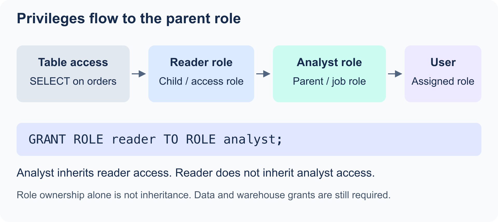
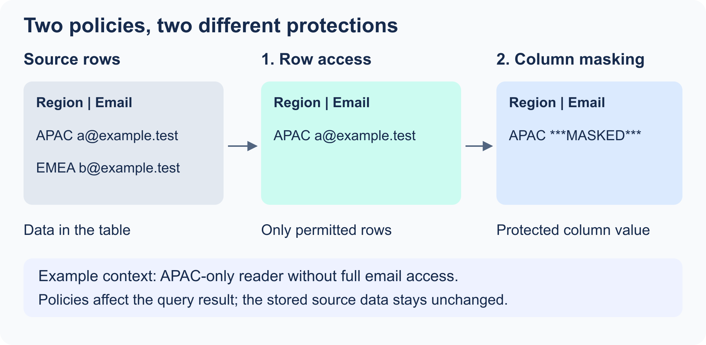

# Domain 2.0: Account Management and Data Governance

The [SnowPro Core C03 study guide](https://learn.snowflake.com/en/certifications/snowpro-core-c03/) assigns **20%** of the exam to Domain 2. Learn the access decisions and governance features here; use the linked labs for detailed SQL practice.

| Objective | Main question |
| --- | --- |
| **2.1 Security model** | Who can sign in, and what can their active roles do? |
| **2.2 Data governance** | How do you protect, classify, audit, and recover data? |
| **2.3 Monitoring and cost** | Which usage view or cost control answers the question? |

## Practice files

- [Ordered SQL labs](exercises/readme.md): begin with [setup](exercises/00-setup.sql) and finish with [stop-lab](exercises/99-stop-lab.sql).
- Practice Q&A: [2.1 security](practice/01-security-model-and-principles-qa.md), [2.2 governance](practice/02-data-governance-features-qa.md), and [2.3 cost](practice/03-monitoring-and-cost-management-qa.md).
- [Data Metric Functions lab](../additional-exercises/04-dmf-data-quality/readme.md) for extra hands-on practice.

The examples below show the idea; the lab scripts provide complete setup. Security and cost settings can affect an account, so use the lab's test objects and cleanup steps.

---

## 2.1 Security Model and Principles

### 2.1.1 Roles, privileges, and ownership

**Authentication** proves who is signing in. **Authorization** decides what the session may do. A successful login does not grant table access.

- **RBAC:** grant privileges to roles, then grant roles to users or other roles. To query `db.schema.table`, the session needs access to the database and schema plus `SELECT` on the table; a warehouse-backed query also needs warehouse `USAGE`.
- **DAC:** an object's owner role controls that object and normally grants access. Each object has one `OWNERSHIP` holder. `REVOKE ALL PRIVILEGES` does not remove ownership; transfer it with `GRANT OWNERSHIP`.
- **Managed access schema:** the schema owner or a role with `MANAGE GRANTS` controls grants on its objects, even if another role owns a table there.
- **Least privilege:** grant only what the job needs. Build custom functional roles and normally connect their hierarchy to `SYSADMIN` so administrators can manage the objects. Keep `ACCOUNTADMIN` for account administration.

<p align="center"></p>

```sql
GRANT SELECT ON TABLE sales_db.mart.orders TO ROLE sales_reader;
GRANT ROLE sales_reader TO ROLE sales_analyst;
GRANT ROLE sales_analyst TO USER analyst_user;
```

Privileges flow **up** this hierarchy: `sales_analyst` inherits `sales_reader`, but `sales_reader` does not inherit `sales_analyst`. Owning a role is not the same as having that role granted to your role.

**Account roles** can hold account-wide privileges and be activated in a session. **Database roles** organize privileges inside one database and cannot be activated or granted directly to a user; grant the database role to an account role first. An account role can receive privileges directly too. Database roles are useful for reusable, database-scoped access bundles and sharing.

```sql
CREATE DATABASE ROLE sales_db.orders_reader;
GRANT SELECT ON TABLE sales_db.mart.orders
  TO DATABASE ROLE sales_db.orders_reader;
GRANT DATABASE ROLE sales_db.orders_reader TO ROLE sales_analyst;
```

System roles to recognize: `USERADMIN` manages users and roles, `SECURITYADMIN` manages grants, `SYSADMIN` manages objects and warehouses, and `ACCOUNTADMIN` has broad account administration authority. Their hierarchy matters, but privileges are still checked.

### 2.1.2 Primary, secondary, and future grants

A session has **one primary account role** and can activate multiple **secondary account roles**. Ordinary queries can use privileges from active primary and secondary roles and their inherited roles. **Object creation** is authorized through the primary role and its inherited roles; the new object belongs to the primary role.

```sql
USE ROLE sales_analyst;
USE SECONDARY ROLES ALL;   -- or NONE
SELECT CURRENT_ROLE(), CURRENT_SECONDARY_ROLES();
```

**Future grants** give privileges to new objects of a type. If schema-level future grants exist for that object type, they take precedence over database-level future grants for new objects in that schema. A future grant does not retroactively grant access to existing tables. The [2.1 lab](exercises/readme.md) lets you test this behavior.

### 2.1.3 Network rules and sign-in methods

Keep three questions separate: **where** can the connection originate (network policy), **how** does the identity prove itself (authentication), and **what** may it access after login (roles and privileges).

- A **network policy** uses network rules to allow or block connection sources. Creating one does not enforce it; assign it at the applicable account, user, or security-integration level. A blocked rule wins over an allowed rule for the same address.
- A **password + MFA** combines a password with another factor. **SSO/SAML** lets the organization's identity provider authenticate people centrally; **OAuth** supplies access tokens to applications. **Key-pair authentication** lets a client prove it holds a private key. An **authentication policy** restricts allowed methods and MFA enrollment.
- Use `LOGIN_HISTORY` to investigate sign-in outcomes. `CURRENT_ACCOUNT()`, `CURRENT_ORGANIZATION_NAME()`, and `CURRENT_USER()` help identify the active account and user; an account identifier is not a username.

### 2.1.4 Telemetry

Snowflake can send **logs**, **traces**, and **metrics** to an **event table** for supported code and services. A missing info-level log message can be caused by the configured logging level. An event table is for observability; `QUERY_HISTORY` and `LOGIN_HISTORY` answer different audit questions.

References: [Access control](https://docs.snowflake.com/en/user-guide/security-access-control-overview), [Managed access](https://docs.snowflake.com/en/user-guide/security-access-control-configure#label-managed-access-schemas), [Authentication](https://docs.snowflake.com/en/user-guide/security-authentication-overview), [Network policies](https://docs.snowflake.com/en/user-guide/network-policies), [Logging and tracing](https://docs.snowflake.com/en/developer-guide/logging-tracing/logging-tracing-overview).

---

## 2.2 Data Governance Features

### 2.2.1 Choose the control

| Need | Feature |
| --- | --- |
| Hide or change a column's value at query time | **Masking policy** |
| Restrict which rows a user sees | **Row access policy** |
| Label objects/columns for classification or policy automation | **Tag** |
| Limit privacy loss from repeated aggregate queries | **Privacy policy** |
| Require sufficiently large groups | **Aggregation policy** |
| Keep a column out of the final output | **Projection policy** |
| Find account security risks | **Trust Center** |
| Check data quality over time | **Data Metric Function (DMF)** |

Policies shape results **after** a role has been granted access; they do not grant `SELECT`. Masking changes the returned value, while a row access policy filters rows. A tag is metadata unless another feature, such as tag-based masking, uses it.

<p align="center"></p>

```sql
CREATE MASKING POLICY email_mask AS (val STRING) RETURNS STRING ->
  CASE WHEN IS_ROLE_IN_SESSION('PII_VIEWER') THEN val
       ELSE '***MASKED***' END;

CREATE ROW ACCESS POLICY region_filter AS (region STRING)
  RETURNS BOOLEAN ->
  IS_ROLE_IN_SESSION('GLOBAL_MANAGER')
  OR (IS_ROLE_IN_SESSION('APAC_ANALYST') AND region = 'APAC');
```

Attach a masking policy to the sensitive column and a row access policy to the table. `CURRENT_ROLE()` checks the **primary** role; `IS_ROLE_IN_SESSION()` can recognize an active role in the session hierarchy. A tag-based masking policy can protect matching columns automatically, but a plain tag alone does not hide values.

**Privacy policy** means differential privacy: supported analytical queries consume a **privacy budget** and can receive controlled noise. The privacy budget measures information exposure, not Snowflake credits. For an aggregation policy, an entity key such as `customer_id` makes the minimum group size count **distinct customers**, not rows. A projection policy can stop a column appearing in the result even when it may be used in a filter. These are separate controls; the supplied C03 guide explicitly names privacy policies.

### 2.2.2 Security, encryption, and recovery

- **Trust Center** reports security findings. `SNOWFLAKE.TRUST_CENTER_VIEWER` can view findings; `SNOWFLAKE.TRUST_CENTER_ADMIN` can manage scanner configuration. These are application roles. A persistent misconfiguration is a **violation**; a one-time suspicious event is a **detection**.
- Snowflake encrypts data at rest and in transit. **Tri-Secret Secure** combines Snowflake-managed and customer-managed key material and is available with **Business Critical** or higher. Key rotation creates new active keys while retaining old keys needed to decrypt existing data; periodic rekeying can re-encrypt older data.
- **Replication** creates and refreshes a secondary copy in another account/region for read-only access. **Failover** also includes promotion of a secondary failover group so it can become primary during an authorized disaster-recovery event. Replication and promotion are different steps.
- **Data lineage** shows upstream and downstream relationships, useful before changing a table or column. Use dependency views or supported programmatic lineage tools to check potential impact.

### 2.2.3 Alerts, notifications, and data quality

An **alert** evaluates a condition and runs an action when that condition is true. A **notification integration** defines how a message is sent, such as email, webhook, or a cloud queue. The alert decides **when to act**; the integration supplies a **delivery channel**. Use scheduled checks for predictable times and triggered alerts when a change should prompt a check.

A **DMF** measures data quality, such as null count, duplicate count, or freshness. Assign it to a table or view with a schedule and inspect results; it does not automatically repair bad data. Practice in the [DMF lab](../additional-exercises/04-dmf-data-quality/readme.md).

References: [Masking](https://docs.snowflake.com/en/user-guide/security-column-ddm-intro), [Row access](https://docs.snowflake.com/en/user-guide/security-row-intro), [Tags](https://docs.snowflake.com/en/user-guide/object-tagging/introduction), [Differential privacy](https://docs.snowflake.com/en/user-guide/diff-privacy/differential-privacy-overview), [Trust Center](https://docs.snowflake.com/en/user-guide/trust-center/overview), [Alerts](https://docs.snowflake.com/en/user-guide/alerts).

---

## 2.3 Monitoring and Cost Management

### 2.3.1 Resource monitors and budgets

A **resource monitor** tracks assigned virtual-warehouse credit usage against a quota. At thresholds it can `NOTIFY`, `SUSPEND` after running work finishes, or `SUSPEND_IMMEDIATE` and cancel running work. **Assign it to a warehouse or the account**; creating it alone does not control a warehouse. A quota is not a perfect hard spending cap because monitoring and suspension can lag.

```sql
CREATE RESOURCE MONITOR etl_limit WITH CREDIT_QUOTA = 100
  TRIGGERS
    ON 80 PERCENT DO NOTIFY
    ON 100 PERCENT DO SUSPEND;
ALTER WAREHOUSE etl_wh SET RESOURCE_MONITOR = etl_limit;
```

Resource monitors cover warehouse usage, including associated cloud-services usage before billing adjustments; they do **not** suspend Snowpipe, compute pools, or other serverless services. Multiple warehouses assigned to one monitor share its quota. A **budget** can track expected spend across supported services and notify about projected overspend, but it does not suspend a warehouse like a resource monitor.

### 2.3.2 Warehouse credits and usage views

Warehouse compute credits depend on **size × running time**. A resumed warehouse is billed for at least **60 seconds**, then for additional time while it runs. `AUTO_SUSPEND` reduces idle time; `AUTO_RESUME` starts it for a new query if enabled. Suspending a warehouse clears its local data cache, but does not delete table data.

| Question | Useful source |
| --- | --- |
| Which warehouse used credits by hour? | `SNOWFLAKE.ACCOUNT_USAGE.WAREHOUSE_METERING_HISTORY` |
| What was billed daily across services? | `SNOWFLAKE.ACCOUNT_USAGE.METERING_DAILY_HISTORY` |
| Which SQL was slow or failed? | `SNOWFLAKE.ACCOUNT_USAGE.QUERY_HISTORY` |
| Who signed in or failed login? | `SNOWFLAKE.ACCOUNT_USAGE.LOGIN_HISTORY` |
| Which data was accessed? | `SNOWFLAKE.ACCOUNT_USAGE.ACCESS_HISTORY` (where available) |
| What did a compute pool cost? | Container services usage views, separately from warehouse metering |

```sql
SELECT warehouse_name, SUM(credits_used_compute) AS compute_credits
FROM snowflake.account_usage.warehouse_metering_history
WHERE start_time >= DATEADD(day, -7, CURRENT_TIMESTAMP())
GROUP BY warehouse_name
ORDER BY compute_credits DESC;
```

`ACCOUNT_USAGE` is historical and can have latency. Information Schema functions can be fresher but usually cover shorter windows. Having run a query does not itself grant `SELECT` on `SNOWFLAKE.ACCOUNT_USAGE.QUERY_HISTORY`: an administrator can grant the specific Snowflake database role, such as `SNOWFLAKE.GOVERNANCE_VIEWER`, to an account role. `SNOWFLAKE.USAGE_VIEWER` is used for warehouse metering and `SNOWFLAKE.SECURITY_VIEWER` for login history.

Cloud-services usage is billed only above **10% of that day's warehouse compute credits** (UTC day). Resource monitors count the cloud-services usage **before** this daily billing adjustment. Use `METERING_DAILY_HISTORY` to see the billed adjustment.

References: [Resource monitors](https://docs.snowflake.com/en/user-guide/resource-monitors), [Account Usage](https://docs.snowflake.com/en/sql-reference/account-usage), [Warehouse metering](https://docs.snowflake.com/en/sql-reference/account-usage/warehouse_metering_history).

---

## What to Recall

Answer each question, then open its answer. For longer scenarios, use the [practice files](#practice-files).

### 2.1 Security

<details>
<summary><strong>1. Q:</strong> What privileges are usually needed to SELECT from db.schema.table?</summary>

<br>

**A:** Access to the database and schema, SELECT on the table, and warehouse USAGE for warehouse-backed execution.

</details>

<hr>

<details>
<summary><strong>2. Q:</strong> How do RBAC and DAC differ?</summary>

<br>

**A:** RBAC gives access through roles; DAC gives the object owner grant authority, except that managed access centralizes grant decisions.

</details>

<hr>

<details>
<summary><strong>3. Q:</strong> Does REVOKE ALL PRIVILEGES remove an owner role’s ability to drop its object?</summary>

<br>

**A:** No. Transfer OWNERSHIP to another role.

</details>

<hr>

<details>
<summary><strong>4. Q:</strong> Which way do privileges flow when reader is granted to analyst?</summary>

<br>

**A:** Analyst inherits reader privileges; reader does not inherit analyst privileges.

</details>

<hr>

<details>
<summary><strong>5. Q:</strong> Can a database role be activated directly or granted directly to a user?</summary>

<br>

**A:** No. Grant it to an account role, then activate or grant that account role.

</details>

<hr>

<details>
<summary><strong>6. Q:</strong> Can an active secondary role authorize CREATE TABLE?</summary>

<br>

**A:** No. Creation uses the primary role and roles it inherits; the primary role owns the new table.

</details>

<hr>

<details>
<summary><strong>7. Q:</strong> Does creating a network policy activate it?</summary>

<br>

**A:** No. Assign it at the applicable level. A blocked rule wins for the same address.

</details>

<hr>

<details>
<summary><strong>8. Q:</strong> How do SSO, OAuth, and a network policy differ?</summary>

<br>

**A:** SSO authenticates a person through an identity provider; OAuth uses access tokens for applications; a network policy restricts connection origins.

</details>

<hr>

<details>
<summary><strong>9. Q:</strong> Where would you inspect failed logins and code log messages?</summary>

<br>

**A:** LOGIN_HISTORY for sign-ins; an event table for supported logs, traces, and metrics.

</details>

<hr>

### 2.2 Governance

<details>
<summary><strong>10. Q:</strong> Masking policy versus row access policy?</summary>

<br>

**A:** Masking changes returned column values; row access filters which rows are visible. Neither grants SELECT.

</details>

<hr>

<details>
<summary><strong>11. Q:</strong> Does a tag alone mask data?</summary>

<br>

**A:** No. A policy or another feature must use the tag.

</details>

<hr>

<details>
<summary><strong>12. Q:</strong> What is a privacy budget?</summary>

<br>

**A:** A limit on cumulative privacy loss from supported analytical queries, not a credit budget.

</details>

<hr>

<details>
<summary><strong>13. Q:</strong> With an aggregation policy entity key, what does minimum group size count?</summary>

<br>

**A:** Distinct entities identified by that key, not the number of source rows.

</details>

<hr>

<details>
<summary><strong>14. Q:</strong> What does a projection policy restrict?</summary>

<br>

**A:** Whether a protected column can appear in the final query output.

</details>

<hr>

<details>
<summary><strong>15. Q:</strong> Which Trust Center roles view findings and manage scanners?</summary>

<br>

**A:** SNOWFLAKE.TRUST_CENTER_VIEWER views findings; SNOWFLAKE.TRUST_CENTER_ADMIN manages scanners and supported schedules.

</details>

<hr>

<details>
<summary><strong>16. Q:</strong> What is Tri-Secret Secure?</summary>

<br>

**A:** Customer-managed key material combined with Snowflake-managed key material; Business Critical or higher.

</details>

<hr>

<details>
<summary><strong>17. Q:</strong> How do replication and failover differ?</summary>

<br>

**A:** Replication refreshes a secondary copy; failover adds the authorized promotion step to make the secondary primary.

</details>

<hr>

<details>
<summary><strong>18. Q:</strong> Alert versus notification integration?</summary>

<br>

**A:** An alert decides when to act; the integration provides a message delivery channel.

</details>

<hr>

<details>
<summary><strong>19. Q:</strong> What does a DMF do?</summary>

<br>

**A:** It measures data quality, such as nulls or freshness; it does not repair rows automatically.

</details>

<hr>

### 2.3 Monitoring and cost

<details>
<summary><strong>20. Q:</strong> What does a resource monitor control?</summary>

<br>

**A:** Assigned virtual warehouses. It does not suspend Snowpipe or compute pools.

</details>

<hr>

<details>
<summary><strong>21. Q:</strong> SUSPEND versus SUSPEND_IMMEDIATE?</summary>

<br>

**A:** SUSPEND lets current work finish; SUSPEND_IMMEDIATE cancels running work.

</details>

<hr>

<details>
<summary><strong>22. Q:</strong> What are the warehouse billing minimum and main cost factors?</summary>

<br>

**A:** At least 60 seconds per resume, then size multiplied by running time.

</details>

<hr>

<details>
<summary><strong>23. Q:</strong> Which views answer warehouse credits, billed daily credits, SQL history, and logins?</summary>

<br>

**A:** WAREHOUSE_METERING_HISTORY, METERING_DAILY_HISTORY, QUERY_HISTORY, and LOGIN_HISTORY, respectively.

</details>

<hr>

<details>
<summary><strong>24. Q:</strong> Does running a query grant access to ACCOUNT_USAGE.QUERY_HISTORY?</summary>

<br>

**A:** No. An administrator must grant appropriate access, such as SNOWFLAKE.GOVERNANCE_VIEWER through an account role.

</details>

<hr>
