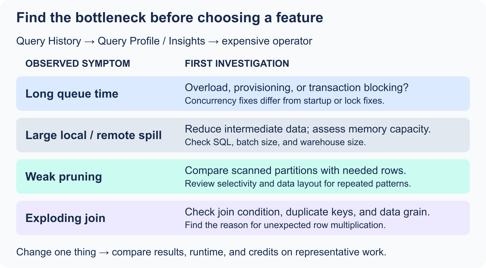
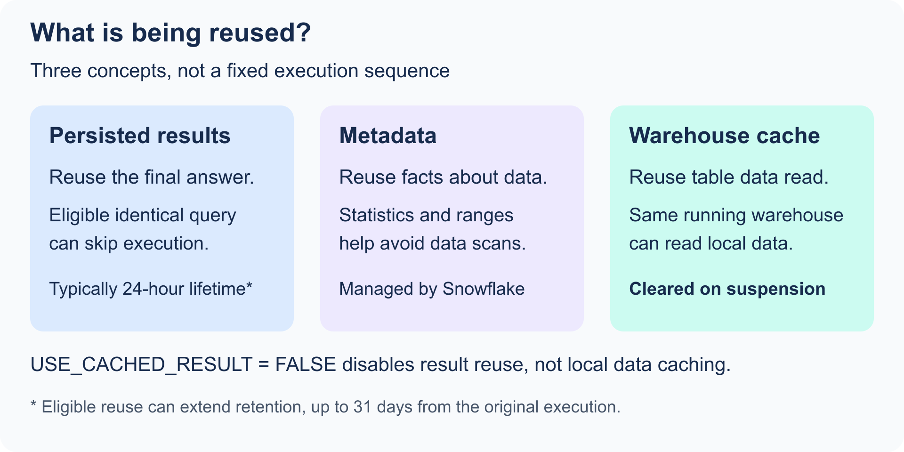
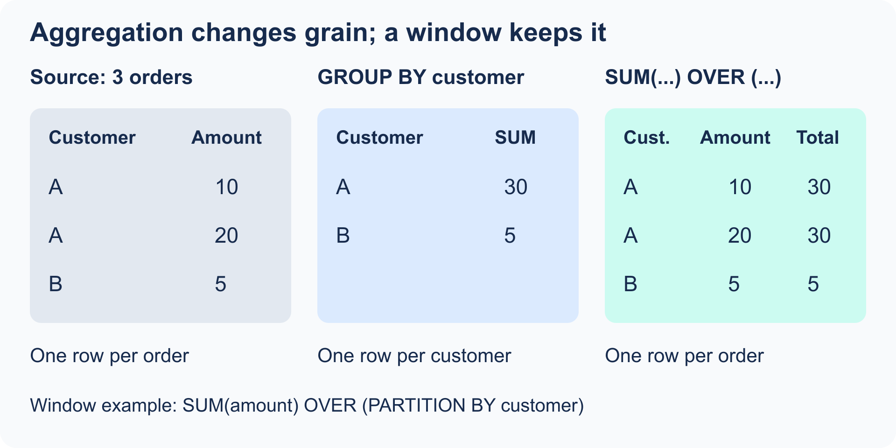

# Domain 4.0: Performance Optimization, Querying, and Transformation

This note follows the SnowPro Core Certification Study Guide (C03) objectives:

1. Evaluate query performance.
2. Optimize query performance.
3. Use Snowflake caching.
4. Transform structured, semi-structured, and unstructured data.

Scope: all named objectives in the supplied **C03 guide**, with extra course material identified separately. SQL is illustrative and checked against documentation; it has not been executed in your account. Use an appropriate database/schema context, existing source objects, an authorized role, and a running warehouse for examples that execute queries. Folder numbers 7/8/9 identify course chapters, not C03 exam domains.

> **Exam mindset:** diagnose first, then choose the narrowest fix. Do not jump straight to a larger warehouse. The query profile tells you whether the real problem is pruning, joins, spilling, queuing, or a repeated workload that deserves a storage optimization.

## Material already covered in your other course notes

This Domain 4 note brings the exam-relevant parts together. The linked notes remain the deeper reference for each topic.

| Domain 4 topic | Existing note to review | What is reused here |
| --- | --- | --- |
| Micro-partitions, pruning, and clustering | [Domain 1 storage concepts](../1-Snowflake-AI-Data-Cloud-Features-and-Architecture/05-storage-tables-and-views.md) | Pruning fundamentals; key-selection decisions remain in Domain 4. |
| Virtual warehouses and local cache | [Domain 1 warehouses](../1-Snowflake-AI-Data-Cloud-Features-and-Architecture/04-virtual-warehouses.md) | Warehouse configuration and local caching. |
| Semi-structured data | [Loading course note](../../study-notes/7-Data-Loading-and-Unloading/readme.md) | `VARIANT`, paths, casting, and `FLATTEN`. |
| Unstructured file functions | [Data Transformation note](../../study-notes/8-Data-transformation/readme.md) | Scoped, stage, and pre-signed URLs; directory tables. |
| Aggregates, windows, sampling, and approximate functions | [Data Transformation note](../../study-notes/8-Data-transformation/readme.md) | Core transformations plus course extensions. |

---

## 4.1 Evaluate Query Performance

### A practical diagnostic order

1. Find a representative slow query in **Snowsight Query History**.
2. Open its **Query Profile** and inspect the most expensive nodes and Query Insights.
3. Identify the main bottleneck: poor pruning, a bad join, data spilling, or queueing.
4. Check whether the problem is one query, a repeated query pattern, or warehouse concurrency.
5. Apply the smallest suitable fix, then compare the same workload again.

Record the query ID, row count, warehouse size, elapsed time, bytes scanned, spill, and queue time. Separate compilation, provisioning/startup wait, execution, and client/network time. A slower end-to-end result does not always mean slower SQL execution. Use representative data and repeated measurements; preserve result correctness while optimizing.

### Query Profile and Query Insights

<p align="center"></p>

The Query Profile shows how Snowflake executed a query. It helps you find expensive scan, join, aggregate, sort, and data-transfer operations. Query Insights flags recognized performance problems and suggests a next step.

| Signal | What it means | First response |
| --- | --- | --- |
| **Bytes spilled to local storage** | Intermediate query data did not fit in memory and spilled to local disk. | Simplify or batch the work; consider a larger warehouse. |
| **Bytes spilled to remote storage** | The data exceeded local disk too, so Snowflake used remote storage. This is especially slow. | Reduce intermediate rows, process in batches, or use a larger warehouse. |
| **Inefficient pruning** | A scan reads too many micro-partitions relative to the data returned. | Add a selective filter; assess clustering only for a large, repeated workload. |
| **Exploding join** | A join produces far more rows than its inputs, often because of a missing or many-to-many join condition. | Check join keys, grain, duplicates, and filters before the join. |
| **Queued overload** | The warehouse lacks enough concurrency capacity at that time. | Isolate workloads, use a larger warehouse, or scale out with multi-cluster capacity. |

### Reading the most common problems

#### Bytes spilled to storage

Spilling is usually a symptom of a large intermediate result from operations such as a big sort, aggregation, `COUNT(DISTINCT ...)`, or join.

- Local spill is slower than in-memory processing.
- Remote spill is slower than local spill.
- More warehouse memory can help, but first ask whether the SQL is producing unnecessary rows or columns.

**Exam clue:** When a profile shows spill, choose a solution about memory/capacity or reducing intermediate data - not a result-cache solution.

With QAS enabled, a small nonzero remote-spill value can be service-related even if the query is not accelerated. Inspect the expensive operator and magnitude before concluding that memory is exhausted. See [spilling diagnostics](https://docs.snowflake.com/en/user-guide/performance-query-warehouse-memory).

#### Inefficient pruning

Snowflake uses micro-partition metadata to skip partitions that cannot satisfy a filter. In the profile, compare **partitions scanned** with **partitions total**.

- A small scanned-to-total ratio usually means pruning worked well.
- A large ratio means the filter did not eliminate much data or the relevant values are scattered across partitions.

Start with a selective filter expressed so Snowflake can use the stored column values directly. Only add a cluster key when the table is very large and the filter/join/aggregation pattern is frequent enough to justify maintenance cost. A full scan can be appropriate when the query genuinely needs most of the table; a high scanned ratio alone is not proof of bad SQL.

#### Exploding joins

An exploding join produces a row count much larger than expected. Common causes:

- A missing join condition, creating a Cartesian product.
- A many-to-many relationship when you expected one-to-many.
- Duplicate dimension keys.
- A filter applied after, rather than before, a large join.

```sql
-- Risky: missing a join condition creates a Cartesian product.
SELECT *
FROM orders o
JOIN customers c;

-- Better: join on the intended key and project only needed columns.
SELECT
  o.order_id,
  o.order_date,
  c.customer_name
FROM orders o
JOIN customers c
  ON o.customer_id = c.customer_id;
```

#### Queuing

Queue time is not the same as query execution time. A query can be well written but still wait because too many queries compete for the warehouse.

Group similar workloads where possible:

| Workload | Why separate it? |
| --- | --- |
| Interactive BI | Needs predictable, low latency and benefits from a warm warehouse cache. |
| ETL / ELT | Often uses large scans and long transformations that can delay BI queries. |
| Ad hoc exploration | Can be unpredictable and should not disrupt scheduled production work. |

Use dedicated warehouses where the performance requirement or workload behavior is meaningfully different. Use multi-cluster warehouses for concurrency, not to make a single poorly written query faster.

Distinguish `QUEUED_OVERLOAD_TIME` (capacity/concurrency wait) from `QUEUED_PROVISIONING_TIME` (warehouse provisioning or resume) and `TRANSACTION_BLOCKED_TIME` (transaction blocking). More clusters may address overloaded concurrency; transaction contention requires investigation of the conflicting work. **Scale up** increases resources per cluster. **Scale out** adds clusters, primarily to run more queries concurrently. Multi-cluster warehouses require Enterprise or higher.

### `ACCOUNT_USAGE` for query analysis and attribution

The shared `SNOWFLAKE` database provides historical views for monitoring.

| View | Use it for | Important limitation |
| --- | --- | --- |
| `QUERY_HISTORY` | Analyze execution time, scans, spill, queue time, user, and warehouse. | Historical data; it can lag by up to about 45 minutes. |
| `QUERY_ATTRIBUTION_HISTORY` | Attribute warehouse compute credits to individual query runs. | Does not represent idle cost as a separate query cost. |
| `WAREHOUSE_LOAD_HISTORY` | Review warehouse load and queued workload. | Historical, not a live alerting control. |

`QUERY_HISTORY` retains up to 365 days. Information Schema query-history functions cover a shorter recent range (up to seven days) and are useful for fresher investigation. Access depends on the user's own queries and granted monitoring privileges. The most expensive operator is a better starting point than SQL text length.

`QUERY_ATTRIBUTION_HISTORY` can lag up to eight hours and excludes idle compute from its per-query attribution. QAS credits are in a separate column; sum them with attributed compute to include acceleration. Cloud services, storage, and transfer are outside this combined query-compute figure. See [query attribution](https://docs.snowflake.com/en/sql-reference/account-usage/query_attribution_history).

```sql
-- Find recent queries with the most remote spill or overload queue time.
SELECT
  query_id,
  warehouse_name,
  user_name,
  total_elapsed_time / 1000 AS elapsed_seconds,
  bytes_scanned,
  bytes_spilled_to_local_storage,
  bytes_spilled_to_remote_storage,
  queued_overload_time / 1000 AS overload_queue_seconds,
  partitions_scanned,
  partitions_total,
  query_text
FROM snowflake.account_usage.query_history
WHERE start_time >= DATEADD(day, -7, CURRENT_TIMESTAMP())
  AND (bytes_spilled_to_local_storage > 0
       OR bytes_spilled_to_remote_storage > 0
       OR queued_overload_time > 0)
ORDER BY bytes_spilled_to_remote_storage DESC, queued_overload_time DESC
LIMIT 20;
```

```sql
-- Attribute compute credits to users' queries. This is useful for showback,
-- but it is not the full warehouse invoice because idle cost also exists.
SELECT
  user_name,
  SUM(credits_attributed_compute) AS query_compute_credits
FROM snowflake.account_usage.query_attribution_history
WHERE start_time >= DATEADD(day, -30, CURRENT_TIMESTAMP())
GROUP BY user_name
ORDER BY query_compute_credits DESC;
```

Add `QUERY_TAG` to application sessions to identify workload ownership, and use `QUERY_PARAMETERIZED_HASH` to group repeated query patterns with different literals. Repeated moderately slow queries can cost more in total than one rare long-running query.

```sql
ALTER SESSION SET QUERY_TAG = 'finance_dashboard';
-- Run the workload here, then restore the prior tag or clear it.
ALTER SESSION UNSET QUERY_TAG;
```

---

## 4.2 Optimize Query Performance

### Choose the right optimization

| Need | Best first choice | Why the alternatives may be wrong |
| --- | --- | --- |
| Large scans with highly selective filters or aggregations; variable/ad hoc workload | Query Acceleration Service (QAS) | QAS does not fix an incorrect join or warehouse queueing. |
| Fast point lookups returning a few rows, including targeted `VARIANT` searches | Search Optimization Service | A cluster key is broader and is usually less targeted for “needle in a haystack” lookups. |
| Frequent range filters, joins, or aggregations on the same columns in a very large table | Clustering key | It adds maintenance cost and is not for every table. |
| Repeated, expensive single-table aggregation or semi-structured flattening pattern | Materialized view | It has storage and maintenance cost; it cannot be based on more than one table. |
| A query returns a huge unnecessary result | Rewrite the SQL | Storage optimizations cannot fix `SELECT *`, a missing filter, or a bad join. |

### Query Acceleration Service (QAS)

QAS can offload eligible parts of a query to serverless compute. It is a good fit for workloads with large scans and highly selective filters or eligible aggregations, especially when query shapes and scanned volume vary.

```sql
ALTER WAREHOUSE analytics_wh
  SET ENABLE_QUERY_ACCELERATION = TRUE;
```

Key points:

- QAS is enabled at the warehouse level, but additional serverless compute is used only for eligible work.
- It consumes credits separately from the warehouse. The scale factor limits the extra consumption rate.
- Use `QUERY_ACCELERATION_ELIGIBLE` and `SYSTEM$ESTIMATE_QUERY_ACCELERATION` before enabling it broadly.
- QAS and search optimization can help the same query: search optimization reduces the partitions to read, then QAS can accelerate eligible remaining work.

QAS requires Enterprise or higher. Set a finite `QUERY_ACCELERATION_MAX_SCALE_FACTOR` when testing; `0` means unlimited scale factor rather than disabled acceleration. Eligibility and available service capacity determine benefit, so enabling QAS does not guarantee a speedup.

```sql
ALTER WAREHOUSE analytics_wh SET
  ENABLE_QUERY_ACCELERATION = TRUE
  QUERY_ACCELERATION_MAX_SCALE_FACTOR = 2;
-- Replace with a real eligible query ID from your account.
SELECT PARSE_JSON(SYSTEM$ESTIMATE_QUERY_ACCELERATION('query-id'));
```

### Search Optimization Service

Search optimization builds a persistent search access path to make highly selective searches faster. It is an Enterprise Edition feature.

Good fits:

- Equality or `IN` lookups that return a small number of rows.
- Substring or regular-expression searches.
- Targeted searches of values inside `VARIANT`, `ARRAY`, or `OBJECT` data.
- Geospatial searches on `GEOGRAPHY`.

```sql
-- Optimize equality and IN predicates on a frequently searched identifier.
ALTER TABLE analytics.mart.events
  ADD SEARCH OPTIMIZATION ON EQUALITY(user_id);

-- A targeted semi-structured path can also be optimized.
ALTER TABLE analytics.raw.events
  ADD SEARCH OPTIMIZATION ON EQUALITY(src:user.uuid);
```

Snowflake decides automatically whether to use the search access path for a query. Adding it is not a guarantee that every query becomes faster, so measure a representative workload and review ongoing cost.

Search optimization incurs both storage and serverless maintenance cost. Its initial build takes time: check `SEARCH_OPTIMIZATION_PROGRESS` in `SHOW TABLES` before benchmarking. Targeting selected columns/methods avoids unnecessary maintenance. Its effectiveness depends on supported predicates and selectivity, not simply on table size.

### Clustering keys

Snowflake automatically creates micro-partitions. A **clustering key** tells Snowflake which expressions should remain naturally co-located as data changes; Automatic Clustering maintains the key in the background.

```sql
-- Appropriate only after confirming a repeated access pattern on a large table.
ALTER TABLE analytics.mart.orders
  CLUSTER BY (order_date, customer_id);
```

Use a clustering key when:

- The table is very large, typically multi-terabyte.
- Queries repeatedly filter, join, or aggregate on the same columns.
- Query Profile shows weak pruning because values are broadly overlapping across micro-partitions.

Do not add one just because a table is large. It adds compute and storage cost from reclustering and can increase Fail-safe storage. A highly unique lookup key is more often a Search Optimization Service candidate than a clustering-key candidate.

Prefer a small set of expressions aligned with common predicates. For a high-cardinality timestamp, a date expression can preserve useful ordering without clustering by every unique instant. With multiple expressions, key order affects organization; lower-to-higher cardinality is a useful starting point, then measure the workload.

```sql
SELECT SYSTEM$CLUSTERING_INFORMATION('ANALYTICS.MART.ORDERS');
```

Clustering depth/overlap describe data organization. Lower overlap can improve pruning, but there is no universal “good depth” independent of the table and workload. Automatic Clustering maintains an explicitly defined key with serverless compute; natural clustering exists even when no key is specified.

### Materialized views

A materialized view stores a precomputed result from a `SELECT` statement on a **single base table**. Snowflake maintains it automatically as the base table changes.

```sql
CREATE OR REPLACE MATERIALIZED VIEW analytics.mart.daily_sales_mv
  AS
  SELECT
    order_date,
    region,
    SUM(amount) AS daily_sales
  FROM analytics.mart.orders
  GROUP BY order_date, region;
```

Use a materialized view for a repeated, expensive pattern that returns a small subset of the source table, such as an aggregation, a range query, or frequently flattened semi-structured data.

- It has storage and automatic-maintenance compute cost.
- You cannot insert, update, merge, or delete directly in a materialized view.
- It is not a replacement for a general-purpose transformation model or a multi-table join result.

Materialized views require Enterprise or higher. The optimizer can rewrite eligible base-table queries to use one; users do not always need to name the view explicitly. Definitions have restrictions beyond the single-table rule, including unsupported window functions and non-deterministic expressions. Check the definition before choosing one for a transformation. A normal view stores SQL, a materialized view stores maintained results, and a result-cache entry is a temporary result of a particular query.

### SQL changes before feature changes

Before adding an optimization service, make the query do less work:

- Select only required columns; avoid `SELECT *` on large tables.
- Filter early and use selective predicates.
- Join on the correct keys and check table grain before joining.
- Use `UNION ALL` when duplicate elimination from `UNION` is not required.
- Remove unnecessary `DISTINCT` and `GROUP BY` operations.
- Aggregate before a join only when it preserves the required business grain.

Prefer explicit range boundaries when they express the intended filter clearly:

```sql
SELECT order_id, amount
FROM analytics.mart.orders
WHERE order_timestamp >= '2026-01-01'::TIMESTAMP_NTZ
  AND order_timestamp <  '2026-02-01'::TIMESTAMP_NTZ;
```

Applying a function to every stored value can make some optimizations less effective; it is not a universal rule that every expression prevents pruning. Confirm the actual profile. SQL clause order also does not dictate physical execution order: Snowflake's optimizer can reorder operations. Use explicit join conditions and filter semantics rather than assuming a CTE forces materialization.

---

## 4.3 Snowflake Caching

Snowflake uses several caching layers. The exam usually tests **what is reused**, **where it is kept**, and **what invalidates it**.

<p align="center"></p>

| Cache | What is reused | Main behavior | Common invalidation / limitation |
| --- | --- | --- | --- |
| **Persisted query result cache** | The final result of an identical query. | Can bypass query execution entirely. Results normally expire after 24 hours; successful reuse can extend retention up to 31 days from the first execution. | Query text must match exactly; data, relevant settings, and required privileges must still allow reuse. Non-reusable functions also prevent reuse. |
| **Warehouse cache** | Frequently read table data on the local storage of a running warehouse. | Later queries on the same warehouse can read cached data faster. | The cache is lost when the warehouse suspends; separate warehouses do not share it. |
| **Metadata cache** | Table/micro-partition statistics and object metadata managed by cloud services. | Supports pruning and some metadata-only operations without scanning table data. | Not a cache of the full rows or final result; only eligible operations can be answered from metadata. |

### Persisted query results

Result reuse is enabled by default. Snowflake can return a prior result when the identical query runs again and the underlying data has not changed.

```sql
-- For a fair performance benchmark, force queries to execute rather than reuse a result.
ALTER SESSION SET USE_CACHED_RESULT = FALSE;

-- Restore the normal behavior after the benchmark.
ALTER SESSION SET USE_CACHED_RESULT = TRUE;
```

**Exam traps:**

- Same logical query is not enough: even changing letter case or adding an alias can prevent exact result reuse.
- A cached result is not a security bypass; the role still needs the required access.
- Query-result caching is different from the warehouse data cache.

- Result reuse can work across sessions and warehouses when all reuse and authorization conditions hold; suspending a warehouse does not clear persisted query results.
- Meeting the documented reuse conditions does not guarantee a cache hit. Non-deterministic functions such as `RANDOM()` and changes to underlying micro-partitions can prevent reuse.
- `USE_CACHED_RESULT = FALSE` affects result reuse, not the warehouse's local data cache. Compare cold and warm runs separately when benchmarking.

### Warehouse cache

A running virtual warehouse keeps recently accessed table data in a local cache. Repeating similar queries on the **same running warehouse** can be faster because fewer remote reads are needed.

- A longer auto-suspend setting keeps the cache warm but can cost more during idle time.
- Suspending a warehouse clears its cache.
- Mixing unrelated large workloads can evict useful data from the cache.
- Dedicated BI warehouses can help preserve a warm cache for dashboards.

### Metadata cache

Snowflake maintains metadata such as row counts and micro-partition value ranges. It can use this information to avoid unnecessary data reads. For example, some simple `COUNT(*)` queries can be answered using metadata rather than scanning the table. Filters and security policies can change whether this is possible; do not assume every `COUNT`, `MIN`, or `MAX` is metadata-only.

Metadata is managed outside the warehouse-local data cache. Warehouse suspension therefore does not have the same meaning for metadata and local cached table data. Query compilation/plan reuse is a related internal optimization, but **metadata cache** in the C03 checklist should not be replaced with “compilation cache.”

---

## 4.4 Perform Data Transformation Techniques

### Structured, semi-structured, and unstructured data

| Data type | Examples | Where / how to work with it |
| --- | --- | --- |
| **Structured** | Relational rows and columns, CSV loaded to typed columns. | Standard SQL tables, joins, filters, aggregates, and window functions. |
| **Semi-structured** | JSON, Avro, ORC, Parquet, XML. | Typically stored in `VARIANT`, `OBJECT`, or `ARRAY`; use path syntax, casting, and `FLATTEN`. |
| **Unstructured** | Documents, images, audio, video. | Store files on an internal or external stage; use file URLs, directory tables, and supported processing features. |

### Structured data: aggregates and windows

<p align="center"></p>

An aggregate reduces a group of rows to one result. A window function calculates across related rows but keeps the original row-level output.

```sql
-- Aggregate: one row per customer.
SELECT customer_id, SUM(amount) AS customer_total
FROM analytics.mart.orders
GROUP BY customer_id;

-- Window: one row per order, plus the customer's total.
SELECT
  order_id,
  customer_id,
  amount,
  SUM(amount) OVER (PARTITION BY customer_id) AS customer_total
FROM analytics.mart.orders;
```

Use `PARTITION BY` to define related rows, `ORDER BY` inside `OVER (...)` for ordered calculations such as ranks and running totals, and an explicit window frame when the intended range must be clear.

```sql
-- Running total within each customer, ordered by date.
SELECT
  customer_id,
  order_date,
  amount,
  SUM(amount) OVER (
    PARTITION BY customer_id
    ORDER BY order_date, order_id
    ROWS BETWEEN UNBOUNDED PRECEDING AND CURRENT ROW
  ) AS running_total
FROM analytics.mart.orders;
```

### Aggregate behavior and filtering

Common aggregates are `COUNT`, `SUM`, `AVG`, `MIN`, and `MAX`. `COUNT(*)` counts rows, while `COUNT(column)` excludes SQL `NULL` values. `COUNT(DISTINCT column)` counts distinct non-NULL values. Most numeric aggregates ignore NULL inputs; replacing NULL with zero changes the business meaning and sometimes the denominator.

```sql
-- WHERE filters orders before aggregation; HAVING filters customer groups.
SELECT
  customer_id,
  COUNT(*) AS order_count,
  COUNT(amount) AS orders_with_amount,
  SUM(amount) AS total_amount
FROM analytics.mart.orders
WHERE order_date >= '2026-01-01'::DATE
GROUP BY customer_id
HAVING SUM(amount) > 1000;
```

The logical filtering order is **WHERE → GROUP BY / HAVING → window functions → QUALIFY**. `QUALIFY` is particularly useful for selecting rows after calculating a window function.

### Ranking, deduplication, and window frames

| Function / clause | Behavior | Typical use |
| --- | --- | --- |
| `ROW_NUMBER()` | Assigns a distinct sequence within each partition. | Keep one latest record per business key. |
| `RANK()` | Ties share a rank and leave gaps afterward. | Competition ranking, such as `1, 1, 3`. |
| `DENSE_RANK()` | Ties share a rank with no gaps afterward. | Ranking such as `1, 1, 2`. |
| `LAG` / `LEAD` | Reads an earlier/later row according to window ordering. | Compare a record with its previous/next value. |
| `QUALIFY` | Filters after window calculations. | Keep the top-ranked or latest rows. |

```sql
-- Latest order per customer. order_id breaks ties in order_date.
SELECT order_id, customer_id, order_date, amount
FROM analytics.mart.orders
QUALIFY ROW_NUMBER() OVER (
  PARTITION BY customer_id
  ORDER BY order_date DESC, order_id DESC
) = 1;
```

`ROWS` describes physical row offsets. `RANGE` describes an ordering-value range and can include peers with equal ordering values. For example, a running total using `RANGE ... CURRENT ROW` includes all peers at that value, while `ROWS ... CURRENT ROW` advances one row at a time. Use explicit frames and deterministic tie-breakers when needed. The `ORDER BY` inside `OVER` controls the calculation, not final display order; add an outer `ORDER BY` for that.

### Semi-structured data: parsing, paths, and flattening

From your loading course note: JSON keys are case-sensitive, while unquoted Snowflake column names are case-insensitive. Extract a path from `VARIANT`, then cast it to the type you need. Arrays use zero-based indexes.

```sql
-- Extract and type JSON fields.
SELECT
  src:customer.id::NUMBER AS customer_id,
  src:customer.name::STRING AS customer_name
FROM analytics.raw.events;

-- Turn one array element into one row while keeping the original row context.
SELECT
  e.src:customer.id::NUMBER AS customer_id,
  f.value::STRING AS product_id
FROM analytics.raw.events AS e,
LATERAL FLATTEN(INPUT => e.src:products) AS f;
```

`PARSE_JSON` converts valid JSON text into a `VARIANT`; `TRY_PARSE_JSON` returns SQL NULL rather than raising a parsing error for invalid input. Missing JSON paths and explicit JSON `null` are different: use `IS_NULL_VALUE` when you must distinguish a JSON null from SQL NULL.

```sql
-- Self-contained query: no source table required.
WITH sample AS (
  SELECT PARSE_JSON('{"id":1,"items":[{"sku":"A","qty":2},{"sku":"B","qty":1}]}') AS src
)
SELECT
  s.src:id::NUMBER AS order_id,
  f.index AS item_index,
  f.value:sku::STRING AS sku,
  f.value:qty::NUMBER AS quantity
FROM sample AS s,
LATERAL FLATTEN(INPUT => s.src:items) AS f;
```

This returns two rows for order 1. `FLATTEN` exposes `SEQ`, `KEY`, `PATH`, `INDEX`, `VALUE`, and `THIS`. Use `OUTER => TRUE` when zero-row expansions should preserve a parent row, and nested lateral calls for nested arrays. Flattening two independent arrays can multiply the output; confirm the intended grain before joining or aggregating.

Extracting selected fields into typed relational columns with CTAS or `INSERT ... SELECT` is a common ELT pattern. Frequently queried fields can then be validated and transformed without repeating every path expression. A materialized view is another option for supported repeated patterns when its cost and definition restrictions fit. For loading details, use the [loading course note](../../study-notes/7-Data-Loading-and-Unloading/readme.md).

### Unstructured data: staged files and secure URLs

Unstructured data has no relational schema. It must be stored on an internal or external stage before Snowflake can access or process it.

| Function | Main use | Important behavior |
| --- | --- | --- |
| `BUILD_SCOPED_FILE_URL` | Controlled, temporary file access. | The URL follows the persisted-result lifetime, normally 24 hours. |
| `BUILD_STAGE_FILE_URL` | Durable file reference for authenticated clients. | It does not bypass stage authorization. |
| `GET_PRESIGNED_URL` | Temporary direct download from cloud storage. | Gives a time-limited URL with a token. |

```sql
-- Create a controlled temporary file URL for a staged file.
SELECT BUILD_SCOPED_FILE_URL(@images_stage, 'product.jpg');
```

A directory table provides queryable file metadata for a named stage. For the full unstructured-file and directory-table note, use [Data Transformation](../../study-notes/8-Data-transformation/readme.md).

```sql
-- Use an existing named stage with DIRECTORY enabled and metadata refreshed.
SELECT relative_path, size, last_modified, file_url
FROM DIRECTORY(@images_stage)
WHERE relative_path LIKE '%.jpg';

-- Refresh file metadata when the stage/cloud configuration requires it.
ALTER STAGE images_stage REFRESH;
```

Directory tables contain file metadata, not parsed image/document content. URL generation and metadata refresh do not extract text or pixels. Processing needs a supported file-processing function, application, or handler. Generating a scoped URL directly requires stage access; an authorized view owner can expose selected scoped file references through a view. A pre-signed URL grants temporary bearer access, so protect it like a temporary credential. Check each function's authorization and expiration rules rather than treating the three URLs as interchangeable.

### Course extensions: approximate functions and sampling

These appeared in your Tom Bailey course notes. They are useful SQL knowledge, but they are **secondary** compared with the explicit C03 Domain 4 bullets above.

- `APPROX_COUNT_DISTINCT`: fast estimated cardinality for very large data.
- `APPROX_TOP_K`: estimated most frequent values.
- `APPROX_PERCENTILE`: estimated distribution percentile.
- `SAMPLE` / `TABLESAMPLE`: random subset for exploration or testing.

Use exact calculations when the answer must be exact. Use approximations when a small accuracy trade-off is acceptable for lower cost or faster analysis.

---

## Scenario Decision Guide

| Scenario | Best answer | Why |
| --- | --- | --- |
| Query Profile shows many partitions scanned, but the query returns few rows after filtering by date. | Check predicate selectivity and consider clustering only if the large-table access pattern repeats. | This is a pruning issue, not a result-cache issue. |
| A query spills a large amount to remote storage during a large aggregation. | Reduce intermediate data or use a larger warehouse. | Remote spilling indicates memory/local disk was insufficient. |
| A dashboard needs near-instant lookup by `customer_id` and returns one row from a huge table. | Search Optimization Service. | It is designed for selective point lookups. |
| A warehouse runs mixed, variable large-scan queries that have selective filters. | Evaluate QAS eligibility, performance benefit, and cost. | QAS can accelerate eligible work but does not solve bad SQL. |
| The same single-table daily aggregation is used hundreds of times. | Materialized view. | It stores a precomputed result and is maintained automatically. |
| A user reruns exactly the same `SELECT` and data has not changed. | Persisted query result cache may return the result. | It can bypass execution entirely if reuse conditions are met. |
| The first query after warehouse resume is slow, then similar queries improve. | Warehouse cache is cold. | Suspending clears the warehouse-local data cache. |
| An APAC JSON array must become one relational row per item. | `LATERAL FLATTEN`, then cast the extracted values. | Path extraction alone does not expand an array into rows. |

---

## What to Recall

Answer these closed-book before rereading the note.

1. What does Query Profile show that Query History alone does not?
2. What does remote spilling usually mean, and what are two first responses?
3. How do you recognize inefficient pruning in a table-scan node?
4. What causes an exploding join?
5. What is the difference between queue time and execution time?
6. Why should BI and ETL workloads often use different warehouses?
7. What is `QUERY_ATTRIBUTION_HISTORY` useful for, and what cost does it not represent fully?
8. When is QAS a strong fit?
9. When is Search Optimization Service a stronger choice than a clustering key?
10. When is a clustering key worth its ongoing cost?
11. What limitation makes a materialized view unsuitable for a multi-table join result?
12. What three requirements distinguish persisted-result reuse from simply rerunning a query?
13. Which cache is lost when a warehouse suspends?
14. How does an aggregate function differ from a window function?
15. Why should you cast values extracted from `VARIANT`?
16. What does `LATERAL FLATTEN` do?
17. Which URL function is best for temporary controlled access through a view?
18. Which URL function does not bypass stage authorization?
19. What query changes should you make before enabling an optimization service?
20. Which Domain 4 topics are course extensions rather than explicit C03 bullets?
21. How do overload queueing, provisioning queueing, and transaction blocking differ?
22. Why can a small remote-spill value with QAS enabled require a different interpretation?
23. How do scale-up and scale-out solve different warehouse problems?
24. Which optimization services require Enterprise or higher, and which add storage as well as compute cost?
25. How can the optimizer use a materialized view without naming it in the submitted SQL?
26. How does metadata caching differ from persisted results and warehouse-local data caching?
27. Does `USE_CACHED_RESULT = FALSE` disable the warehouse data cache?
28. How do `COUNT(*)`, `COUNT(column)`, and `COUNT(DISTINCT column)` treat NULLs?
29. When do you use WHERE, HAVING, and QUALIFY?
30. How do ROW_NUMBER, RANK, and DENSE_RANK handle ties?
31. How do ROWS and RANGE frames differ when ordering values repeat?
32. Why should a latest-record window include a tie-breaker?
33. How do PARSE_JSON, TRY_PARSE_JSON, SQL NULL, and JSON null differ?
34. Why can flattening two independent arrays inflate the output row count?
35. What does a directory table store, and what additional step processes file contents?
36. How should you benchmark result-cache hits, warm warehouse-cache runs, and cold starts separately?

---

## Official References

- [Query Profile and Query History](https://docs.snowflake.com/en/user-guide/ui-snowsight-activity)
- [Query Insights](https://docs.snowflake.com/en/user-guide/query-insights)
- [Query-performance options](https://docs.snowflake.com/en/user-guide/performance-query-options)
- [Query Acceleration Service](https://docs.snowflake.com/en/user-guide/query-acceleration-service)
- [Search Optimization Service](https://docs.snowflake.com/en/user-guide/search-optimization-service)
- [Clustering keys](https://docs.snowflake.com/en/user-guide/tables-clustering-keys)
- [Materialized views](https://docs.snowflake.com/en/user-guide/views-materialized)
- [Persisted query results](https://docs.snowflake.com/en/user-guide/querying-persisted-results)
- [Warehouse cache](https://docs.snowflake.com/en/user-guide/performance-query-warehouse-cache)
- [Window functions](https://docs.snowflake.com/en/user-guide/functions-window-using)
- [Querying semi-structured data](https://docs.snowflake.com/en/user-guide/querying-semistructured)
- [Unstructured data types](https://docs.snowflake.com/en/sql-reference/data-types-unstructured)
- [Query attribution and exclusions](https://docs.snowflake.com/en/sql-reference/account-usage/query_attribution_history)
- [Memory and spilling](https://docs.snowflake.com/en/user-guide/performance-query-warehouse-memory)
- [COUNT and NULL behavior](https://docs.snowflake.com/en/sql-reference/functions/count)
- [QUALIFY](https://docs.snowflake.com/en/sql-reference/constructs/qualify)
- [Window frame syntax](https://docs.snowflake.com/en/sql-reference/functions-window-syntax)
- [FLATTEN](https://docs.snowflake.com/en/sql-reference/functions/flatten)
- [SQL NULL versus JSON null](https://docs.snowflake.com/en/sql-reference/functions/is_null_value)
