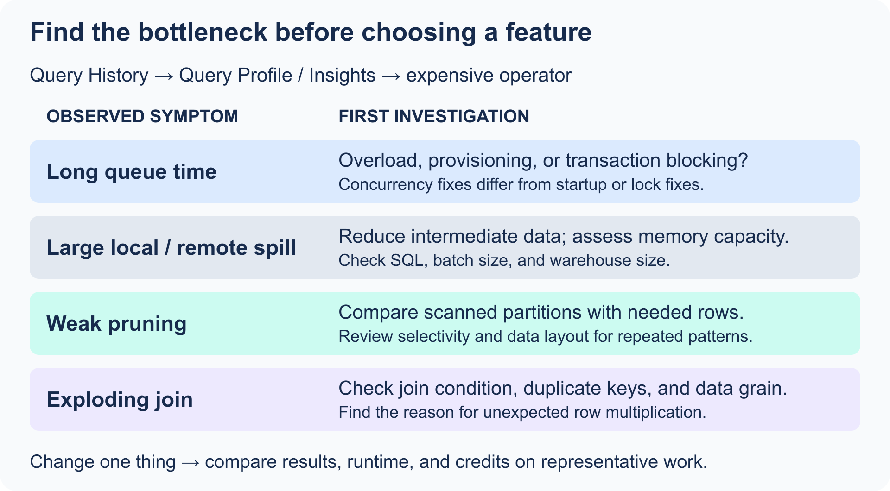
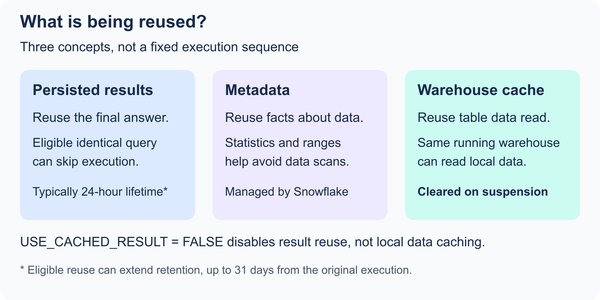
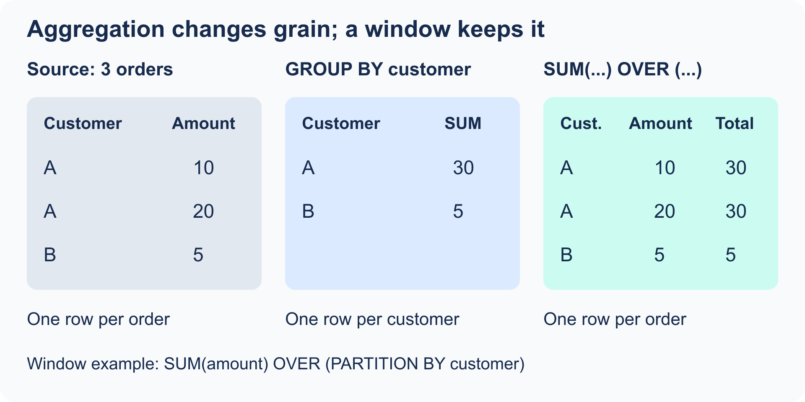

# Domain 4.0: Performance Optimization, Querying, and Transformation

The [SnowPro Core C03 study guide](https://learn.snowflake.com/en/certifications/snowpro-core-c03/) assigns **21%** of the exam to Domain 4. This note focuses on recognizing a performance symptom, choosing the right tool, and reading common SQL patterns.

| Objective | Main question |
| --- | --- |
| **4.1 Evaluate performance** | Where does the query spend time, and how much data does it read? |
| **4.2 Optimize performance** | Should you change SQL, compute, or a table/warehouse feature? |
| **4.3 Caching** | Was a final result reused, or was table data read from warehouse cache? |
| **4.4 Transformation** | How do SQL, JSON, and staged files become useful results? |

## Practice files

- [Ordered SQL labs](exercises/readme.md): begin with [setup](exercises/00-setup.sql) and finish with [stop-lab](exercises/99-stop-lab.sql).
- [Domain 4 practice quiz](practice/domain-4-qa.md) for scenario questions.
- Some optional optimization features have extra cost or edition requirements; use the lab guide's setup and cleanup instructions.

The SQL below illustrates a concept. Run the linked exercises for complete objects and expected results.

---

## 4.1 Evaluate Query Performance

### 4.1.1 Read the symptom before changing settings

Start with the **Query Profile** and query history. Check execution time, queue/provisioning/blocking time, partitions scanned versus total, bytes scanned, warehouse-cache percentage, join row counts, and local/remote spill. A query that waited in a queue needs a different fix from a query that scanned too much data.

<p align="center"></p>

| Symptom | Likely meaning | First action |
| --- | --- | --- |
| High `QUEUED_OVERLOAD_TIME` | Too many simultaneous queries | Check concurrency; consider multi-cluster or workload isolation. |
| High `QUEUED_PROVISIONING_TIME` | Waiting for compute to start/add capacity | Check resume/scaling behavior. |
| Large remote spill | Query exceeded available memory | Fix join/aggregation shape; then consider a larger warehouse. |
| Many partitions scanned for a selective filter | Weak micro-partition pruning | Check filter, data organization, SOS, or clustering. |
| Join produces far more rows than inputs | Join explosion | Fix join keys, data grain, or duplicate matches. |

`partitions_scanned / partitions_total` measures pruning. For example, **1 of 122** partitions scanned means strong pruning; **122 of 122** means none were skipped. `PERCENTAGE_SCANNED_FROM_CACHE = 100%` means scanned table data came from the **warehouse cache**. It does not mean the final query result was reused.

Use `QUERY_TAG` to identify workloads and `QUERY_PARAMETERIZED_HASH` to group similar SQL with different literal values. `ACCOUNT_USAGE.QUERY_HISTORY` is useful for historical patterns; Information Schema history functions can be fresher but expose a different column set. If you need operator-level spill values, inspect Query Profile or `GET_QUERY_OPERATOR_STATS(query_id)` rather than assuming `QUERY_HISTORY_BY_SESSION` has `BYTES_SPILLED_TO_LOCAL_STORAGE`.

```sql
SELECT QUERY_ID, QUERY_TEXT, EXECUTION_TIME, QUEUED_OVERLOAD_TIME
FROM SNOWFLAKE.ACCOUNT_USAGE.QUERY_HISTORY
WHERE START_TIME >= DATEADD(hour, -24, CURRENT_TIMESTAMP())
ORDER BY EXECUTION_TIME DESC
LIMIT 20;
```

References: [Query Profile](https://docs.snowflake.com/en/user-guide/ui-query-profile), [Query history](https://docs.snowflake.com/en/sql-reference/account-usage/query_history), [Operator statistics](https://docs.snowflake.com/en/sql-reference/functions/get_query_operator_stats).

---

## 4.2 Optimize Query Performance

### 4.2.1 Choose by query pattern

| Pattern | First feature or change | Level |
| --- | --- | --- |
| Bad join or unnecessary `SELECT *` | Rewrite SQL | Query |
| Many concurrent short queries | Multi-cluster warehouse or isolate workloads | Warehouse |
| One memory-heavy query with spill | Improve SQL, then consider a larger warehouse | Query/warehouse |
| Eligible large scans with selective filters or aggregations | Query Acceleration Service (QAS) | Warehouse |
| Point lookup that should find a few rows in a huge table | Search Optimization Service (SOS) | Table |
| Frequent range filters on the same columns in a large table | Clustering key | Table |
| Repeated expensive single-table result | Materialized view (MV) | Schema object |

**QAS** offloads eligible query work to separately billed serverless compute. It is set on a **warehouse**, not a table. `QUERY_ACCELERATION_MAX_SCALE_FACTOR` limits how much extra compute a query can borrow; `0` means no limit, not off. Use `SYSTEM$ESTIMATE_QUERY_ACCELERATION(query_id)` and `QUERY_ACCELERATION_ELIGIBLE` to assess past queries. QAS does not repair an incorrect join or a query waiting in the warehouse queue.

**SOS** maintains a search access path for selective predicates. It is set on a **table**, for example `ALTER TABLE t ADD SEARCH OPTIMIZATION ON EQUALITY(id);`. It has build/maintenance cost. It fits a needle-in-a-haystack lookup better than a broad scan; it can work with QAS when both are useful.

**Clustering** groups similar values into micro-partitions so range filters can prune more partitions. One table has one clustering key, which may contain **multiple expressions**, such as `(event_date, customer_id)`. Automatic reclustering can consume credits after the load/query completes. Use `SYSTEM$CLUSTERING_INFORMATION('DB.SCHEMA.TABLE', '(EVENT_DATE)')` to assess candidate columns when the table has no key. High `average_depth`/`average_overlaps` can indicate poor clustering, but decide using representative query scans and maintenance cost—not one JSON number alone.

**Materialized views** store and maintain a supported query result from **one base table**. They suit repeated single-table aggregates or projections that are expensive to recompute. They use storage and maintenance credits; they are not a general multi-table pipeline or a replacement for a Dynamic Table.

QAS, SOS, and materialized views require **Enterprise Edition or higher**. Clustering keys are available across editions, but automatic maintenance can still cost credits.

```sql
ALTER TABLE events ADD SEARCH OPTIMIZATION ON EQUALITY(event_id);
ALTER TABLE events CLUSTER BY (event_date);
SELECT SYSTEM$CLUSTERING_INFORMATION('DB.SCHEMA.EVENTS');
```

Try SQL changes first when they remove needless work: filter early, select only needed columns, join at the intended grain, and avoid applying a function to a filter column when it blocks effective pruning. Compare query IDs and profiles before and after any feature change.

References: [Optimization choices](https://docs.snowflake.com/en/user-guide/performance-query-options), [QAS](https://docs.snowflake.com/en/user-guide/query-acceleration-service), [SOS](https://docs.snowflake.com/en/user-guide/search-optimization-service), [Clustering](https://docs.snowflake.com/en/user-guide/tables-clustering-keys), [Materialized views](https://docs.snowflake.com/en/user-guide/views-materialized).

---

## 4.3 Snowflake Caching

<p align="center"></p>

| Cache | What it holds | When it helps | What clears or bypasses it? |
| --- | --- | --- | --- |
| **Persisted query result** | Final answer from a previous query | Identical reusable query with unchanged contributing data and required privileges | `USE_CACHED_RESULT = FALSE` prevents reuse; results also expire. |
| **Warehouse cache** | Table data read by a running warehouse | Later scans on the same warehouse | Suspending that warehouse clears it. |
| **Metadata cache** | Snowflake-managed metadata used for planning/pruning | Deciding which micro-partitions to scan | Not controlled by `USE_CACHED_RESULT`. |

Persisted-result reuse is usually enabled and can avoid running the query at all. It needs eligible SQL, unchanged contributing data, and appropriate privileges; an external function prevents reuse. The warehouse cache is independent: `USE_CACHED_RESULT = FALSE` still allows scans to use cached table data. `PERCENTAGE_SCANNED_FROM_CACHE` measures the **warehouse** cache, not persisted-result reuse.

```sql
ALTER SESSION SET USE_CACHED_RESULT = FALSE;
-- Run the same SELECT after the warehouse resumes, then again while it stays on.
ALTER SESSION SET USE_CACHED_RESULT = TRUE;
-- Run identical eligible SQL again to test persisted-result reuse.
```

**Fair benchmark:** Set `USE_CACHED_RESULT = FALSE` to force execution. Run the query just after a suspended test warehouse auto-resumes (cold), then repeat it while that warehouse stays running (warm). Keep data, role, and warehouse size the same; record each query ID, Query Profile, `PERCENTAGE_SCANNED_FROM_CACHE`, and provisioning wait. Avoid other queries that could warm the cache. Finally, set `USE_CACHED_RESULT = TRUE` and repeat identical SQL to test persisted-result reuse separately.

References: [Persisted results](https://docs.snowflake.com/en/user-guide/querying-persisted-results), [Warehouse cache](https://docs.snowflake.com/en/user-guide/performance-query-warehouse-cache).

---

## 4.4 Perform Data Transformation Techniques

### 4.4.1 Structured data: aggregates and windows

`GROUP BY` reduces rows to one result per group. A **window function** computes a value across related rows while keeping each input row. `WHERE` filters rows **before** window calculation; `QUALIFY` filters rows **after** window calculation.

<p align="center"></p>

```sql
-- One row per customer.
SELECT customer_id, SUM(amount) AS total
FROM orders
WHERE status = 'COMPLETE'
GROUP BY customer_id;

-- One row per order, with the customer total beside it.
SELECT order_id, customer_id, amount,
  SUM(amount) OVER (PARTITION BY customer_id) AS customer_total
FROM orders
WHERE status = 'COMPLETE';
```

`COUNT(*)` counts rows; `COUNT(column)` ignores SQL `NULL` values. `COUNT(DISTINCT column)` counts distinct non-null values. `AVG(column)` ignores nulls in both numerator and denominator. `HAVING` filters grouped results.

For deduplication or top-N per group, use `ROW_NUMBER()` and `QUALIFY`. Add a deterministic tie-breaker to `ORDER BY`; otherwise equal timestamps can produce inconsistent winners.

```sql
SELECT * FROM events
QUALIFY ROW_NUMBER() OVER (
  PARTITION BY event_id ORDER BY updated_at DESC, load_id DESC
) = 1;
```

A window frame matters: `ROWS` counts physical rows; `RANGE` groups peers with the same ordering value for many frame definitions. Check the specified frame before answering a running-total question.

### 4.4.2 Semi-structured data: VARIANT, paths, and FLATTEN

`PARSE_JSON` turns valid JSON text into a `VARIANT` value. Use `:`/dot or bracket notation to traverse objects and arrays; JSON keys are case-sensitive. Cast a selected value to a SQL type when needed. `FLATTEN` expands an array or object into rows; `LATERAL` lets it use the current source row.

```sql
SELECT src:customer.name::STRING AS name,
       src:items[0].sku::STRING AS first_sku
FROM json_events;

SELECT e.id, f.index, f.value:sku::STRING AS sku
FROM json_events e,
     LATERAL FLATTEN(INPUT => e.src:items, OUTER => TRUE) f;
```

Without `OUTER => TRUE`, an empty/missing array contributes no output row. With it, an empty expansion can produce a row with `NULL` `INDEX`/`VALUE`. `COUNT(*)` counts that row; `COUNT(f.index)` does not. For nested arrays, use another `LATERAL FLATTEN` on the previous `VALUE`.

### 4.4.3 Unstructured data: staged files and URLs

A stage stores a file; a directory table lists its metadata. `TO_FILE` represents a staged file as a `FILE` value for supported functions, including document AI functions. Keep file access and recipient requirements in mind:

| Function | Typical use |
| --- | --- |
| `BUILD_SCOPED_FILE_URL` | Give limited, query-scoped access to a staged file. |
| `BUILD_STAGE_FILE_URL` | Build a Snowflake file URL that uses Snowflake authentication and privileges. |
| `GET_PRESIGNED_URL` | Give a temporary URL to someone who may not sign in to Snowflake; the URL itself grants access until expiry. |

For an internal stage, `GET_PRESIGNED_URL` requires the appropriate `SNOWFLAKE_SSE` encryption setup. Do not assume every file URL has the same access and expiry behavior.

<a id="read-the-contents-of-a-staged-document"></a>

To read a staged document's **contents** rather than just its filename, pass a `FILE` value to a supported parser such as `AI_PARSE_DOCUMENT`. The [unstructured-data exercise](../additional-exercises/01-unstructured-data-sharing/readme.md) and [Snowflake file-function guide](https://docs.snowflake.com/en/user-guide/unstructured-intro) show complete setup.

**Exam decision:** choose `GROUP BY` for one row per group, windows for values alongside original rows, `FLATTEN` for array elements, and file functions for staged documents.

References: [Window functions](https://docs.snowflake.com/en/user-guide/functions-window-using), [FLATTEN](https://docs.snowflake.com/en/sql-reference/functions/flatten), [Semi-structured data](https://docs.snowflake.com/en/user-guide/semistructured-intro), [Unstructured data](https://docs.snowflake.com/en/user-guide/unstructured-intro).

---

## What to Recall

Answer each question, then open its answer. For longer scenarios, use the [practice quiz](practice/domain-4-qa.md).

### 4.1 Diagnose

<details>
<summary><strong>1. Q:</strong> What does high QUEUED_OVERLOAD_TIME suggest?</summary>

<br>

**A:** Warehouse concurrency pressure. Check workload isolation or multi-cluster capacity.

</details>

<hr>

<details>
<summary><strong>2. Q:</strong> What does scanning 1 of 122 micro-partitions suggest?</summary>

<br>

**A:** Strong pruning: most micro-partitions were skipped.

</details>

<hr>

<details>
<summary><strong>3. Q:</strong> What does large remote spill suggest?</summary>

<br>

**A:** The query exceeded available memory; inspect joins and aggregations, then consider warehouse size.

</details>

<hr>

<details>
<summary><strong>4. Q:</strong> Where can you inspect operator-level spill if QUERY_HISTORY_BY_SESSION lacks those columns?</summary>

<br>

**A:** Use Query Profile or GET_QUERY_OPERATOR_STATS(query_id).

</details>

<hr>

### 4.2 Optimize

<details>
<summary><strong>5. Q:</strong> Which feature fits a selective equality lookup on a huge table?</summary>

<br>

**A:** Search Optimization Service on the table.

</details>

<hr>

<details>
<summary><strong>6. Q:</strong> Which feature can accelerate eligible large scans with extra serverless compute?</summary>

<br>

**A:** Query Acceleration Service on the warehouse.

</details>

<hr>

<details>
<summary><strong>7. Q:</strong> Does QUERY_ACCELERATION_MAX_SCALE_FACTOR = 2 change table settings?</summary>

<br>

**A:** No. It caps additional QAS compute for queries on that warehouse.

</details>

<hr>

<details>
<summary><strong>8. Q:</strong> Can one table have a clustering key with more than one column?</summary>

<br>

**A:** Yes. One clustering key can contain multiple expressions, such as event_date and customer_id.

</details>

<hr>

<details>
<summary><strong>9. Q:</strong> When might a materialized view help?</summary>

<br>

**A:** For a repeated expensive supported result from one base table, after weighing storage and maintenance cost.

</details>

<hr>

<details>
<summary><strong>10. Q:</strong> What should you check before paying for an optimization feature?</summary>

<br>

**A:** Representative SQL, Query Profiles, partitions scanned, runtime, and maintenance cost.

</details>

<hr>

### 4.3 Caching

<details>
<summary><strong>11. Q:</strong> Does USE_CACHED_RESULT = FALSE disable warehouse cache?</summary>

<br>

**A:** No. It prevents persisted final-result reuse; warehouse scans may still read cached table data.

</details>

<hr>

<details>
<summary><strong>12. Q:</strong> What does PERCENTAGE_SCANNED_FROM_CACHE = 100% measure?</summary>

<br>

**A:** The share of scanned table data served from the warehouse cache, not a persisted-result hit.

</details>

<hr>

<details>
<summary><strong>13. Q:</strong> What happens to the warehouse cache when the warehouse suspends?</summary>

<br>

**A:** Its local data cache is cleared; persistent table data remains.

</details>

<hr>

<details>
<summary><strong>14. Q:</strong> How do you benchmark cold scans, warm scans, and persisted-result reuse fairly?</summary>

<br>

**A:** Set USE_CACHED_RESULT = FALSE. Run just after a suspended test warehouse resumes (cold), then again while it stays running (warm). Keep data, role, and warehouse size the same; record query IDs, profiles, cache percentage, and provisioning wait. Avoid other cache-warming queries. Finally, set USE_CACHED_RESULT = TRUE and rerun identical eligible SQL to test final-result reuse.

</details>

<hr>

### 4.4 Transform

<details>
<summary><strong>15. Q:</strong> How do GROUP BY and a window SUM differ?</summary>

<br>

**A:** GROUP BY reduces rows to one per group; a window SUM keeps original rows and adds a value beside each.

</details>

<hr>

<details>
<summary><strong>16. Q:</strong> How do COUNT(*), COUNT(column), and AVG(column) treat NULL?</summary>

<br>

**A:** COUNT(*) counts rows; COUNT(column) ignores NULL; AVG(column) ignores NULL in its numerator and denominator.

</details>

<hr>

<details>
<summary><strong>17. Q:</strong> Why add a tie-breaker to ROW_NUMBER ordering?</summary>

<br>

**A:** To choose a stable winner when the main sort values are equal.

</details>

<hr>

<details>
<summary><strong>18. Q:</strong> When is QUALIFY applied relative to a window function?</summary>

<br>

**A:** After window results are calculated; WHERE filters input rows before them.

</details>

<hr>

<details>
<summary><strong>19. Q:</strong> What does FLATTEN do, and why can OUTER = TRUE affect COUNT(*)?</summary>

<br>

**A:** FLATTEN expands arrays or objects into rows. OUTER can preserve an empty expansion as a row with NULL values, which COUNT(*) counts.

</details>

<hr>

<details>
<summary><strong>20. Q:</strong> Which URL can be sent to someone without a Snowflake sign-in?</summary>

<br>

**A:** A valid GET_PRESIGNED_URL result; whoever holds it can access the file until it expires.

</details>

<hr>
